# Accounts Management

**Accounts Management** displays all user accounts on ASUS Control Center, and allows you to add, edit, or delete accounts. ASUS Control Center comes with a default Administrator account with Admin role privileges, and a User account with Viewer role privileges.

To access **Accounts Management**, you can use the following methods:

- Click  in the left menu, then click on **Accounts Management**.
- Click  (**Account Information**) in the top right corner, then select **Settings**.

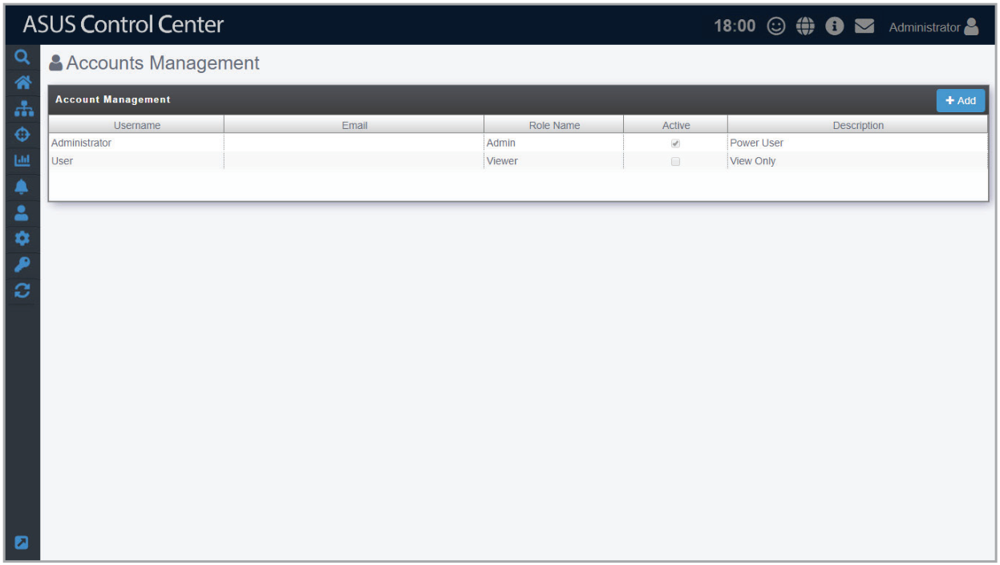

## Adding a new account

You can add new accounts and apply customized roles to them, allowing you to and control the functions and information each account can access with ease. For example, assigning an account with Software User role which is customized to only allow users with this role access to ASUS Control Center software related functions, or creating an account with BIOS User role which is customized to only allow users access to ASUS Control Center BIOS related functions.

> **NOTE:** For more details on role privileges, please refer to the **Role Privilege Management** section.

1. Click on **Add**.

    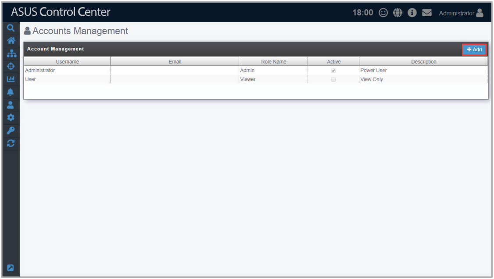

2. Enter the username, password, and email of the new account.
3. Select a role in the **Role Name** field.

    > **NOTE:** For more details on adding new roles, please refer to **Add Role** under the **Role Privilege Management** section.

4. Enter a brief description for the account.
5. (optional) Check or uncheck **Enable the account** in the **Active** field to enable or disable the newly created account.
6. Click on **Save** once you have finished.

    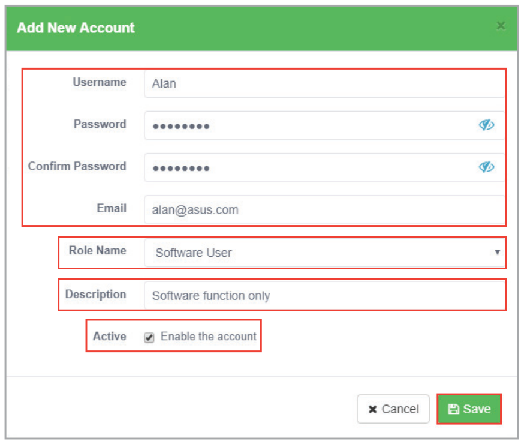

7. Your newly created account should appear in the **Account Management** list.

    

    Logging in to ASUS Control Center using different accounts with different roles assigned will affect the items the account can gain access to, depending on the permissions assigned to the role selected. For example, logging in an account which you have set to a role with access only to Software related functions will result in the following screenshot.

    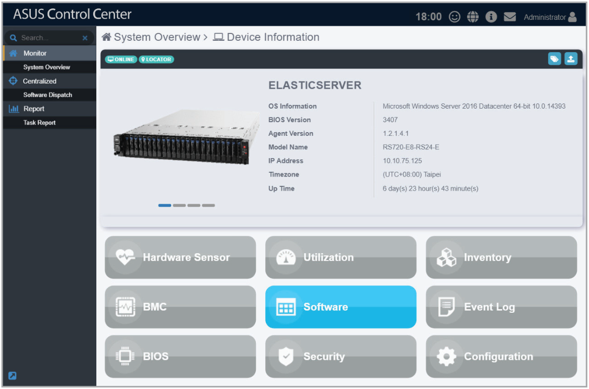

## Editing an account

1. Click on the account you wish to edit.

    

2. You can edit the **Password**, **Email**, **Role Name**, **Description**, and **Active** fields. Once you have finished editing click on **Save** to save the changes made.

    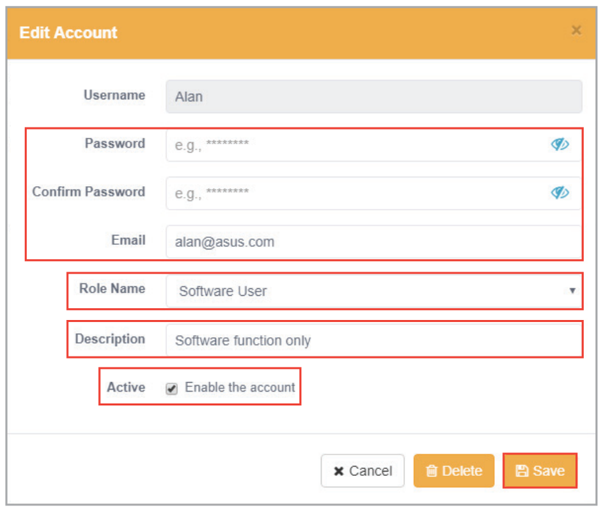

## Deleting an account

> **NOTE:** The default **Administrator** and **User** accounts cannot be deleted.

1. Click on the account you wish to delete.

    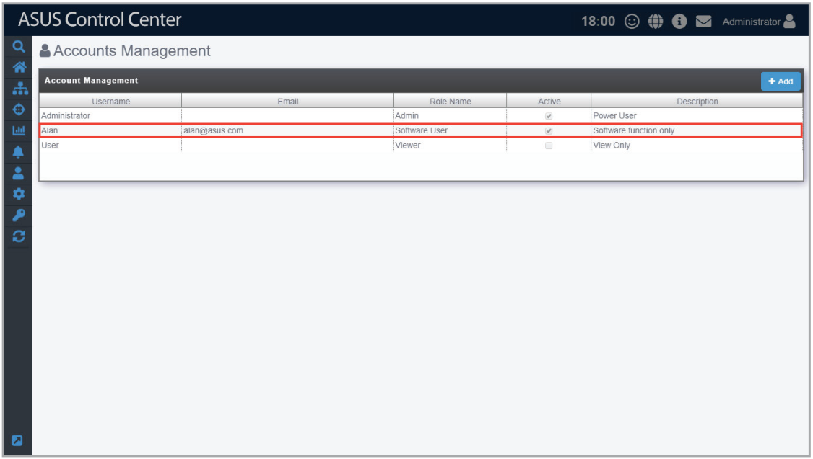

2. Click on **Delete**, then click on **Delete** again on the confirmation pop-up to delete the account.

    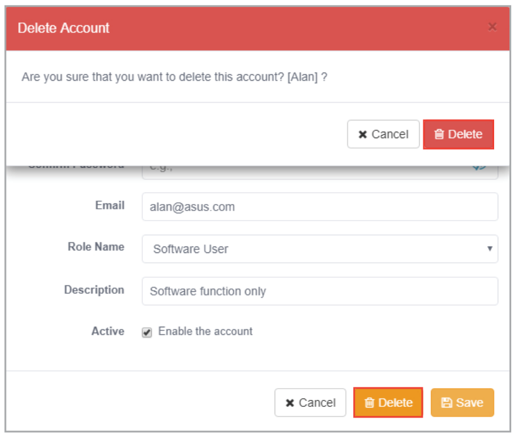

## Enabling multi-factor authentication (MFA)

> **NOTE:** It is only possible to enable or disable MFA for currently logged in account.

1. Click on the currently logged in account.

    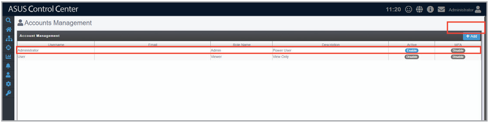

2. Enable the **MFA** option, then scan the QR code using an authenticator app and enter the 6-digit passcode to verify the multi-factor authentication setup.

    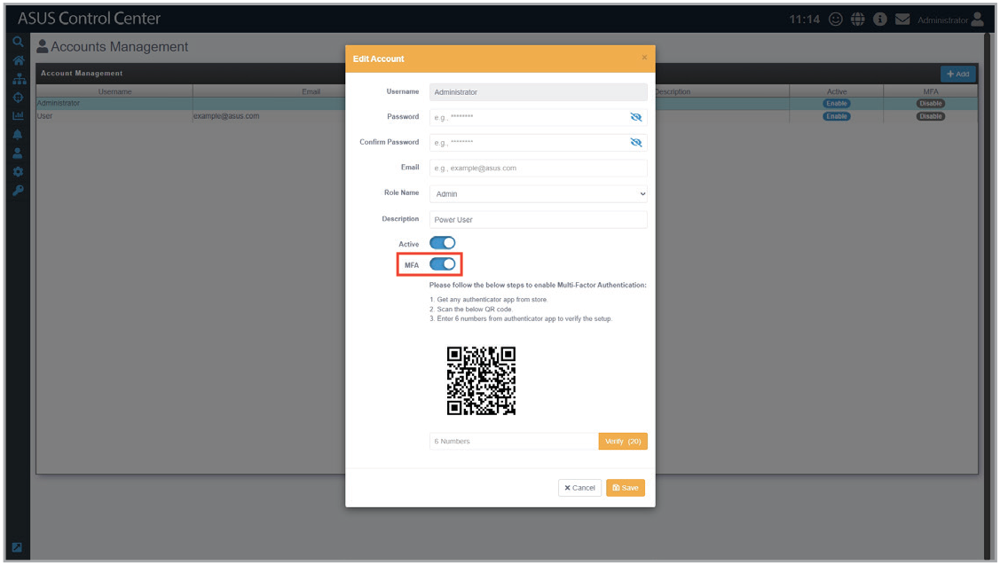

3. Once MFA is enabled, the MFA field will show when MFA was enabled for this account. Click **Save**.

    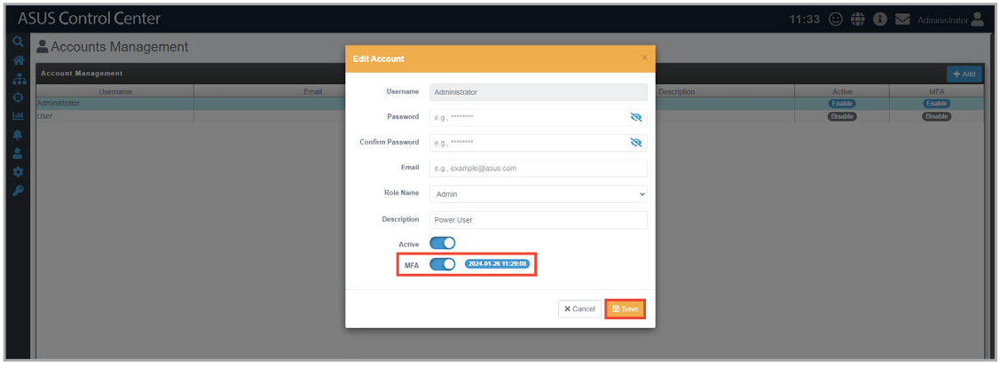

4. Click on the currently logged in account again.

    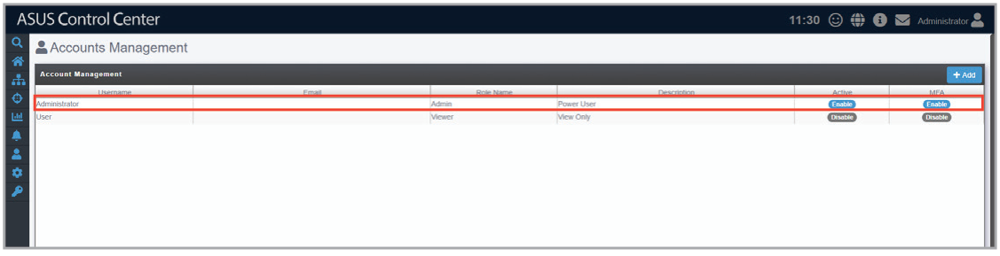

5. Enter the 6-digit passcode from the authenticator app, then click **Verify**.

    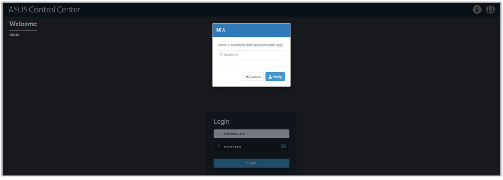

## Disabling multi-factor authentication (MFA)

> **NOTE:**
>
> - It is only possible to enable or disable MFA for the currently logged in account.
> - Only the default Administrator account can view the MFA status of other accounts.

1. Click on the currently logged in account.

    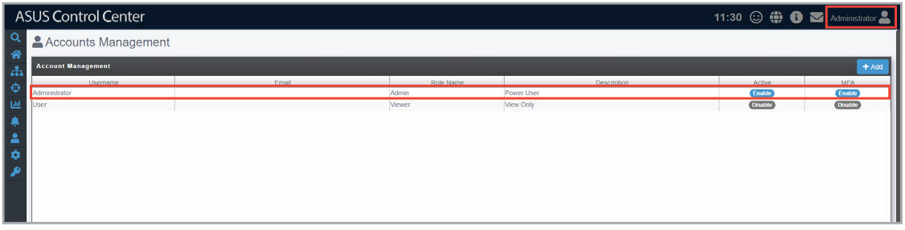

2. Disable the **MFA** option.

    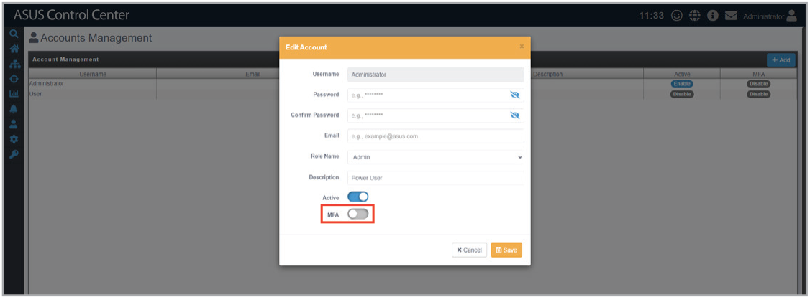
