# Role Privilege Management

**Role Privilege** will allow you to create roles with different permissions which gives you control over the functions and information accessible to each role created.

A **Viewer** role privilege is available by default, which only allows accounts assigned with this role privilege to view all the functions, but cannot edit customized roles.

There is no Administrator role in the **Role List** by default, but you can create one by enabling all permissions when creating a new role, this will allow accounts assigned with this role to add, edit, or delete when using any function, and also allows you to customize roles.

> **NOTE:** The **Admin** role assigned to the default Administrator account of ASUS Control Center will not appear in the **Role List** and cannot be edited.

To access **Role Privilege Management**, Click  in the left menu, then click on **Role Privilege**.

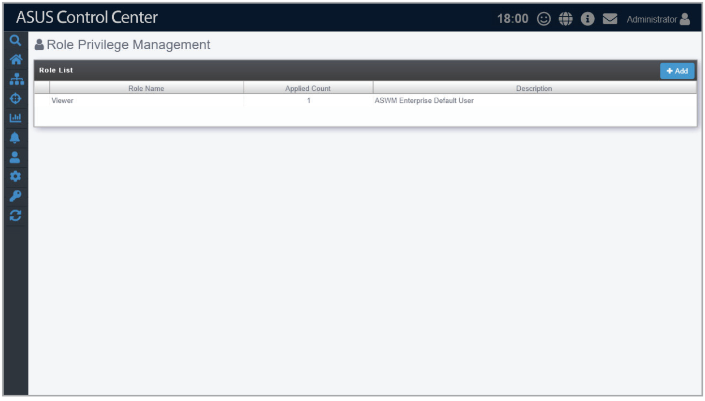

## Adding a new role

You can add new roles and set the permissions of this role. For example, assigning an account with Software User role which is customized to only allow users with this role access to ASUS Control Center software related functions, or creating an account with BIOS User role which is customized to only allow users access to ASUS Control Center BIOS related functions.

1. Click on **Add**.

    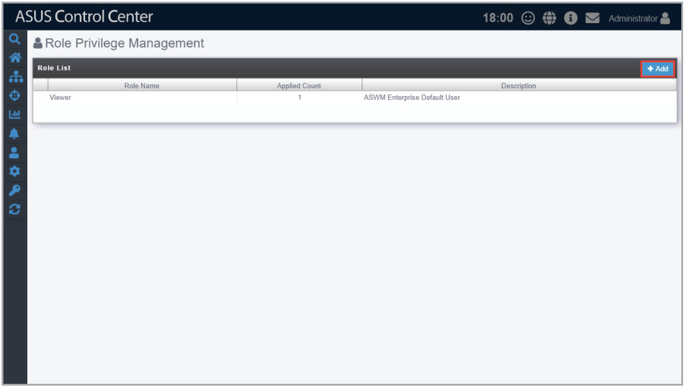

2. Select between **Create new role** and **Copy from exist role**, then click **OK**.

    > **NOTE:**
    >
    > - **Create new role**: Create a new role with no permissions enabled in **Privilege Configurations**.
    > - **Copy from exist role**: Select from an existing role (including the Admin role assigned to ASUS Control Center's default administrator account), this will load the **Privilege Configurations** of the selected account into the new role.

    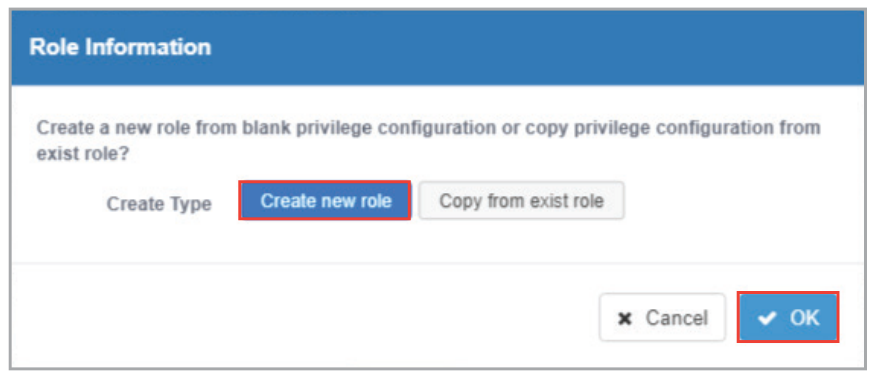

    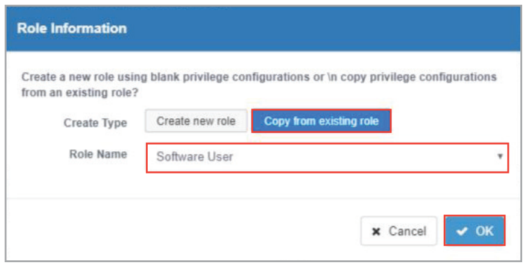

3. Enter the Role Name and Description of the new role.
4. Select and check / uncheck the permissions to enable / disable for the role in the **Privilege Configuration** block.

    > **NOTE:**
    >
    > - If you chose **Copy from exist role** in step 2, your **Privilege Configurations** list should be the same as the role you selected to copy from. You can still customize the permissions for this new role.
    > - You can click on  /  next to each permission category to expand / collapse the category to view / hide the permissions available for that permission category.
    > - You can use the Search Bar to search and filter through the permission items in the **Privilege Configurations** list.

5. Click **Add** once you have finished.

    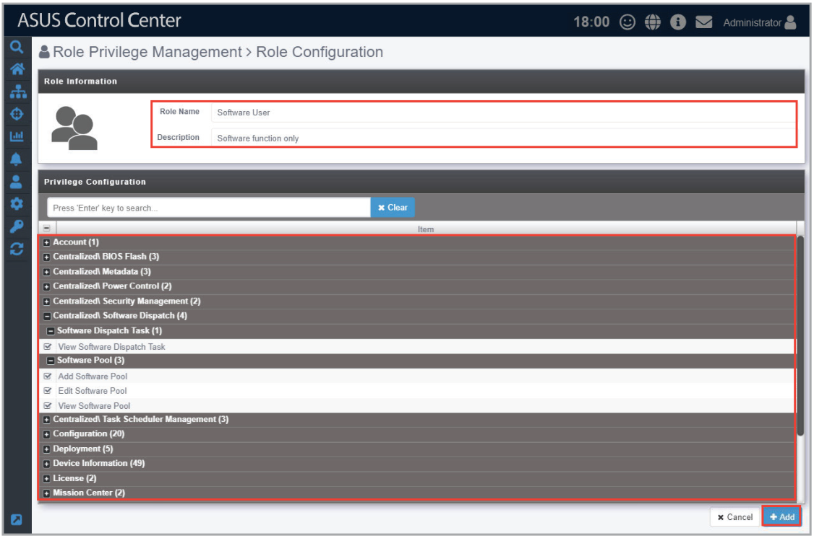

## Editing a role

1. Click on the role you wish to edit from the Role List block.

    

2. You can edit the **Role Name** and **Description**, and also configure the permissions in the Privilege Configuration list. Once you are finished click on **Update**.

    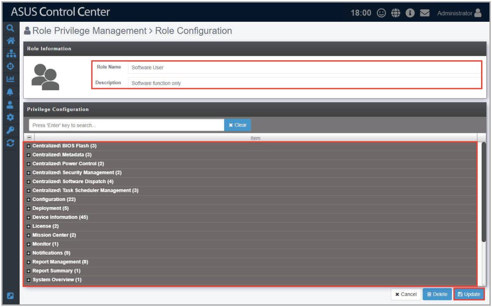

3. A pop-up window should appear and allow you to check the changes made to the role, click on **Update** to confirm these changes.

    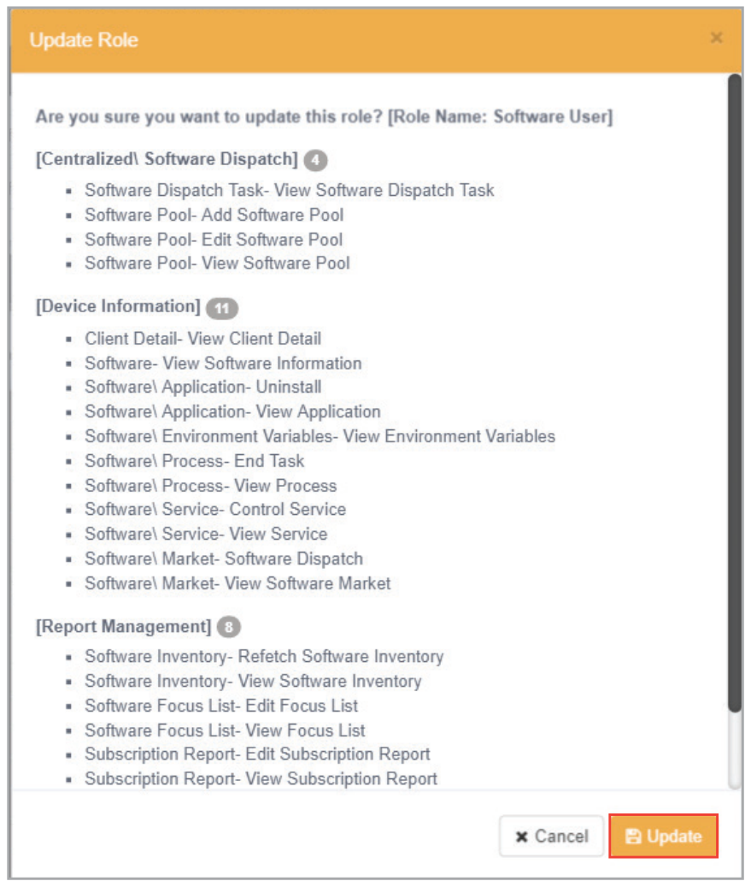

## Deleting a role

> **CAUTION:** Account(s) associated with a role will be deleted too when you delete a role. You can check how many accounts are associated with the role in the Applied Count column. For more information on managing accounts, please refer to the **Accounts Management** section.

You can delete a role using the following methods:

- Deleting the role from the Role List
    1. Click on  next to the role you wish to delete.

        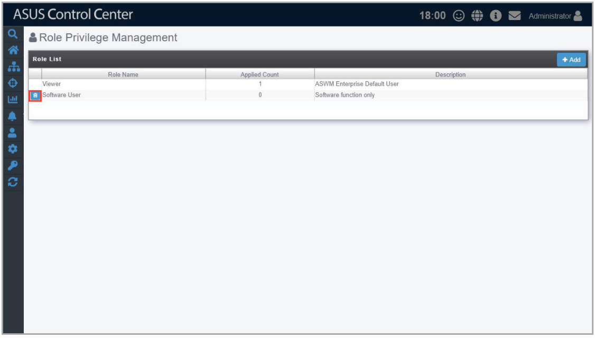

    2. Click Delete to delete the role.

        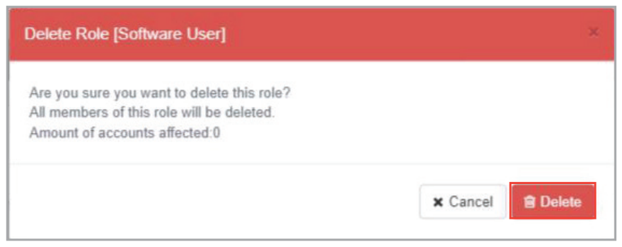

- Deleting the role from Role Configuration
    1. Click on the role you wish to delete from the **Role List** block.

        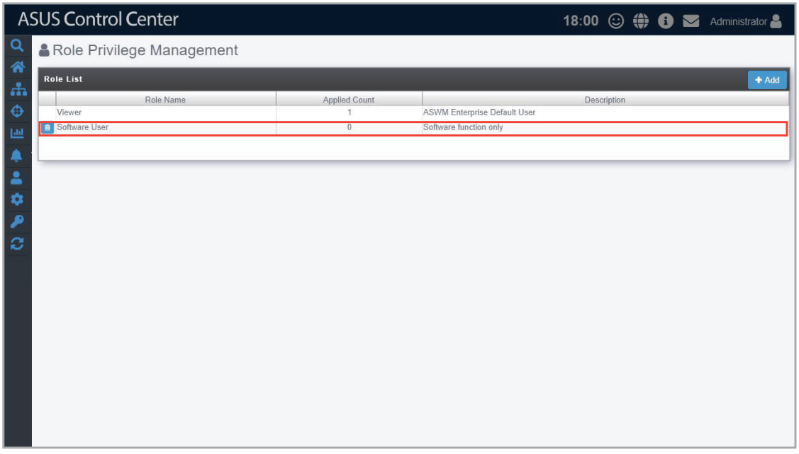

    2. Click Delete to delete the role.

        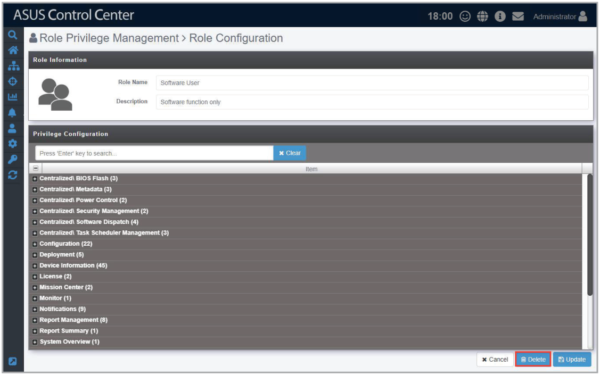

        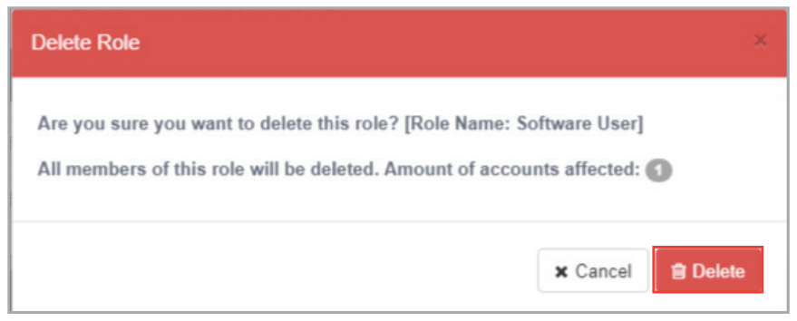
