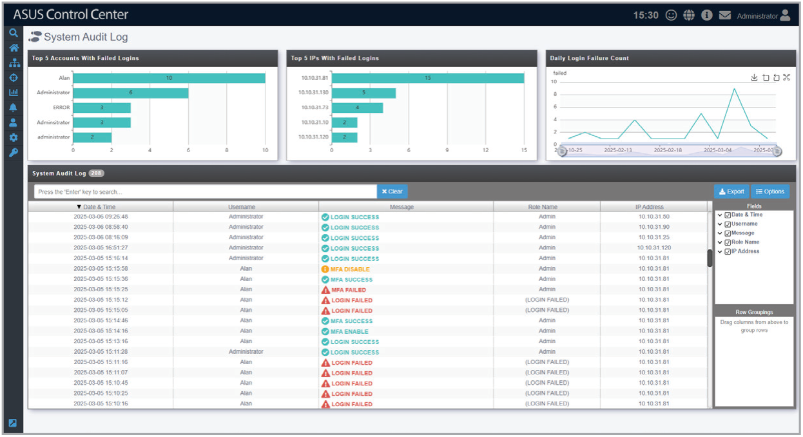

# System Audit Log

This page allows you to view the system audit log.

## Filtering the system audit log

To filter the system audit log, click a user, IP address, or date in the bar graphs or time series chart. You can also use the search field and search options in the **System Audit Log** block to manually define search criteria.

> **NOTE:**
>
> - Only the Administrator account can access the system audit log.
> - The **Role Name** column may display **(LOGIN FAILED)** in cases where the account name is unknown.

## System audit log events

The following events will be logged in the system audit log:

| Event | Description |
| --- | --- |
| LOGIN SUCCESS | Successful login attempt with MFA disabled. |
| LOGIN FAILED | Failed login attempt due to incorrect account credentials. |
| MFA ENABLE | MFA was enabled for this account. |
| MFA DISABLE | MFA was disabled for this account. |
| MFA SUCCESS | Successful login attempt with MFA enabled. |
| MFA FAILED | Failed login attempt due to incorrect MFA response. |
