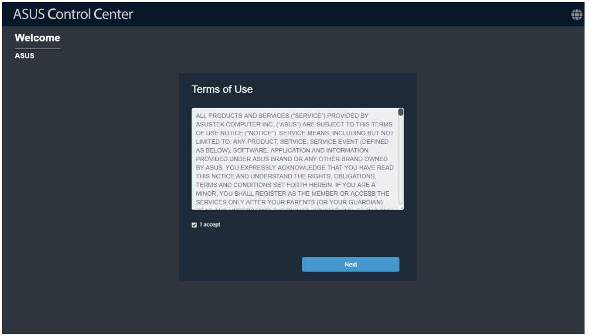
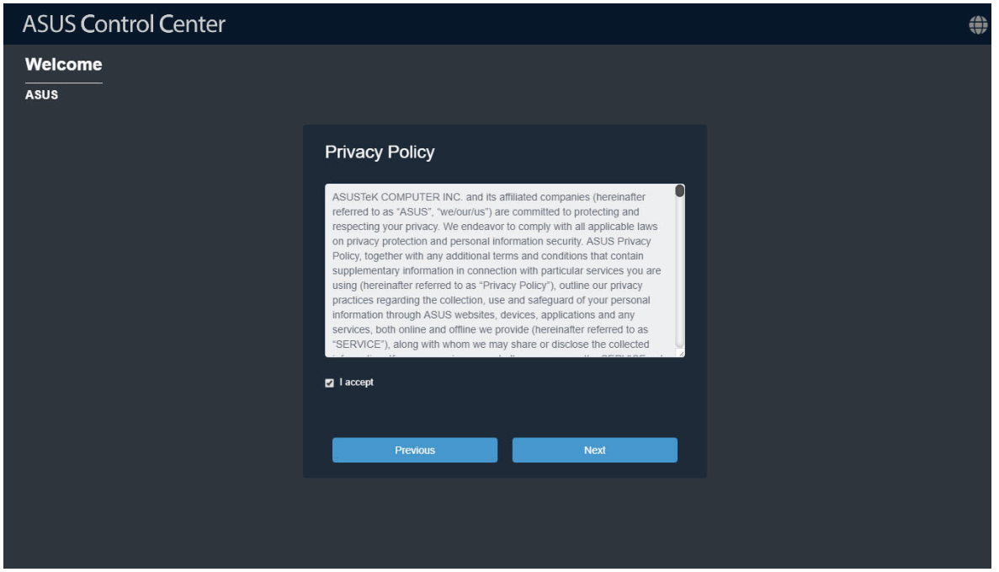
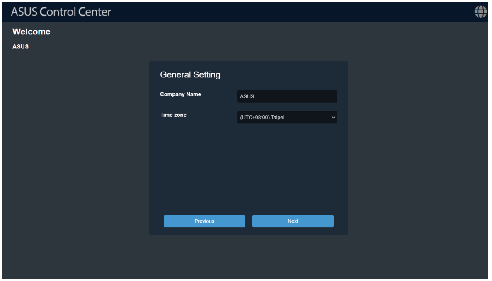
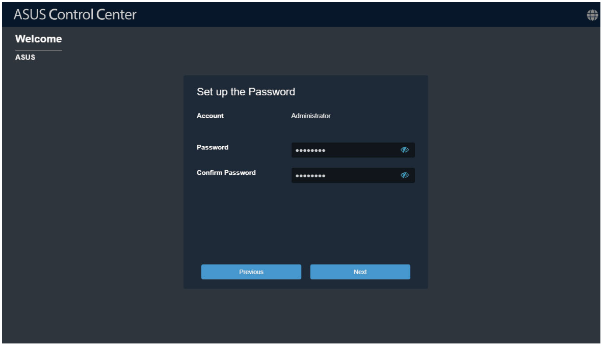
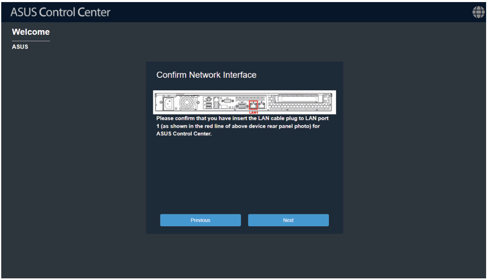
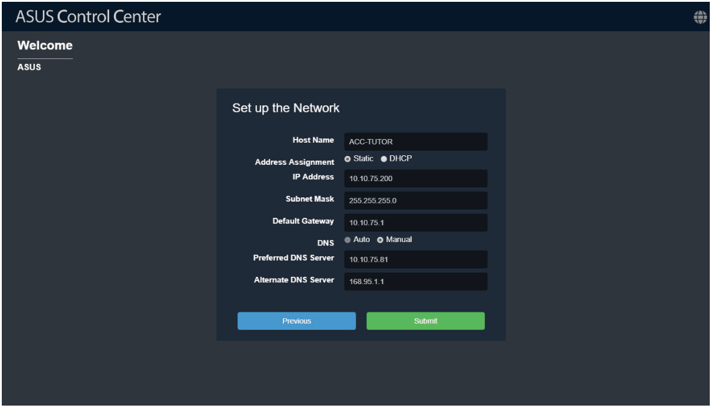
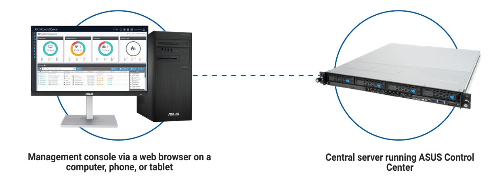

# Initialize settings

Once your ASUS Control Center is installed successfully, you will need to initialize the ASUS Control Center settings such as time zone, account and password, and network settings.

## Initialize startup settings

Once ASUS Control Center has launched, follow the steps below to initialize startup settings:

> **NOTE:** The information entered in this section is for reference only.

1. Read through the end user license agreement, check **I accept**, then click **Next**.

    

2. Carefully read through the Privacy Policy, check **I accept**, then click **Next**.

    

3. Enter the **Company Name**, then select the **Time Zone**. Click on **Next** once you are finished.

    > **NOTE:** When setting the **Time Zone**, ensure that the time zone selected matches the time zone displayed on the physical device which has a hypervisor installed.

    

4. Enter and initialize the password, then click **Next**.

    > **NOTE:**
    >
    > - The default ASUS Control Center administrator account is **Administrator**.
    > - Your password should contain at least 8 characters, and consist of at least one lower case letter, one upper case letter, one digit, and a special character.

    

5. Confirm if the LAN cable is plugged into the correct LAN port, then click **Next**.

    

6. Set the network configurations and Host Name, then click **Submit** once you are finished with all the settings.

    > **NOTE:** If **Static** is selected, the IP Address and Subnet Mask should be filled in manually. If **DHCP** is selected, the IP Address and Subnet Mask will automatically be filled in.

    

## Logging into ASUS Control Center

To log into ASUS Control Center:

1. Open a web browser and navigate to the main server URL:

    | Type | URL format |
    | --- | --- |
    | **Connecting using a hostname** | `https://<hostname>/ACC` Example: `https://ACC-TUTOR/ACC` |
    | **Connecting using an IP address** | `https://<IP address>/ACC` Example: `https://10.10.75.200/ACC` |

    > **NOTE:**
    >
    > - The *ACC* portion of the URL is case sensitive.
    > - Replace "ACC-TUTOR" or "10.10.75.200" with the correct hostname or IP address for your server environment.
    > - To connect via the HTTP protocol (less secure), replace "https://" with "http://" in the URL.
    > - File export and import functionality is disabled when using ACC through a virtual machine. For the optimal experience, connect using an Internet browser installed on the host system.

2. Enter your **Account** and **Password**, then click **Login** to log into ASUS Control Center.
3. If Multi-Factor Authentication (MFA) is enabled, enter the 6-digit passcode displayed in your authenticator app.

    > **NOTE:** Refer to the **Enabling Multi-Factor Authentication** section of the **Account Management** chapter for more information.

4. Activate or import a license key.

    > **NOTE:** Refer to the **Activating/Importing a License Key** section of the **License** chapter for more information.
