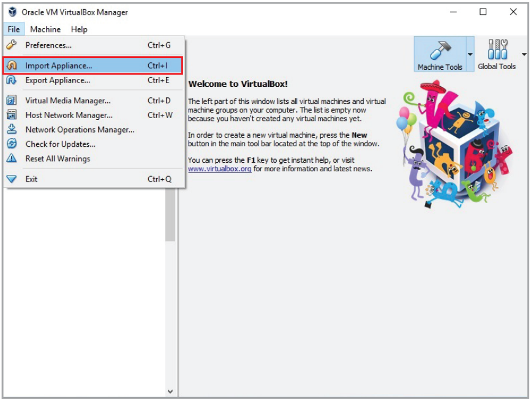
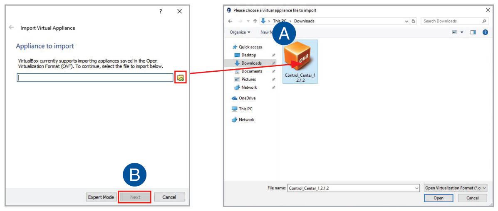
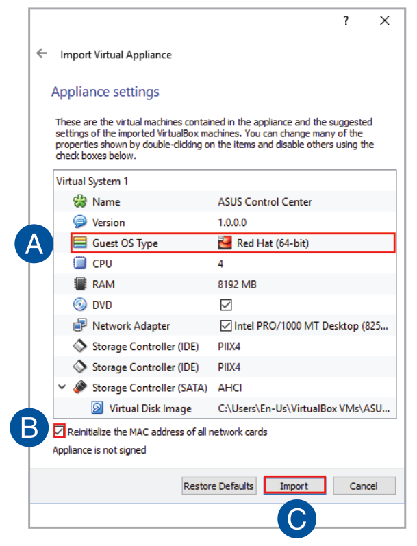
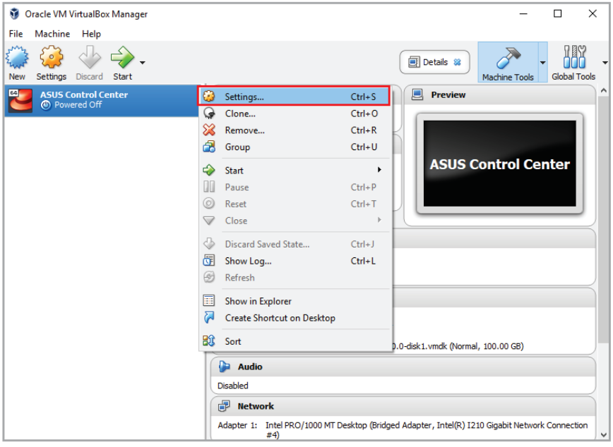
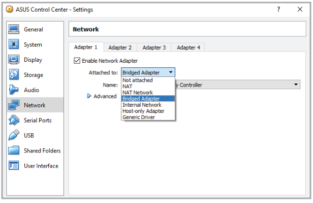
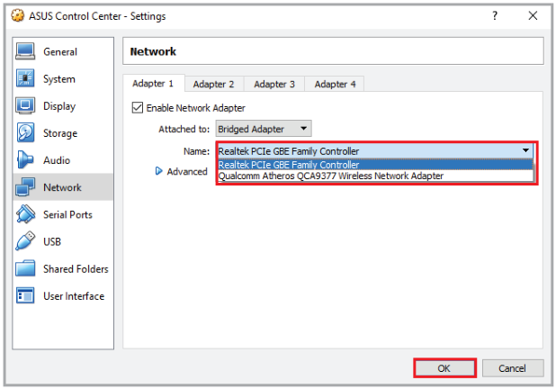

# Installation

ASUS Control Center is a virtual appliance running on a virtual machine (VM), with all required services and settings pre-installed. The system requirements can be found in the **Appendix** section of this manual.

To install the ASUS Control Center on the VM, please refer to the following sections.

## Installing the hypervisor and importing the OVA file

> **NOTE:** Oracle Virtualbox will be used as an example for Hypervisor related items.

1. Download **Oracle VirtualBox** and the **ASUS Control Center** Open Virtual Appliance (OVA) file.

    > **NOTE:**
    >
    > - Please refer to <http://www.oracle.com/technetwork/server-storage/virtualbox/downloads/index.html> to download **Oracle VirtualBox**.
    > - Please contact your local ASUS sales representative for the **ASUS Control Center** OVA file.

2. Install and launch **Oracle VirtualBox**, then select **File** > **Import Appliance...** to launch the **Import Virtual Appliance** wizard.

    

3. Select the OVA file to import (A) and click **Next** (B).

    

4. Ensure the **Guest OS Type** is set to **Red Hat (64-bit)** (A).
5. Check the **Reinitialize the MAC address of all network cards** checkbox (B), then click **Import** (C).

    > **NOTE:** The minimum requirements for the VM are 4 vCPUs, 8GB RAM, and a 100GB HDD.

    

6. Wait for the OVA file to be imported. This may take a few minutes.
7. Select the VM on the list, then click **Start** on the toolbar to start the VM.

    > **NOTE:**
    >
    > If your **Oracle VirtualBox** installation was unsuccessful, please check the following:
    >
    > - Check if VT-x is enabled in the BIOS: **BIOS** > **Advanced** > **Intel Virtualization Technology** > **Enabled**
    > - Check if the correct network card was selected: Select the network connection you are currently using.

## Setting up the VM specification

A message may appear when starting up the virtual machine (VM) for the first time, follow the steps below to set up the VM specification, such as network settings:

> **NOTE:** Ensure your system meets the system requirements listed in the **Appendix** chapter.

1. Right click on the VM and select **Settings**.

    

2. Select **Network** from the menu list on the left, then select **Bridged Adapter** in the **Attached to:** field.

    

3. Select the Network card you are currently using and has an Internet connection from the drop down menu in the **Name:** field, then click **OK**.

    
