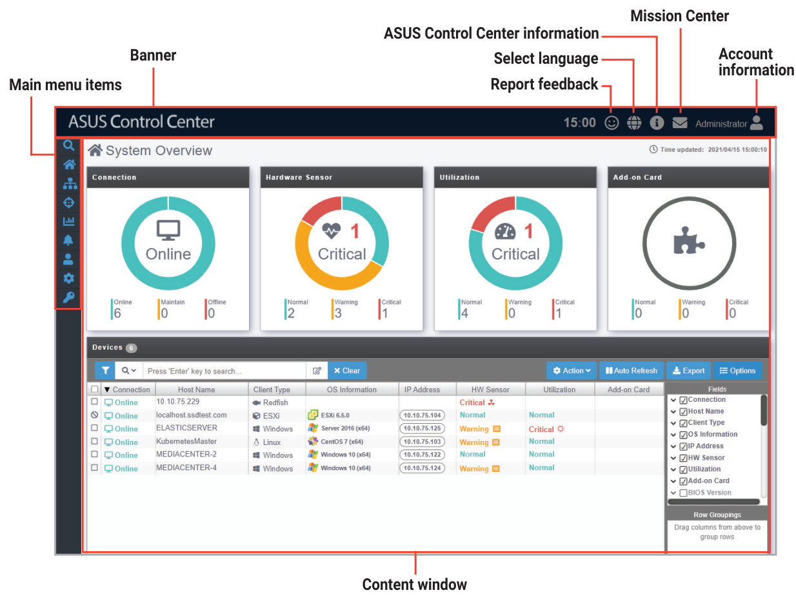
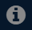
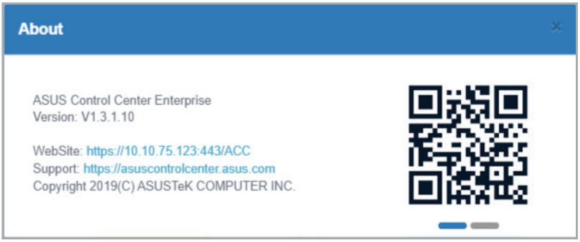
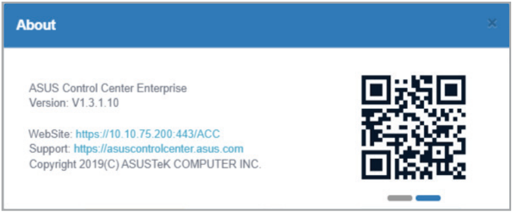
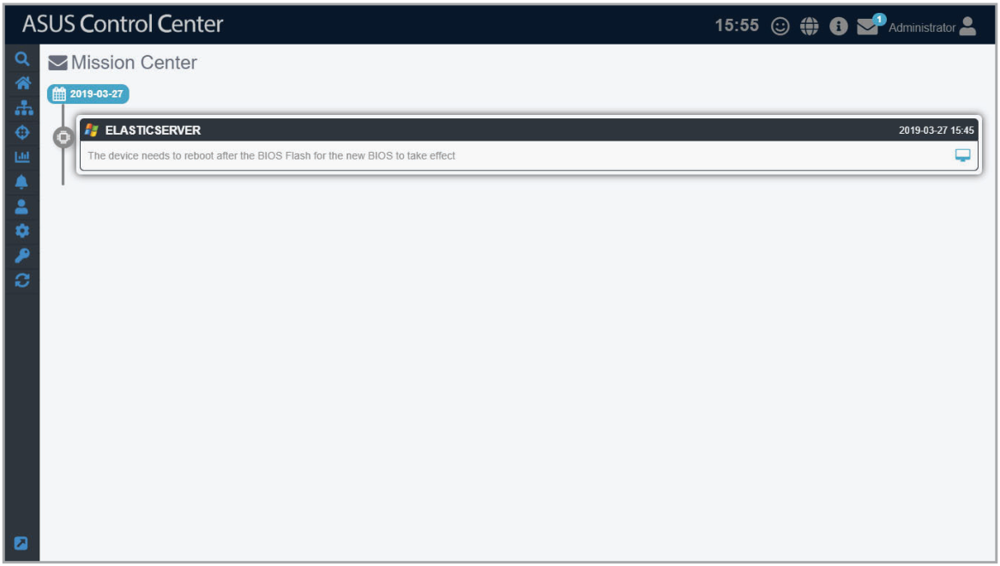
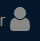

# ASUS Control Center layout

The main control panel of the ASUS Control Center user interface is displayed as below:

## Banner

The banner features the logo of ASUS Control Center, as well as some quick functions such as the language option or the mission center.

### Logo

You can customize the logo of your ASUS Control Center. For more details on customizing the logo for ASUS Control Center, please refer to the **Appearance Configuration** section.

### Feedback

Click  in the top right corner of the banner to bring up the ASUS Control Center Feedback window. You can provide feedback regarding your experience or on issues, and also upload screenshots using the feedback window.

### Multiple Languages

Click  in the top right corner of the banner, then select a language to change the language of ASUS Control Center. The languages currently supported are as follows: English, Traditional Chinese, Simplified Chinese, Japanese, Korean, German, Spanish, French, Russian, and Thai.

### About

Click  in the top right corner of the banner for information such as the version, and support site of ASUS Control Center. You can also scan the QR code for the mobile website version of ASUS Control Center. If you have multiple network cards, and have set the network configurations for all of them, you can slide and view the different networks and scan the QR codes to access the mobile website version of ASUS Control Center.

> **NOTE:** For more information on setting the network configurations for all network cards, please refer to the **Network Configuration** section.

### Mission Center

Click  in the top right corner of the banner to access the **Mission Center**. The Mission Center automatically lists pending actions that still need to be configured on devices, such as devices which still need to be restarted after a BIOS Flash, or devices which need to be restarted in order for updates to take effect. Events or pending actions will be denoted by a blue notification circle on the **Mission Center** icon; the amount of events or pending actions will also be displayed.

### Account Information

Click  in the top right corner of the banner, you can click on **Logout** to logout of the currently logged in account, or click on **Settings** to be redirected to the **Accounts Management** screen.

> **NOTE:** For more details on Accounts Management, please refer to the **Accounts Management** section.
