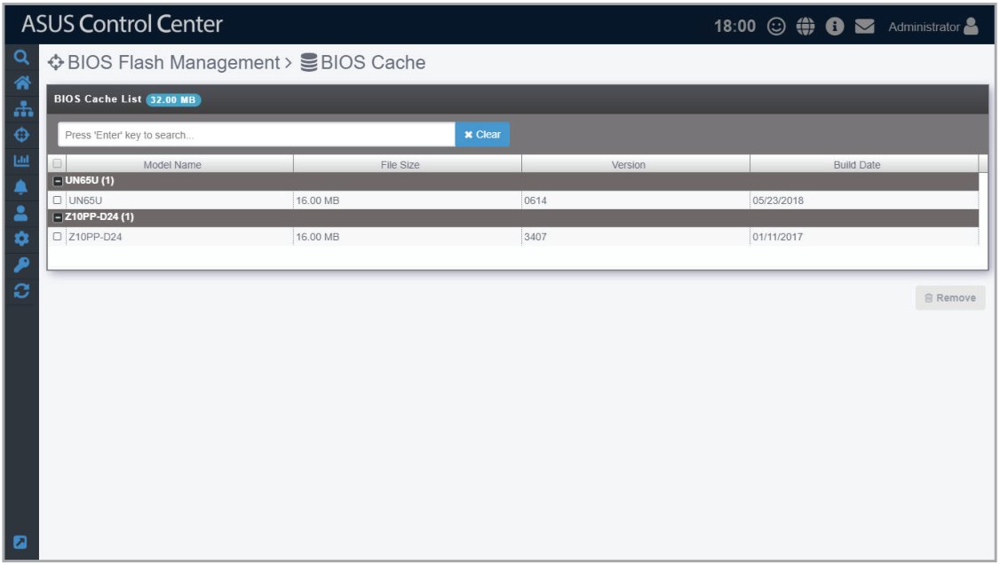
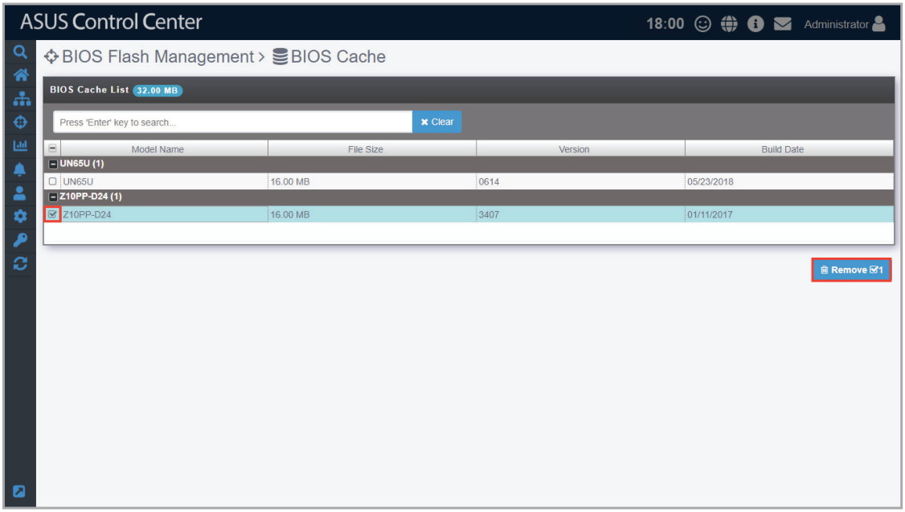
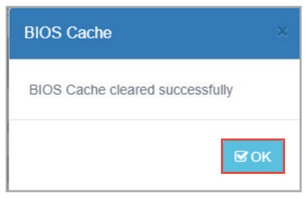

# BIOS Cache

The **BIOS Cache** stores all the BIOS cap files uploaded when flashing the BIOS of a single device or using the BIOS Flash Task function, and allows you to view or delete the BIOS cap files in the BIOS Cache List. The BIOS Cache List also lists the BIOS cap file in groups based on the model, and displays information such as the file size, version, and build date.

## Adding a BIOS cap file to the BIOS Cache

The BIOS cap file is automatically added to the BIOS Cache when you manually upload a BIOS cap file when flashing the BIOS from **Device Information**, or when you manually upload a BIOS cap file when using the **BIOS Flash Task** function.

> **NOTE:**
>
> - For more details on manually uploading a BIOS cap file when flashing the BIOS from **Device Information**, please refer to **BIOS Flash** under the **BIOS** section.
> - For more details on manually uploading a BIOS cap file when using the **BIOS Flash Task** function, please refer to **Manually uploading the BIOS cap file** under the **BIOS Flash Task** section.

## Removing BIOS cap files from BIOS Cache

You can remove BIOS cap files from the BIOS Cache List when you need to, such as when the BIOS version is outdated.

1. Check the item(s) you wish to delete then click **Remove**.

    

2. When the BIOS cap file(s) have been successfully removed, click **OK**.

    
