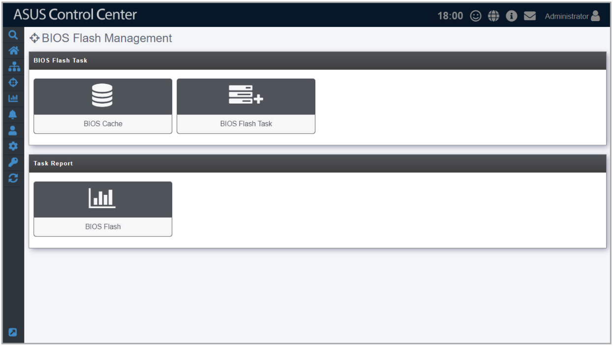

# BIOS Flash Management

**BIOS Flash Management** allows you to upload and flash the BIOS of all devices, uploaded BIOS is also stored in the BIOS cache for centralized management.

To access **BIOS Flash Management**, click  > **BIOS Flash Management** in the left menu.

**Using the search bar and search options**

Refer to the **Search Options** and **Search and Filter Devices** sections of the **Monitor** chapter for more information.
