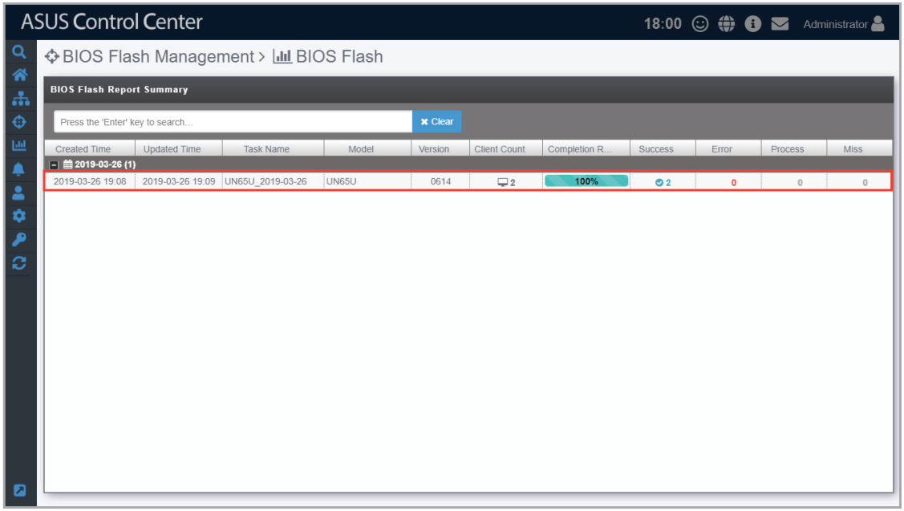
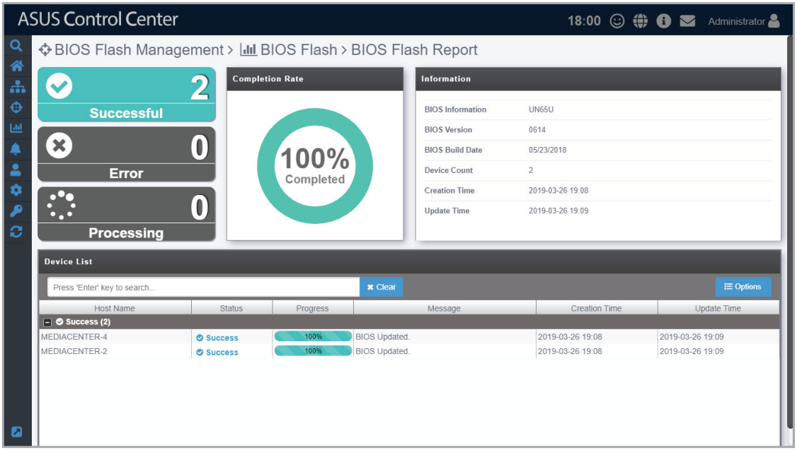

# BIOS Flash Task Report

The **BIOS Flash Task Report** function will display a history of BIOS flashes performed using ASUS Control Center. Selecting a BIOS flash task listed in the BIOS Flash Report Summary will allow you to view information on the BIOS, which devices were flashed, and also the status of the BIOS flash to managed devices. This provides you with a quick overview of your BIOS flash tasks and also help you pinpoint devices which experienced errors when updating BIOS.

