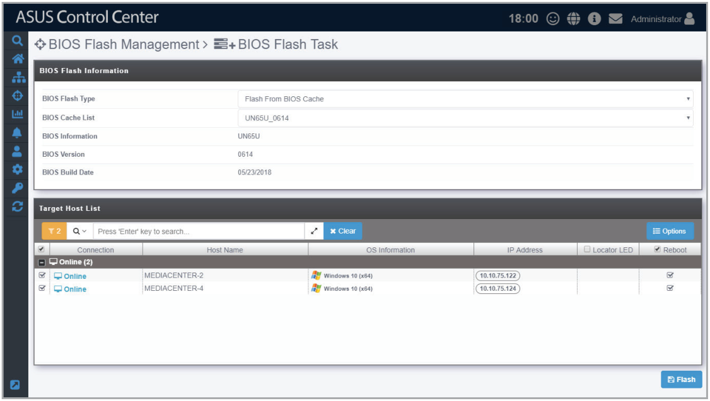
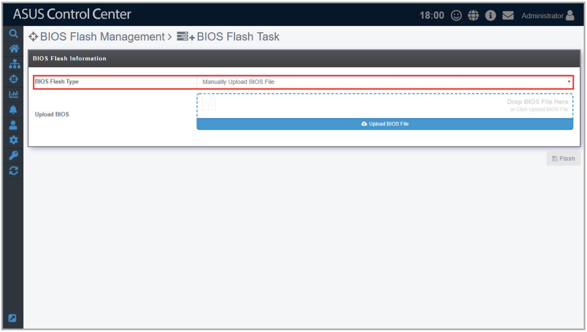
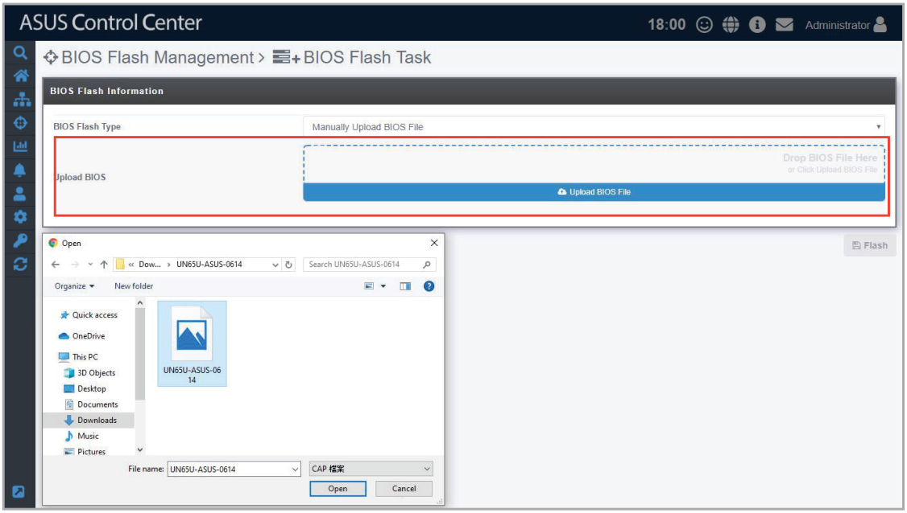
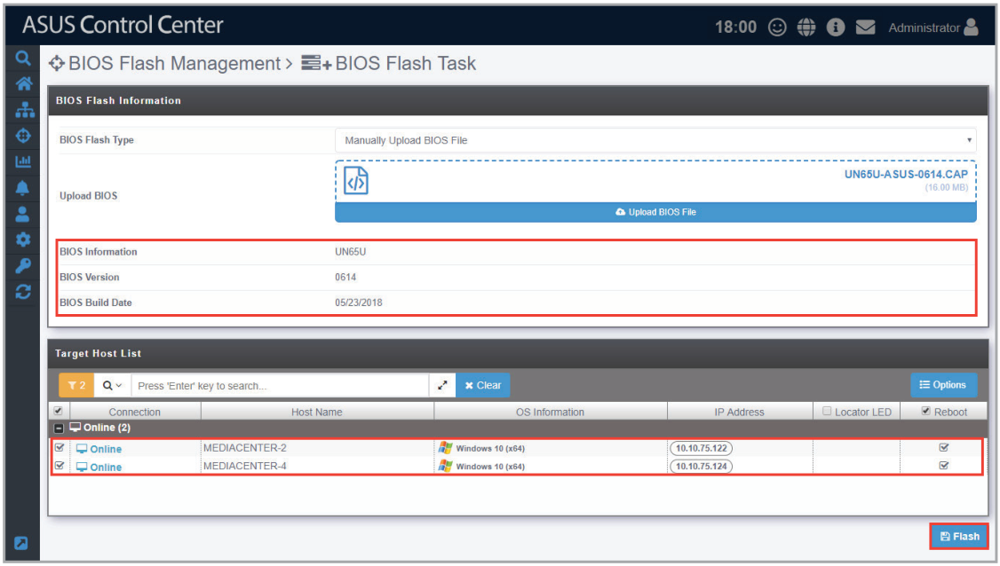
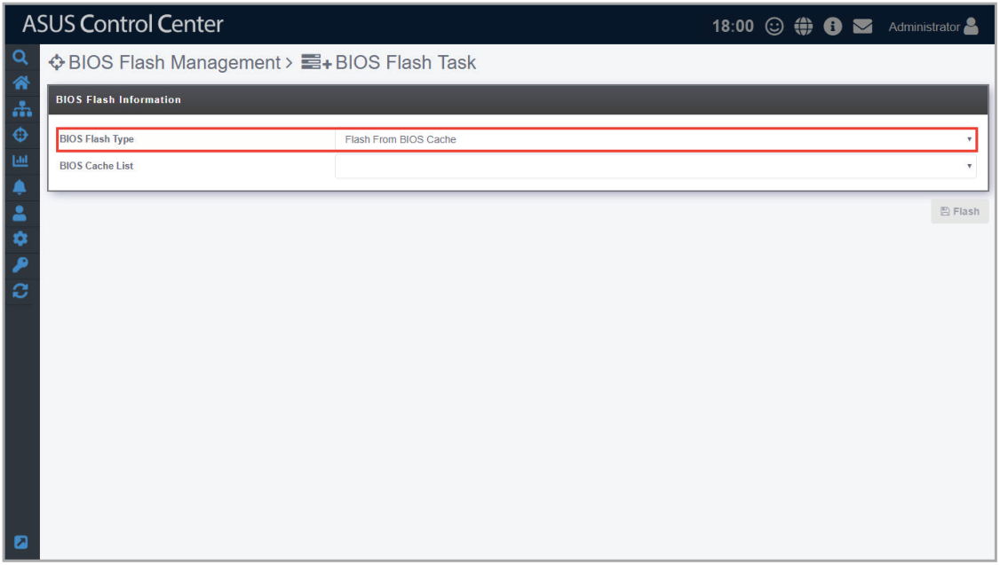
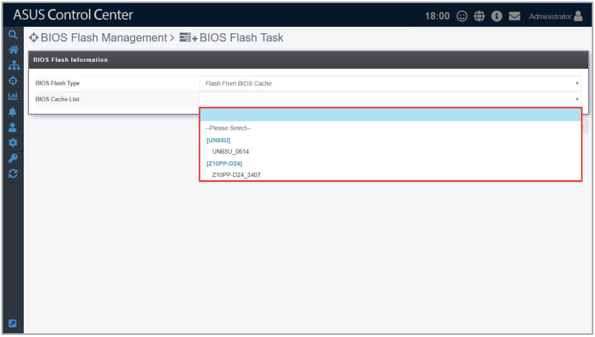
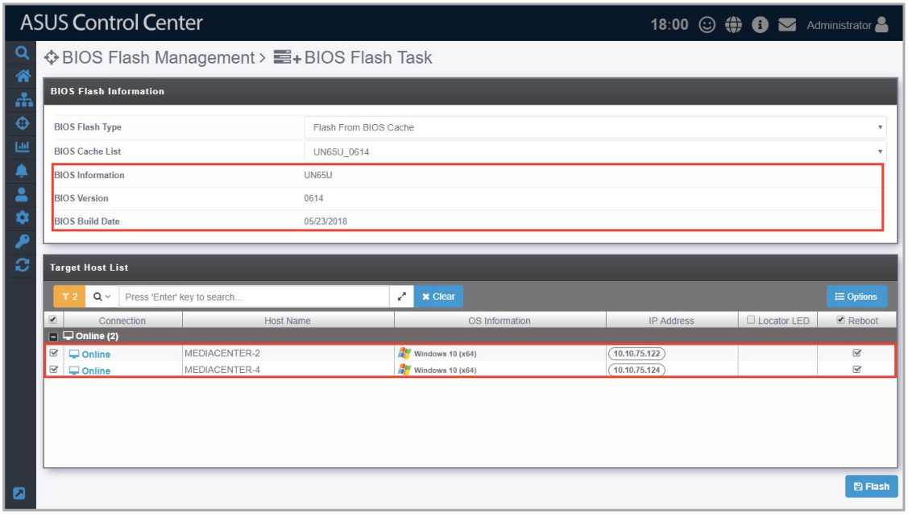
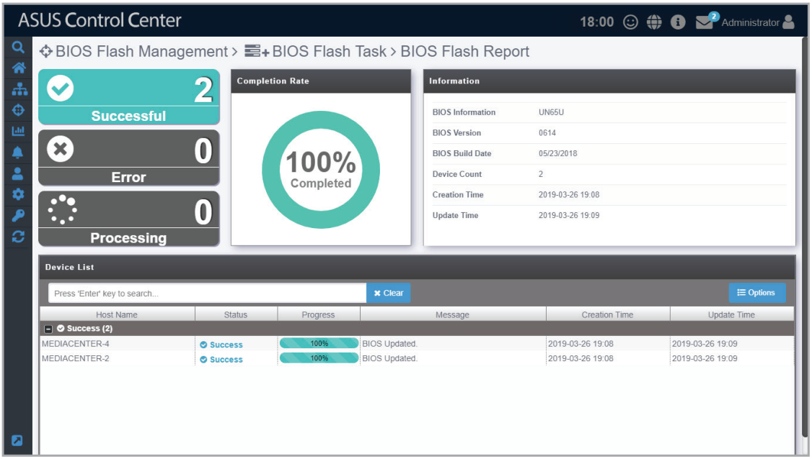

# BIOS Flash Task

The **BIOS Flash Task** function allows you to update the BIOS of multiple managed devices by uploading the BIOS cap file or selecting the BIOS cap file from a BIOS cache list.

## Manually uploading the BIOS cap file

1. Select **Manually Upload BIOS File** from the drop down menu in the **BIOS Flash Type** field.

    

2. Drag and drop the BIOS cap file in the dotted square, or click on **Upload BIOS File** to select a BIOS cap file to upload.

    

3. After selecting the BIOS cap file, the BIOS information, BIOS version, BIOS build date, as well as applicable managed devices should appear. Click on **Flash** to begin the BIOS Flash process.

    

4. Once the flash process is finished, a BIOS Flash Report should appear allowing you to check the BIOS Flash status and progress of all selected devices.

    

## Selecting the BIOS cap file from the BIOS cache

1. Select **Flash From BIOS Cache** from the drop down menu in the **BIOS Flash Type** field.

    

2. Select a **BIOS Cache List**.

    

3. After selecting the BIOS cap file, the BIOS information, BIOS version, BIOS build date, as well as applicable managed devices should appear. Click on **Flash** to begin the BIOS Flash process.

    

4. Once the flash process is finished, a BIOS Flash Report should appear allowing you to check the BIOS Flash status and progress of all selected devices.

    > **NOTE:** If the device is using Windows 11 or Server 2022 and the BIOS flash is failing, please navigate to **Start** > **Settings** > **Update & Security** > **Windows Security** > **Device Security**, then select **Core Isolation details** and set **Memory integrity** to **Off** on the device.

    
