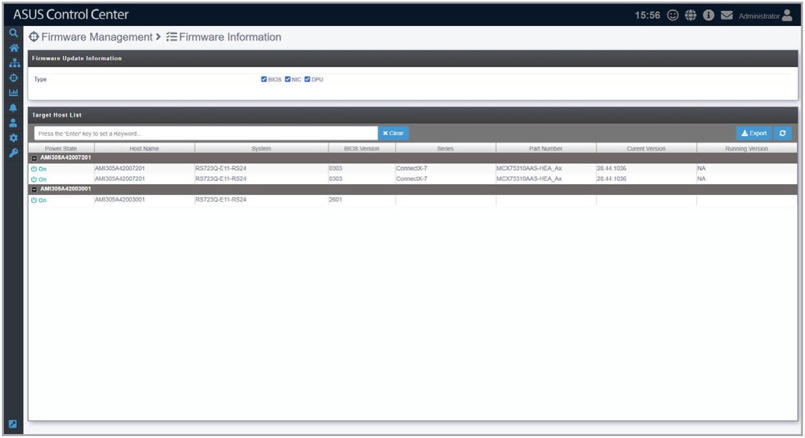

# Firmware Information

This page shows the firmware information of devices that have been successfully scanned using the **Edit Host** page.

> **NOTE:** To scan for additional devices, refer to the **Edit Host** section.

## Filtering the firmware information list by firmware update type

Use the checkboxes in the **Firmware Update Information** block to only show entries matching the selected firmware update types.

**Using the search bar and search options**

Refer to the **Search Options** and **Search and Filter Devices** sections of the **Monitor** chapter for more information.
