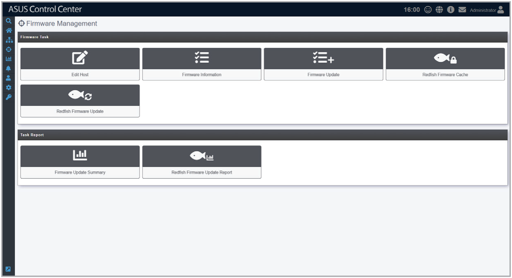

# Firmware Management

Firmware Management allows you to manually update the BIOS, NIC, or DPU firmware of managed Redfish devices.

The **Redfish Firmware Cache** and **Redfish Firmware Update** functions allow you to initiate out-of-band firmware updates using Redfish.

The **Edit Host**, **Firmware Information**, and **Firmware Update** functions allow you to initiate firmware updates via the operating system, in cases where the firmware cannot be updated using Redfish.

> **NOTE:** Firmware Management supports Redfish devices running Linux-based operating systems. Refer to the **System Requirements** section of the **Appendix** chapter for more information.

