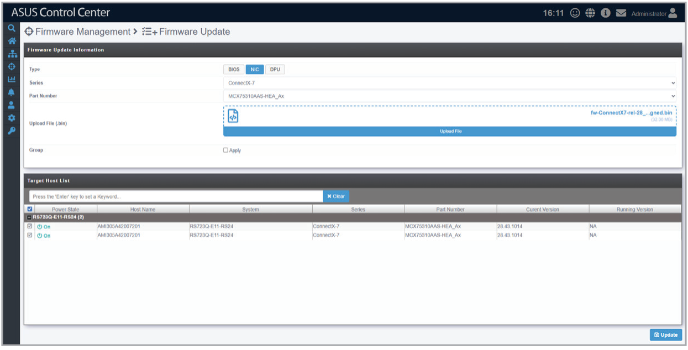

# Firmware Update

This page allows you to upload BIOS, NIC, and DPU firmware packages and manually update device firmware.

## Initiating a firmware update

1. Fill in the fields in the **Firmware Update Information** block and upload a firmware package.
2. Select one or more devices from the **Target Host List** block.
3. Click **Update**, then type "Yes" when prompted.
