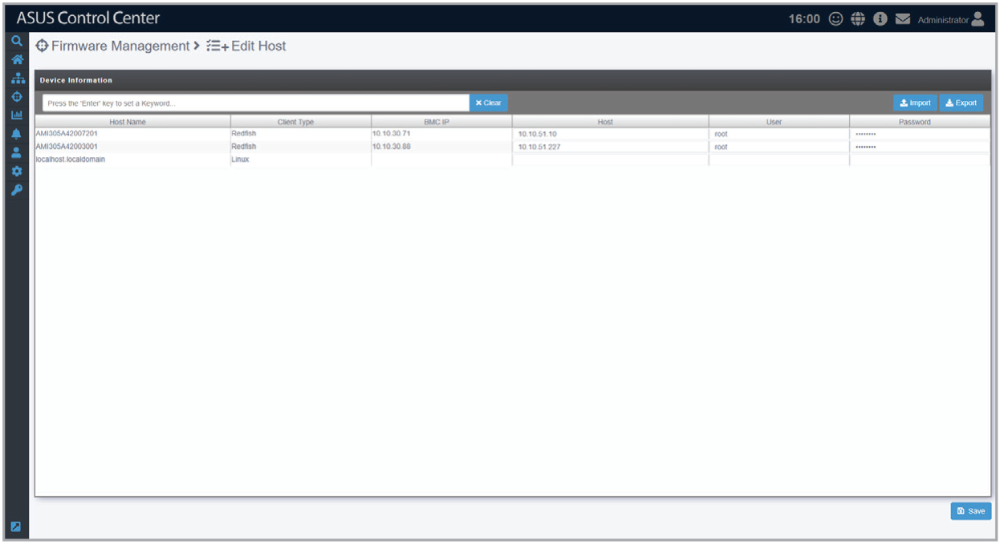

# Edit Host

This page allows you to edit the host list for firmware management.

> **NOTE:** Redfish devices must be added using the **Add Redfish** function in order to be displayed here. Refer to the **Add Redfish** section of the **Deployment** chapter for more information.

## Scanning for devices

> **NOTE:** You can also click **Export** to export the host list as a .csv file, edit the host list in an external program, then click **Import** to load the edited .csv file.

1. In the Host, User, and Password columns, enter the IP address, username, and password of the Linux OS host.
2. Click **Save**.
3. Check the **Firmware Update Summary** page to see if the scan was successful.

## Adding groups

Click **Add Group**, then enter a group name and click **Add**.
