# Metadata Management

The **Metadata Management** screen allows you to add metadata fields, and also enter the information for the newly added metadata fields for a single device or multiple devices. This allows you to manage your devices more efficiently by adding the information you need to each managed device, such as the department the managed device belongs to, or the extension line of the owner of the managed device.

To access **Metadata Management**, click  > **Metadata Management** in the left menu.

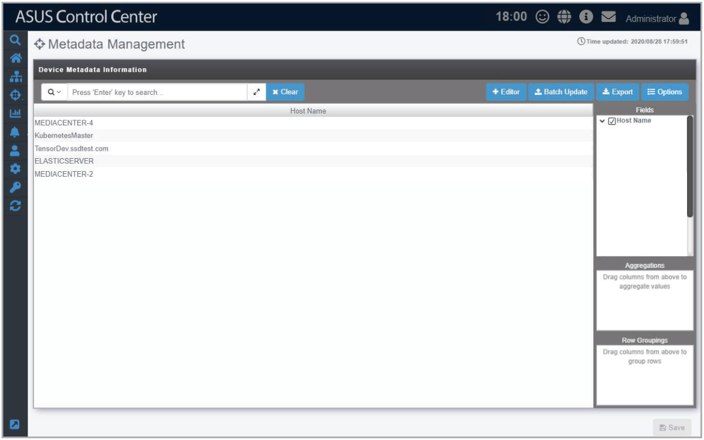

**Using the search bar and search options**

Refer to the **Search Options** and **Search and Filter Devices** sections of the **Monitor** chapter for more information.

## Adding metadata fields

You may add new metadata fields for managed devices using this function.

1. Click on **Editor** to open the Metadata Editor.

    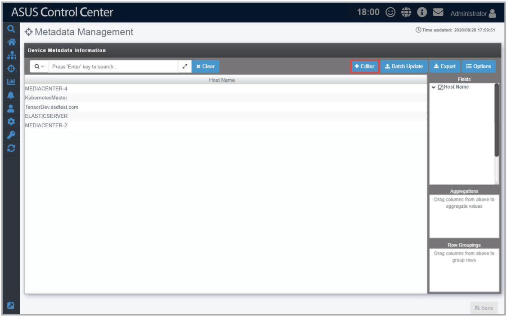

2. Enter the Field Name of the new metadata column and select the Field Type from the drop down menu (**String**, **Number**, **Date**, **Boolean**), then click **Add**.

    > **NOTE:**
    >
    > - **String:** The data in this field contains string variables.
    > - **Number:** The data in this field contains numerical values.
    > - **Date:** The data in this field are in date form.
    > - **Boolean:** The data in this field are either true or false.

    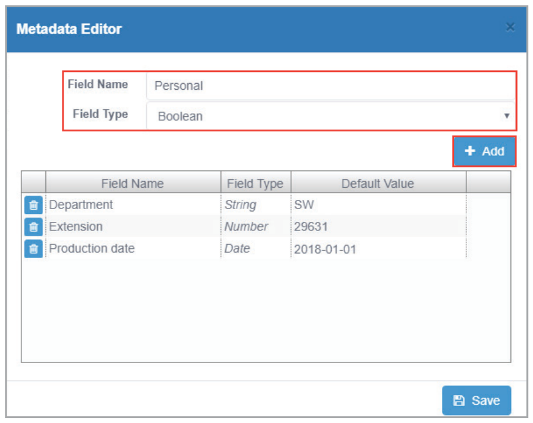

3. (optional) You may set or edit the default value of the new field by double-clicking in the **Default Value** cell and then entering the new default value.

    > **NOTE:** The default values will be restricted to the Field Type chosen.

    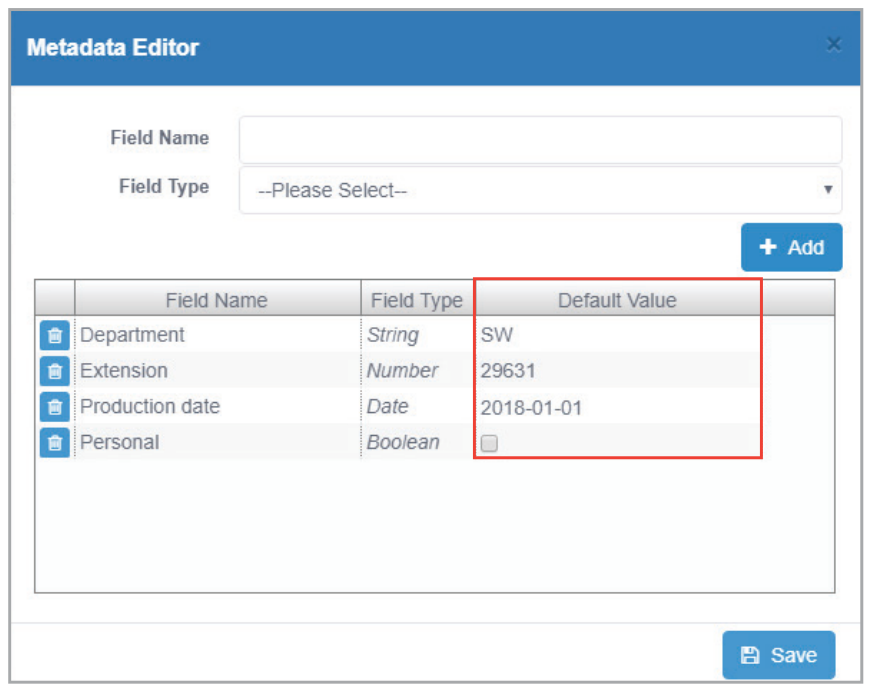

4. Repeat steps 2 to 4 to add additional metadata fields.
5. Click on **Save** when you have finished adding or editing the metadata fields.

    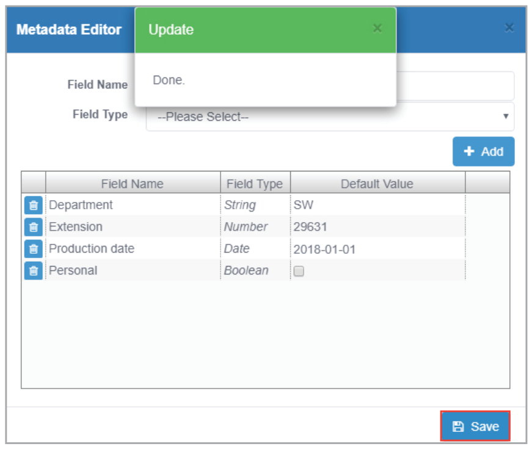

## Editing metadata fields

1. Click on **Editor** to open the Metadata Editor.

    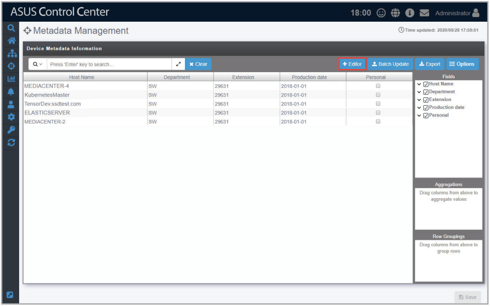

2. You can edit the **Field Name** and **Default Value** of existing metadata fields. When you are finished editing, click on **Save** to save the changes made.

    

## Deleting metadata fields

1. Click on **Editor** to open the Metadata Editor.

    

2. Click on  next to the metadata field you wish to delete. Once you are finished, click on **Save** to save the changes made.

    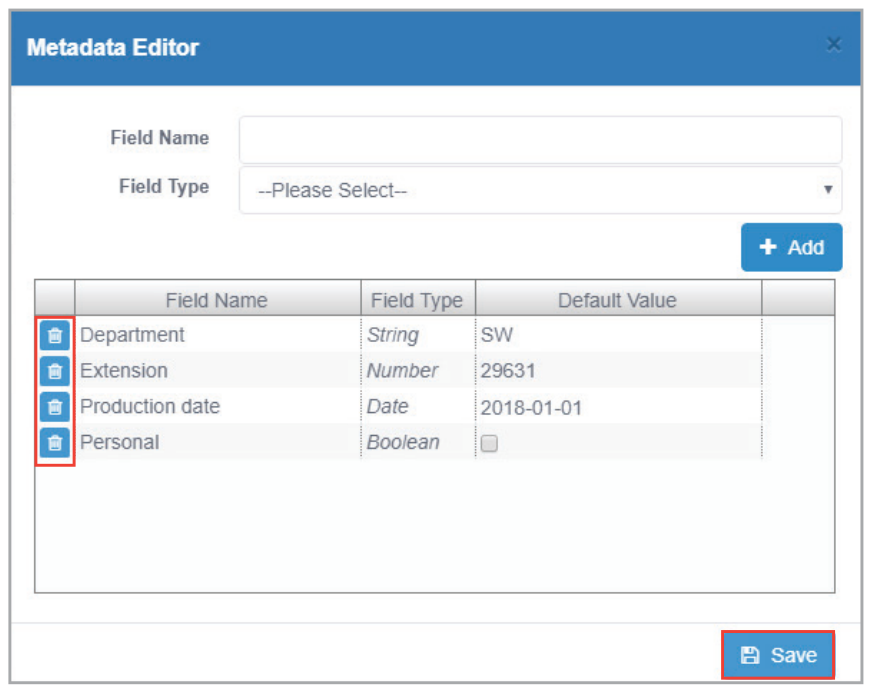

## Editing the metadata value of a single device

1. Double-click on a field you wish to edit and enter the new value.

    > **NOTE:**
    >
    > - Items in the **Host Name** field cannot be edited.
    > - Edited fields will have blue text.

2. Click on **Save** once you have finished making changes to the metadata.

    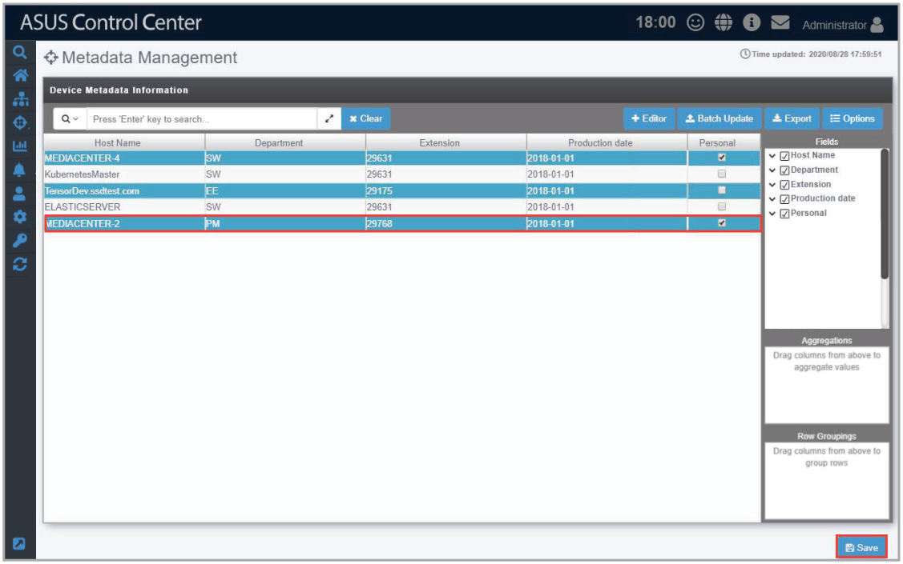

## Editing the metadata value of multiple devices

1. Click on **Batch Update**.

    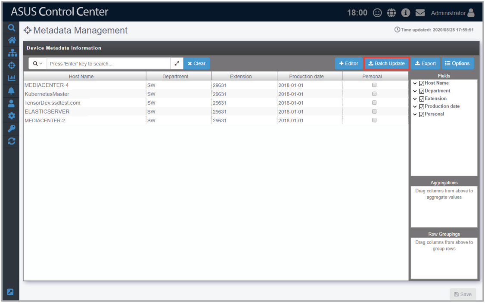

2. Select a CSV file to import, then click **Open**.

    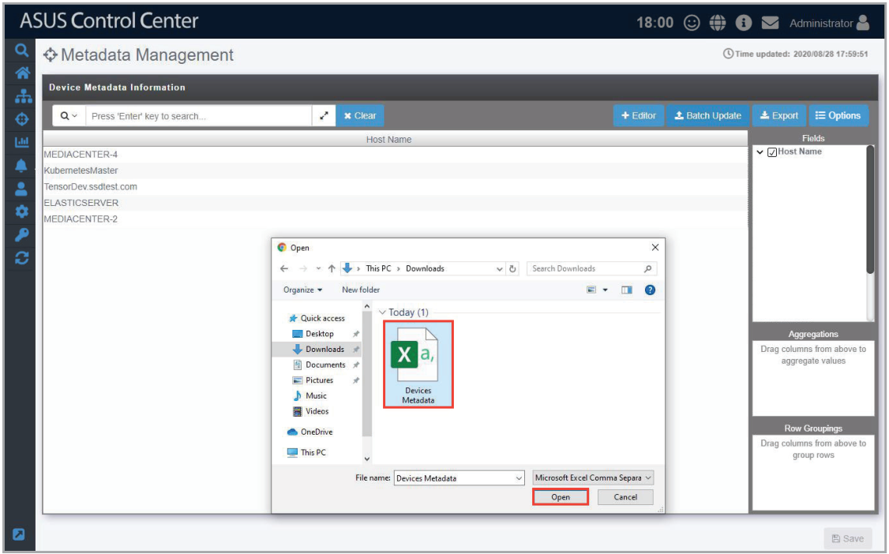

3. Select the metadata field columns to update to the server, then click **Batch Update**.

    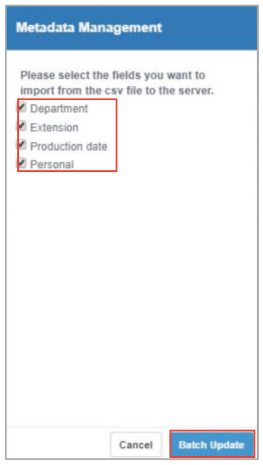

4. A confirmation window should pop-up, click **OK**.

    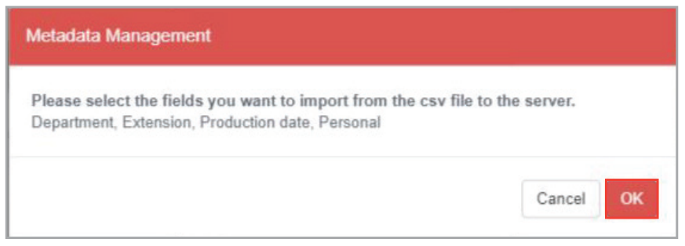

5. Next, another pop-up window will appear notifying you of which devices will be affected by the updated data. Click **OK** to confirm these changes, or click **Cancel** to cancel the batch update.

    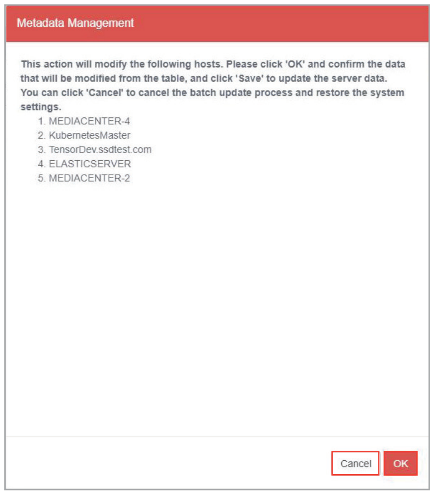

6. If you clicked **OK** in the previous step, click on **Save** to save the changes made.

    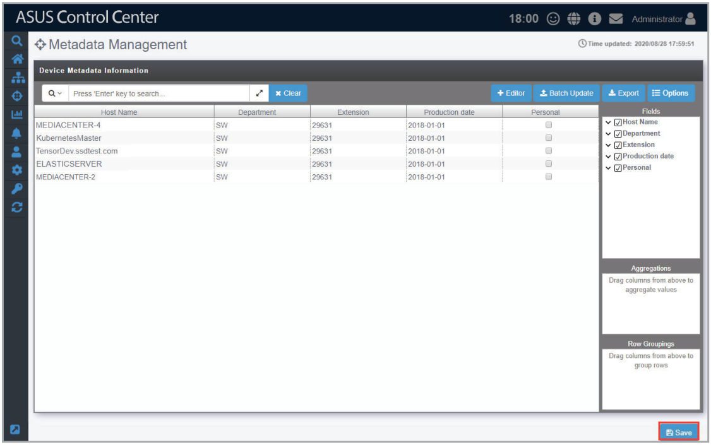

## Exporting the metadata value

Exporting the metadata to a CSV file allows you to edit multiple metadata fields together, then update them by importing it back into ASUS Control Center. To import the changes made to the metadata in the CSV file, refer to **Editing the metadata of multiple devices** under the **Metadata Management** section.

1. Click on **Export**.

    

2. Enter a filename for the CSV file, then click **OK**.

    > **NOTE:**
    >
    > - Use a text editor when editing the exported CSV file.
    > - Do not edit the **aswm_HostName** and **ClientGUID** fields.
    > - Only the existing data in the CSV file may be edited, adding new rows and columns to the CSV file may cause failure when importing to the ASUS Control Center.
