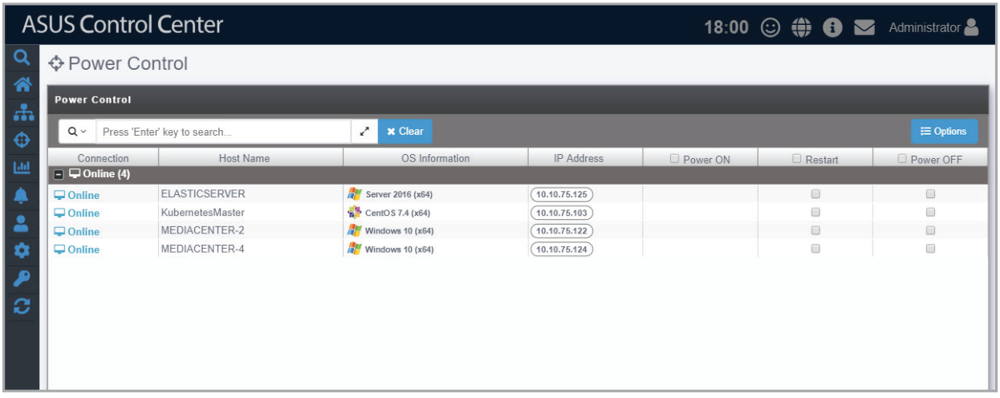
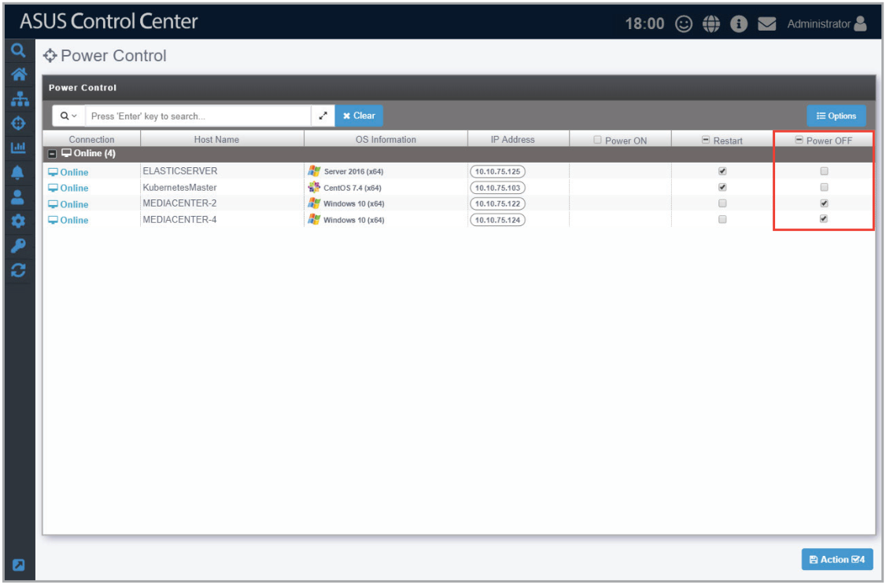
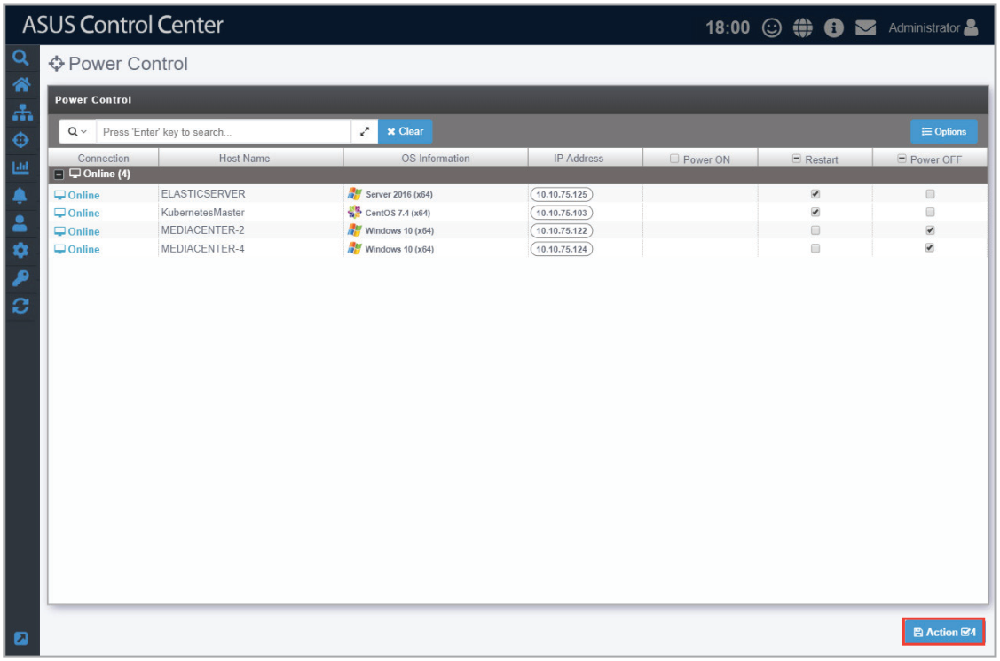
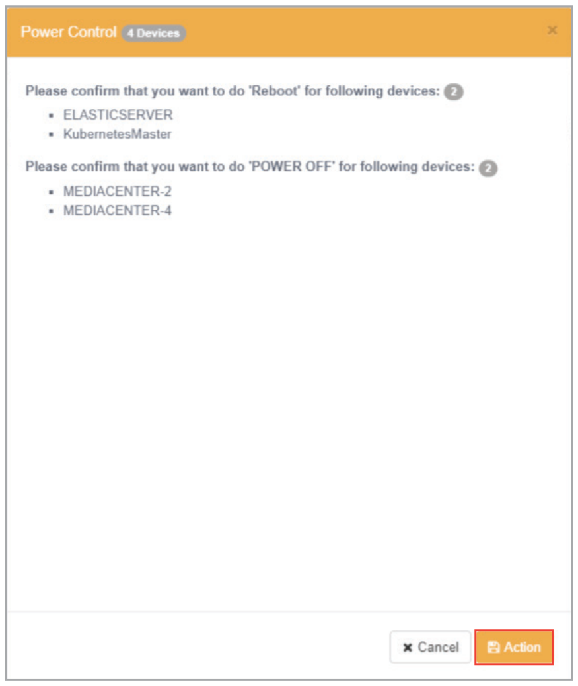

# Power Control

Power Control allows you to control the power settings of managed devices all from a centralized location. The centralized control over the power settings for managed devices makes it so that you do not have to manually power off, power on, or restart each managed device individually.

To power on / power off / restart device(s):

1. Check the **Power ON** / **Power OFF** / **Restart** check boxes of devices you would like to power on / power off / restart, or you may check the column title to check all devices eligible for the chosen action.

    > **NOTE:** The availability of the **Power ON**, **Power OFF**, and **Restart** check boxes will vary according to the current power status of the managed device.

    

2. Click **Action** in the lower right of the screen to perform the chosen action(s).

    

3. Click **Action** when prompted.

    
