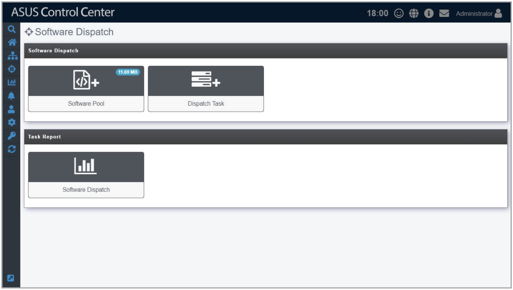

# Software Dispatch

**Software Dispatch** is a centralized software management function that allows you to add or remove software packages to a Software Pool, allowing for easy software dispatching to managed devices using the Software Dispatch Task function.

To access **Software Dispatch**, click  > **Software Dispatch** in the left menu.

**Using the search bar and search options**

Refer to the **Search Options** and **Search and Filter Devices** sections of the **Monitor** chapter for more information.
