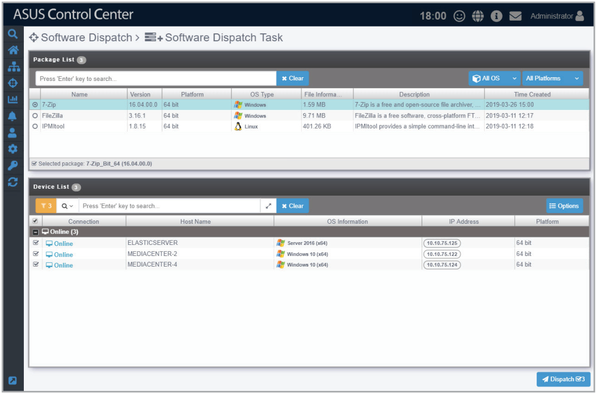
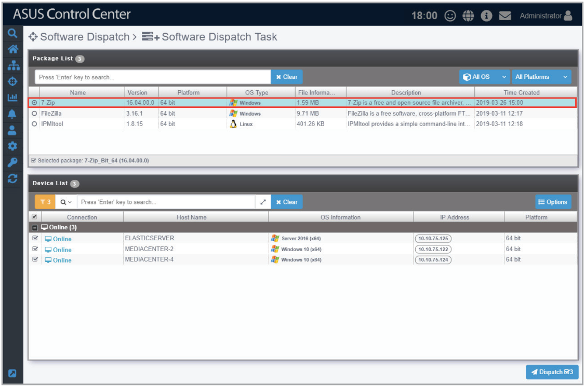
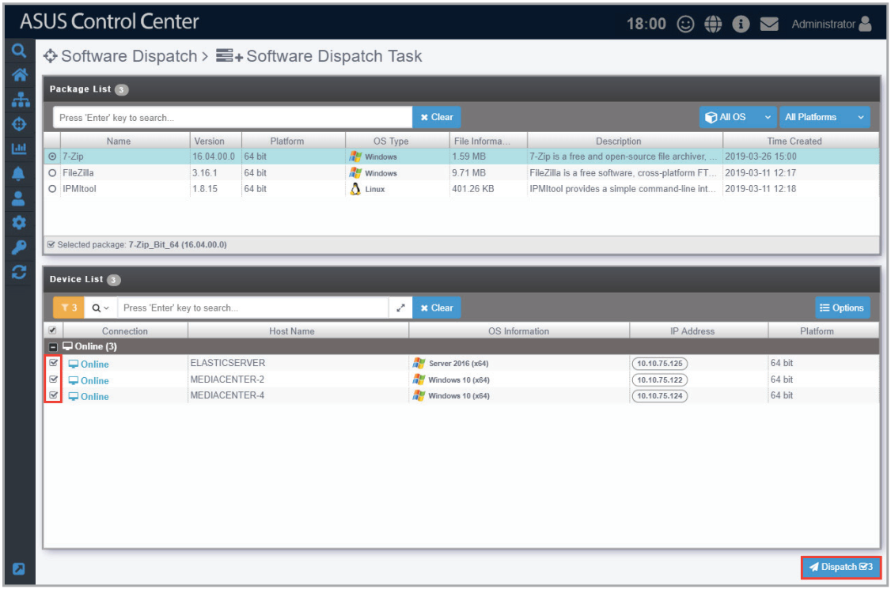
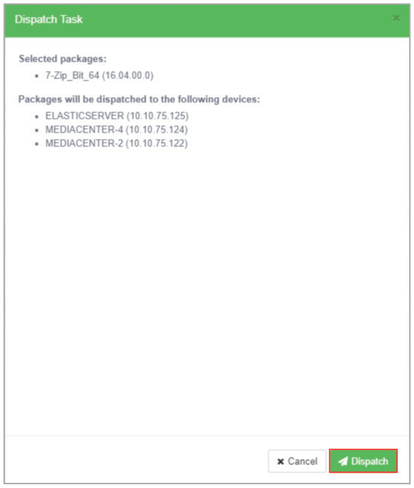

# Software Dispatch Task

You can use Software Dispatch Task to dispatch software packages in the Software Pool to multiple managed devices to be installed in the background quickly and efficiently.

> **NOTE:** To add or view software packages in the Software Pool, please refer to the **Software Pool** section.

## Dispatching software packages to devices

1. Select the software package you wish to dispatch from the Package List.

    > **NOTE:** You may filter the software packages by OS or platform by selecting the filter criteria from the drop down menus located to the right of the Search bar.

    

2. When you select a software package, the managed devices you can dispatch the selected software package to will be displayed in the Devices List. Select the managed devices to dispatch the software package to from the Device List, then click **Dispatch**.

    

3. Confirm that the correct software package and managed devices are selected in the pop-up window, then click **Dispatch** to start dispatching the software to the managed devices.

    

4. After the software packages have been dispatched, you will be redirected to the Software Dispatch Task Report screen.

    > **NOTE:** For more details on the Software Dispatch Task Report, refer to the **Software Dispatch Task Report** section.
