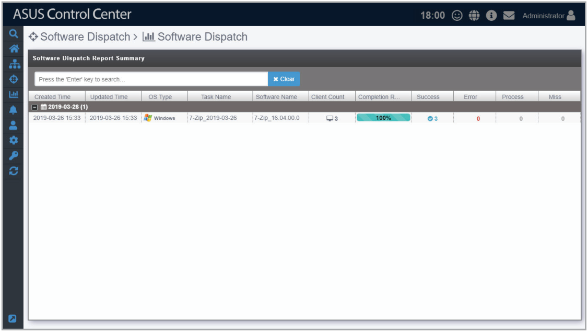
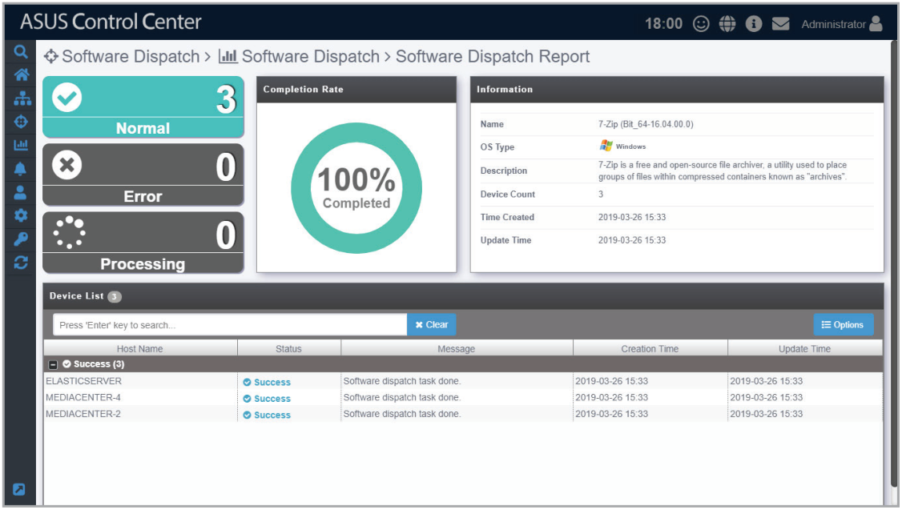

# Software Dispatch Task Report

The **Software Dispatch Task Report** function will display a history of all software dispatch tasks performed using ASUS Control Center.

Selecting a software dispatch task listed in the Software Dispatch Report Summary will allow you to view information on the software, which devices the software was dispatched to, and also the status of the software dispatch to managed devices.

This provides you with a quick overview of your software dispatch tasks and also help you pinpoint failed software dispatches.

