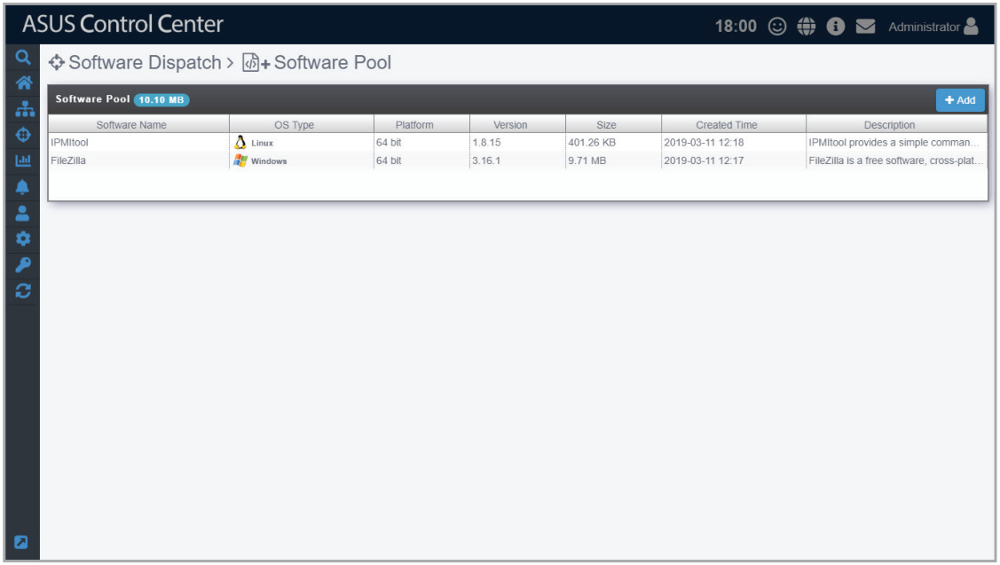
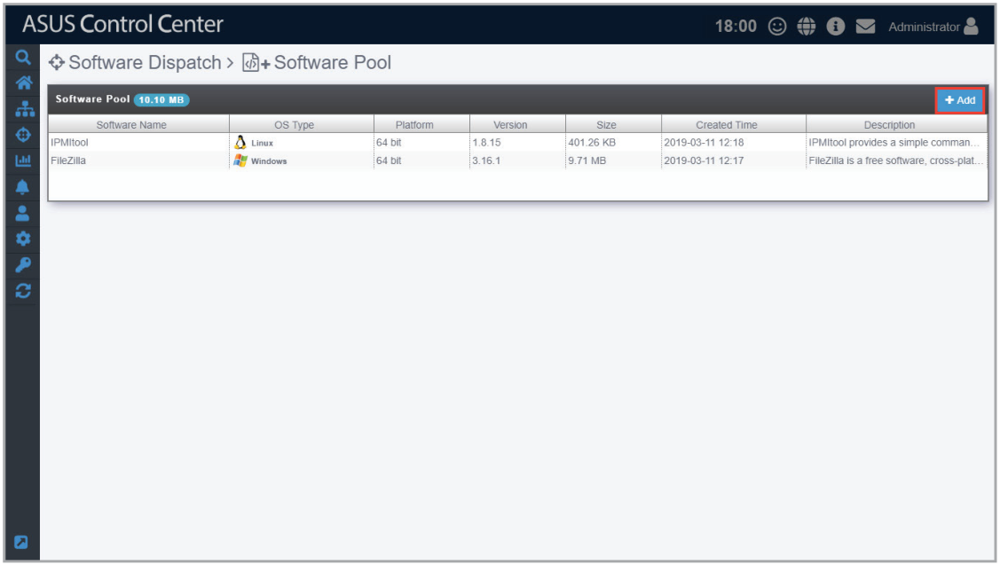
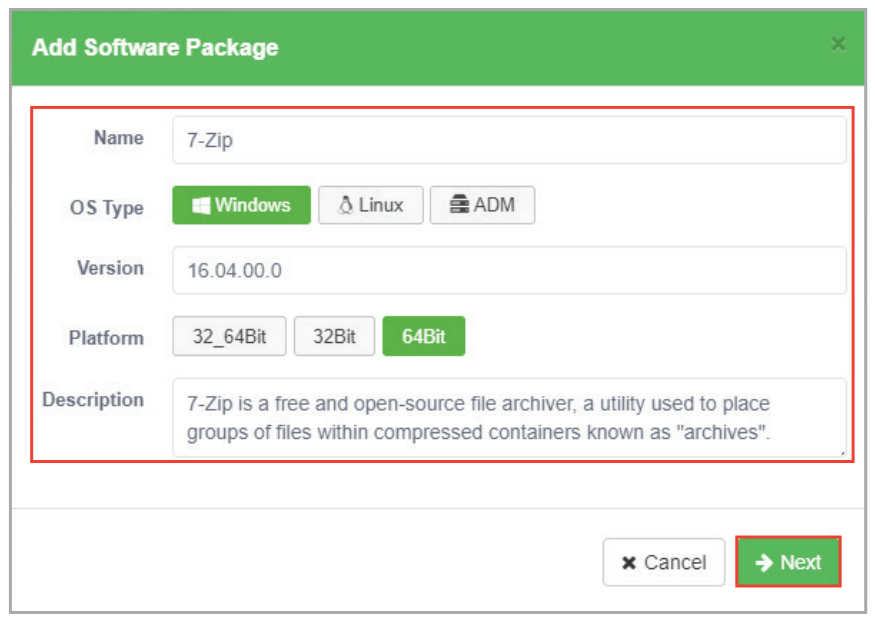
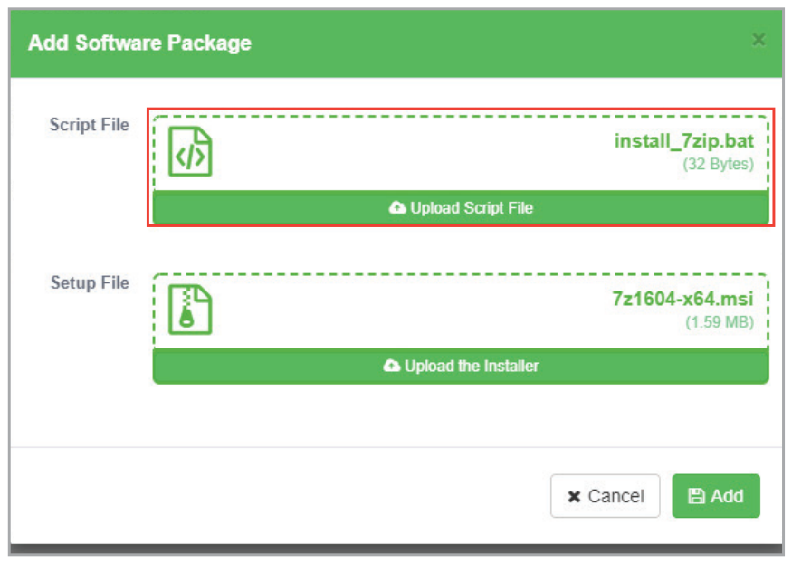
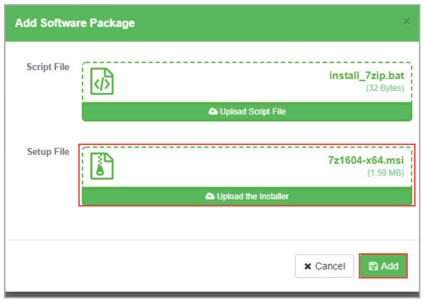
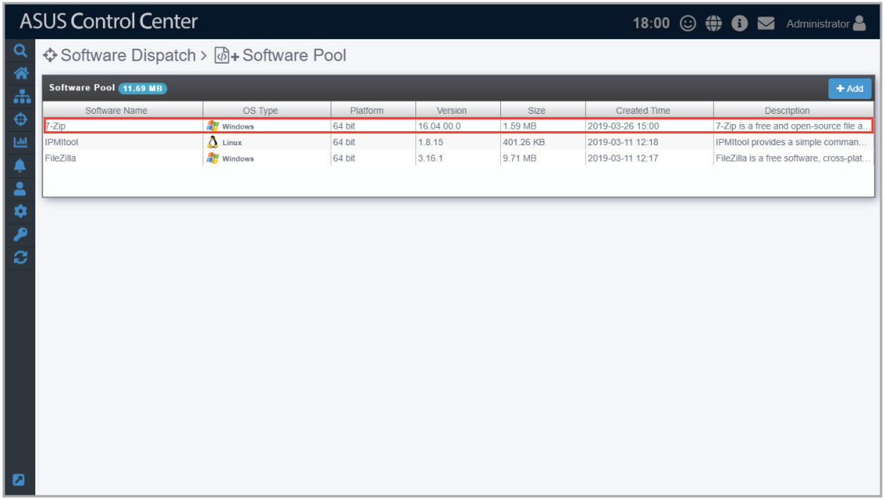
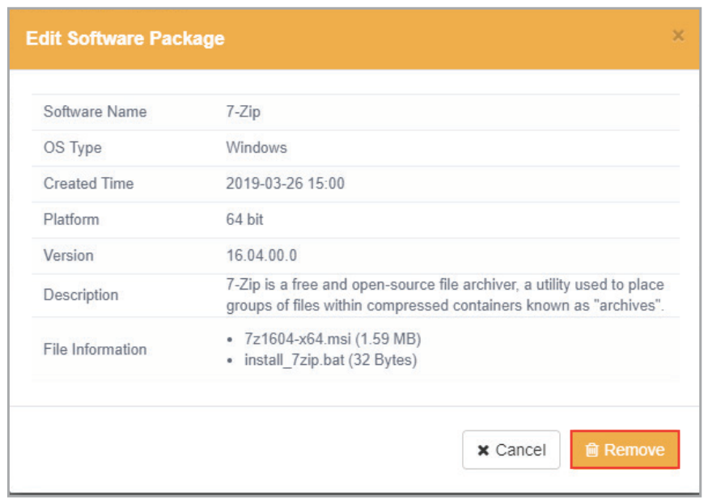

# Software Pool

The Software Pool allows you to view all uploaded software packages. You may also add additional software packages or remove existing software packages from the Software Pool. The uploaded software packages will allow you to easily select and dispatch software to selected managed devices.

## Adding software packages to the Software Pool

1. Click on **Add**.

    

2. Enter the name, OS type, version, platform and description of the software package, then click **Next**.

    

3. Add the script file by clicking on **Upload Script File** to select and upload a script file, or drag the script file into the **Script File** dotted square.

    > **NOTE:** For more information and examples of script files, please refer to <https://github.com/AsusControlCenter/Software-Dispatch-Guide>.

    

4. Add the setup file by clicking on **Upload the Installer** to select and upload a setup file, or drag the setup file into the **Setup File** dotted square, then click on **Add**.

    

5. The newly added software package will appear in the Software Pool list.

    

## Removing software packages from the Software Pool

1. Click on the software package you wish to remove in the Software Pool list.

    

2. Click on **Remove** to remove the software package.

    
