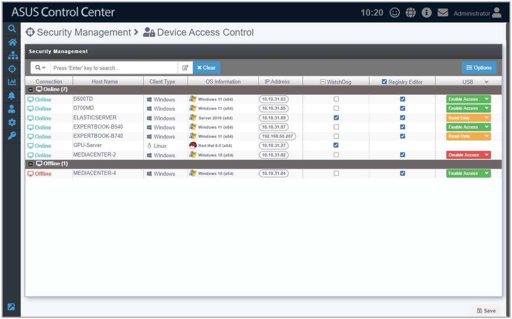
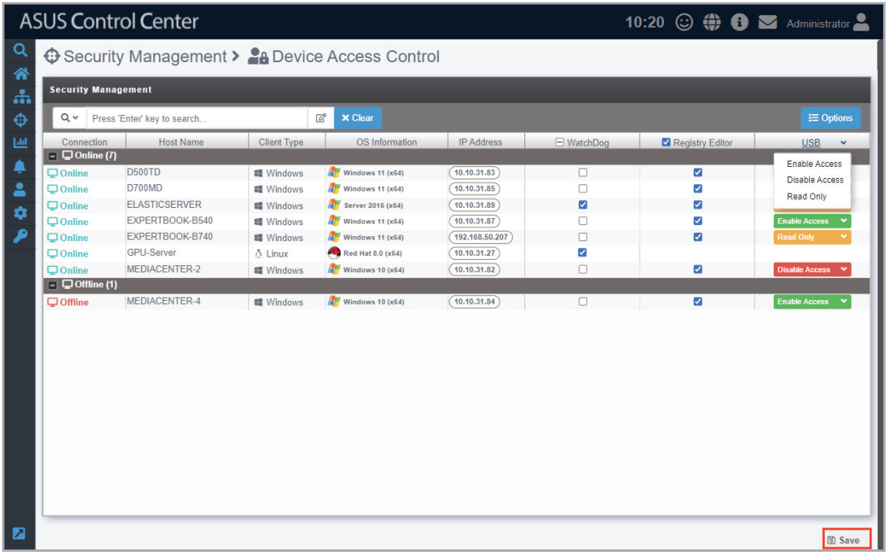

# Device Access Control

**Device Access Control** allows you to modify the security settings for items such as Windows Registry Editor, USB access, or Watchdog for a single managed device or all managed devices. The centralized security management makes it so that you do not have to configure the security settings for each individual managed device through Device Information.

## Setting the device access control for managed devices

1. You can set the security function for all managed devices by checking or unchecking the column headers for **Watchdog** or **Registry Editor**, or selecting a mode for **USB** from the drop down menu in the column header.

    You can also set the security function for a single managed device by checking or unchecking the **Watchdog** or **Registry Editor** checkbox, or selecting a mode for **USB** from the drop down menu of the managed device.

    You may refer to the brief descriptions for the different security functions below:

    - Watchdog

        Watchdog allows you to enable or disable the Watchdog timer. When the watchdog timer in unresponsive due to hardware fault or program error, it will reboot the device.

        > **NOTE:** Auto Restart needs to be disabled on Windows® Server 2016 or later versions for Watchdog to successfully reboot the device when required. To disable **Auto Restart**, search for **Control Center** in the Windows Search Box, then navigate to **System** > **Advanced System Settings** > **Startup and Recovery**.

    - **Registry Editor (Windows only)**

        The **Registry Editor** allows you to enable or disable access to Regedit Tool in Windows® by the managed device's user.

    - **USB (Windows only)**

        **USB** allows you to **Enable Access** or **Disable Access** of USB ports on the managed device, or set it to **Read Only**, which allows the users to view files on the USB storage device only.

2. Click on **Save** once you have finished making changes to save the changes made.

    
