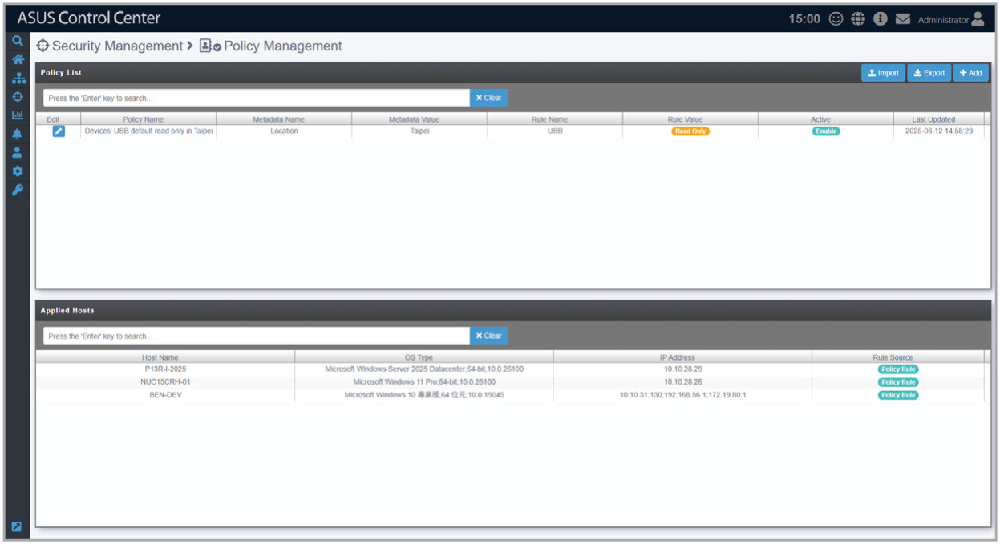
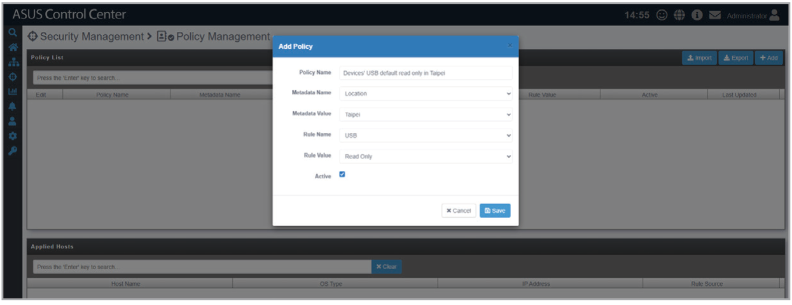

# Policy Management

This page allows you to add policies to automatically apply rules based on device metadata, such as disabling USB access based on the device's location.

Rules are applied in the following priority based on the source of the policy:

1. General Configuration > Policy Configuration (default policy)
2. Security Management > Policy Management (applied based on metadata)
3. Security Management > Device Access Control (applied to multiple devices)
4. Device Information > Security (applied to a specific device)

## Adding a policy

1. Click **Add**, then fill in the policy, metadata, and rule fields.
2. Tick the **Active** checkbox to enable the rule, then click **Save**.

    

## Editing or removing a policy

1. Click the edit icon next to the policy in the **Policy List** block.
2. Make changes as required and click **Update** or **Delete**, then confirm the action if prompted.
