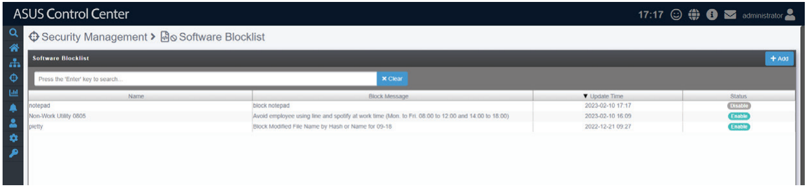
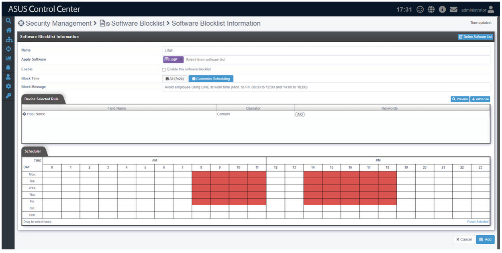
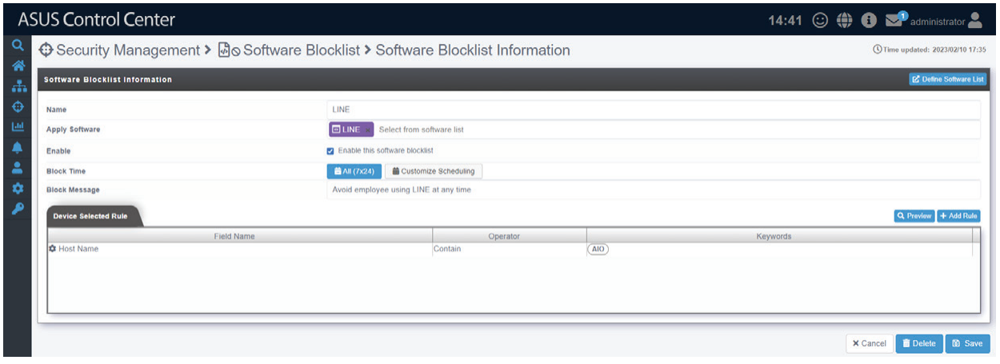

# Software Blocklist

**Software Blocklist** allows you to create or manage rules to prevent selected software applications from running on the managed device during specified time periods.

## Adding a new software blocklist rule

1. Click  to create a new software blocklist rule.

    

2. Enter a **Name** for the software blocklist rule, then use **Apply Software** to select an application from the software list.

    > **NOTE:** For more information on software lists, please refer to the **Software List** section of the **Options** chapter.

3. Tick **Enable** to enable the software blocklist rule.
4. Select **All (7x24)** in the **Block Time** field to enable the software block list rule at all times, or select **Customize Scheduling** to specify a custom schedule using the **Scheduler**.
5. Fill in the **Block Message** field with a brief description that will be displayed on the managed device.
6. Click  to specify which managed devices the software blocklist rule should apply to. To view a list of managed devices that will be affected by the software blocklist rule, click .
7. Click  to save the software blocklist rule.

## Editing a software blocklist rule

1. Double click an existing rule from the Software Blocklist rule list to open the rule editor.

    

2. After making the desired changes, click  to save the software blocklist rule.

## Deleting a software blocklist rule

1. Click an existing rule from the Software Blocklist rule list to open the rule editor.
2. Click  to delete the software blocklist rule.
