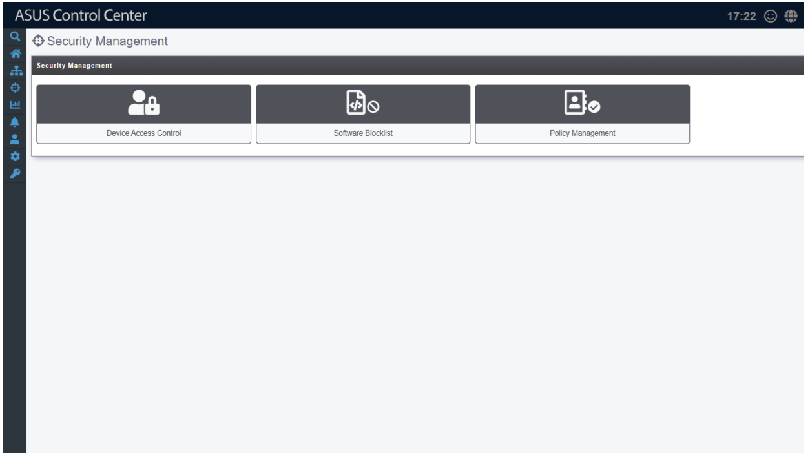

# Security Management

**Security Management** allows you to modify the security settings for items such as Windows Registry Editor, USB access, or Watchdog for a single managed device or all managed devices. The centralized security management makes it so that you do not have to configure the security settings for each individual managed device through Device Information.

To access **Security Management**, click  > **Security Management** in the left menu.

> **NOTE: Registry Editor** and **USB** configurations are only available for Windows system managed devices.

**Using the search bar and search options**

Refer to the **Search Options** and **Search and Filter Devices** sections of the **Monitor** chapter for more information.
