# Task Scheduler

Schedule tasks for managed devices using the Task Scheduler. The tasks set can be executed automatically at specific times, or set to repeat periodically, which allows you to schedule tasks before hand or periodic tasks such as periodic reboot of managed devices.

To access **Task Scheduler**, click  > **Task Scheduler** in the left menu.

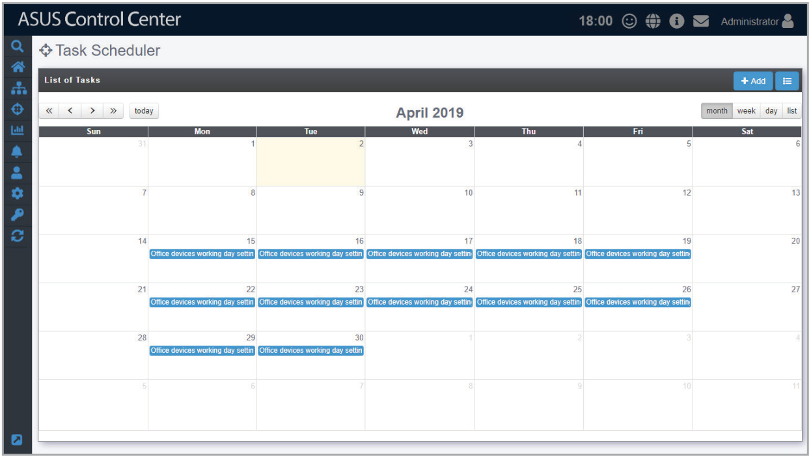

**Using the search bar and search options**

Refer to the **Search Options** and **Search and Filter Devices** sections of the **Monitor** chapter for more information.

## Task Scheduler Overview

Toggle between the different Task Scheduler views by clicking on the  /  icon. You can click on any task displayed to view more details on the task.

- : Calendar view displays the tasks and the dates when they will be executed.

    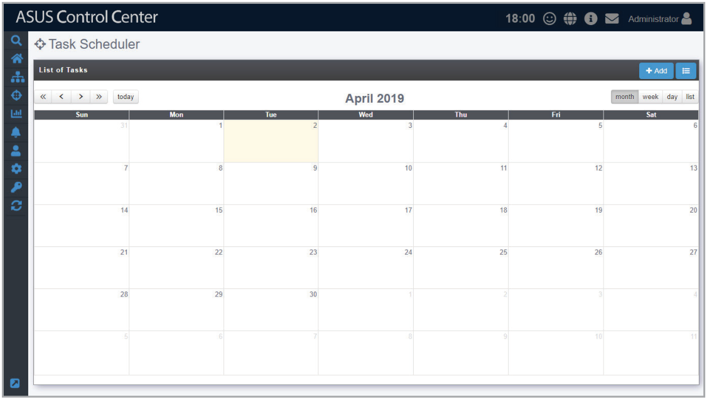

    You can switch the time period displayed in Calendar view by using the following:

    -  View previous year
    -  View next year
    -  View previous month / week / day
    -  View next month / week / day
    -  Move to the current day. The current day will be highlighted on the calendar.
    -  Display month view

        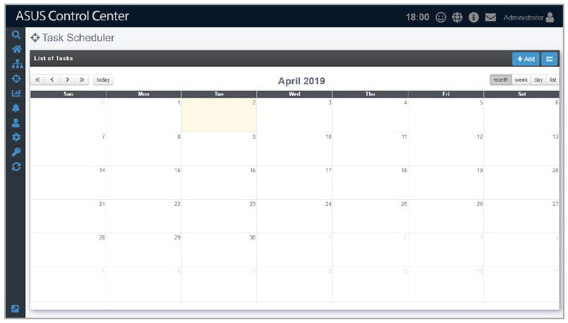

    -  Display week view

        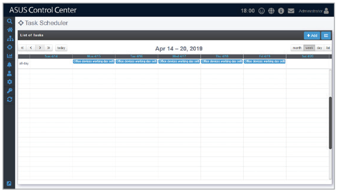

    - 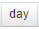 Display day view

        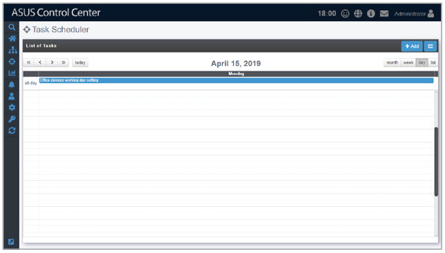

    -  Display list of all tasks in the selected month and year.

        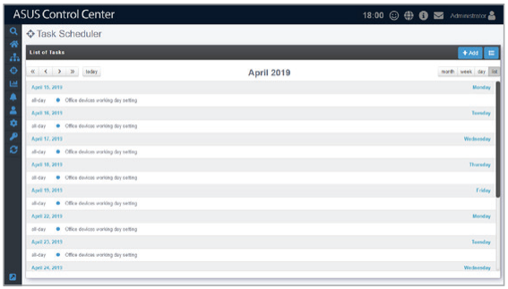

- : History list of all tasks, including Task Name, Start Date & Time, End Date & Time, Repeat, Number of Clients, Status, and Switch.

    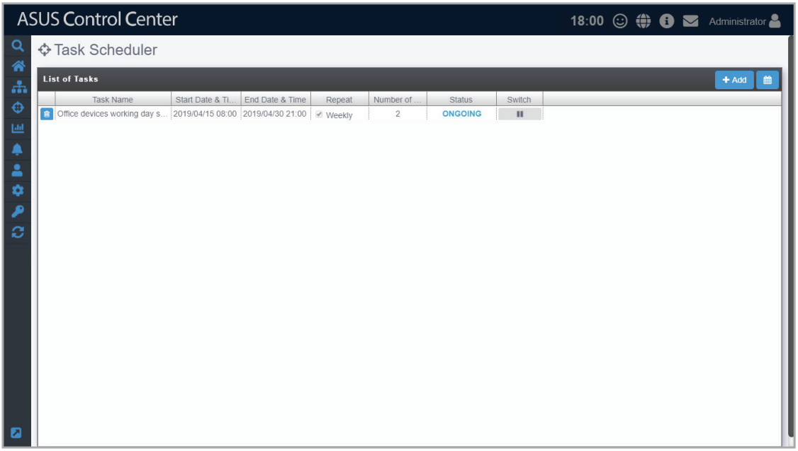

## Adding a scheduled task

1. Click on **Add**.

    

2. Enter the **Taskset Name**, then select a **Start Date & Time**.

    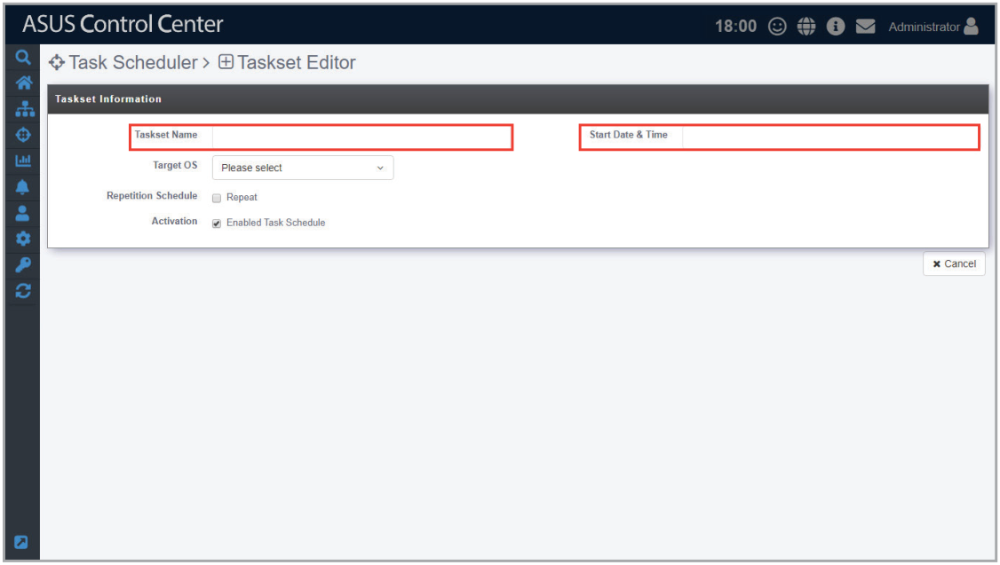

3. Select **Windows** or **Linux** in the **Target OS** field to filter the target devices.

    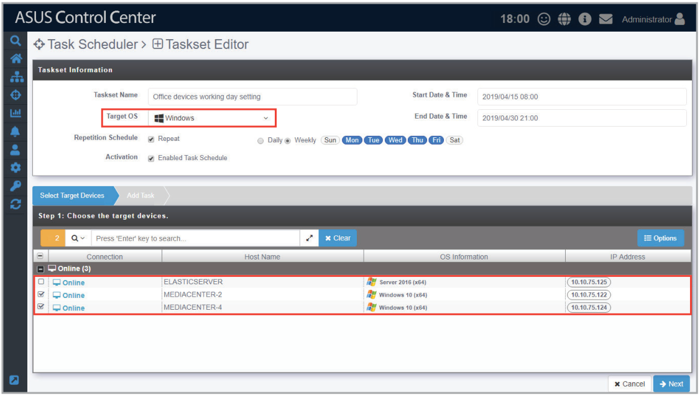

4. (optional) If you want to repeat the task, check **Repeat** in the **Repetition Schedule** field, then select **Daily** to repeat the task daily, or **Weekly** to repeat the task weekly. When you select **Weekly**, remember to select which days of the week you wish to repeat the task.

    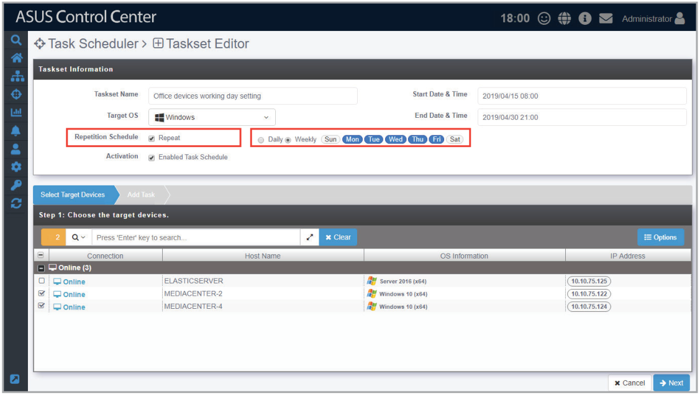

5. (optional) You may select an end date and time.

    > **NOTE:** The **End Date & Time** option only appears when **Repeat** has been checked.

    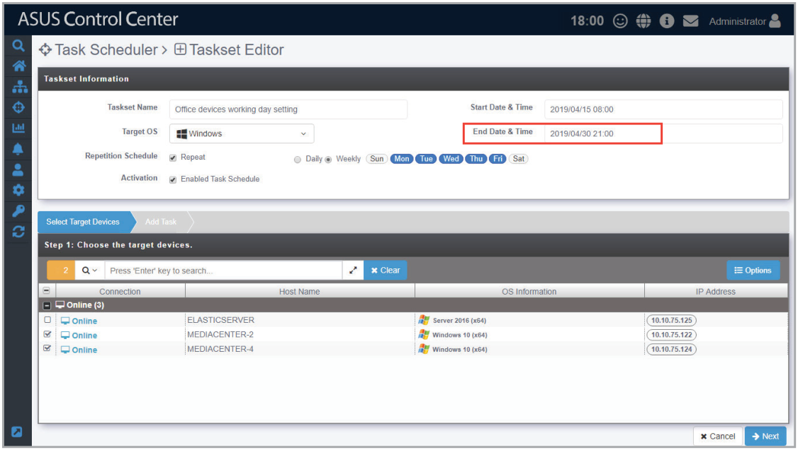

6. **Enabled Task Schedule** is enabled by default, if you wish to disable the task, uncheck **Enabled Task Schedule** in the **Activation** field.

    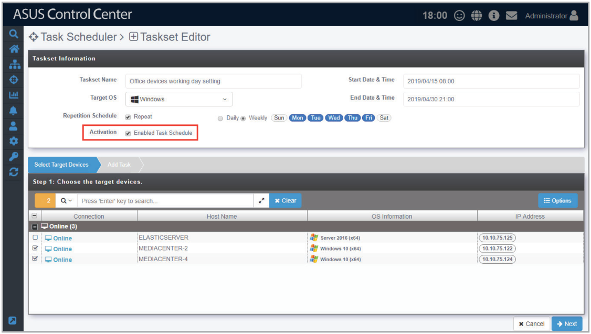

7. A list of all managed devices matching the **Target OS** selected will be displayed. Select the managed devices to apply the task to, then click **Next**.

    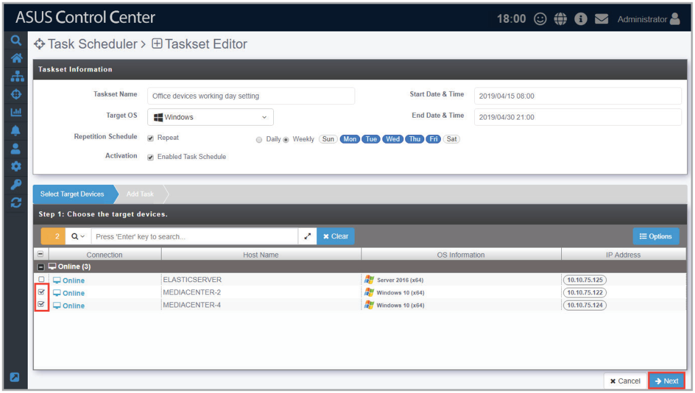

8. Click on **Add** in the middle-right of the screen to add a new task.

    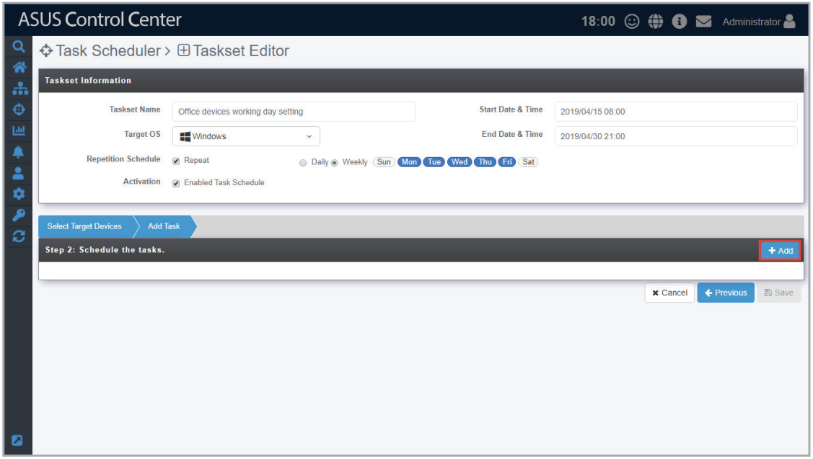

9. Select an **Action Type**. Each action type contains different options, see below for a list of the action types and the options available.

    > **NOTE: Linux** only supports **Power Control** and **Security** action types.

    Power Control:

    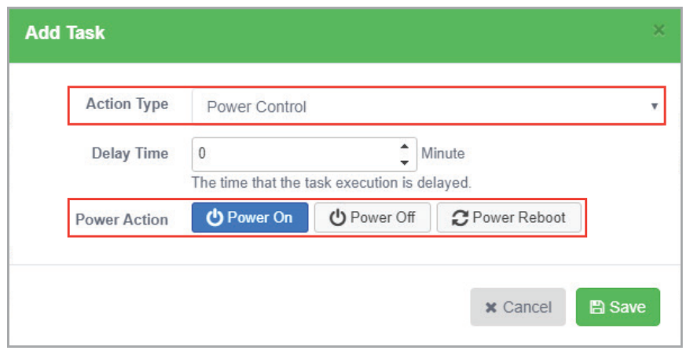

    | Action Type | Options | Description |
    | --- | --- | --- |
    | **Power Control** | Power On | Power on the device. |
    | **Power Control** | Power Off | Power off the device. |
    | **Power Control** | Power Reboot | Reboot the device. |

    Service Control:

    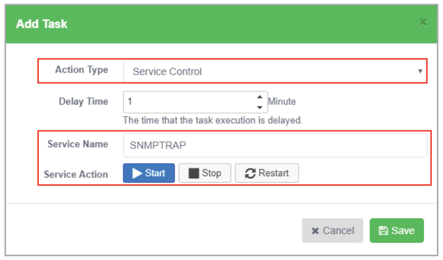

    | Action Type | Options | Description |
    | --- | --- | --- |
    | **Service Control** | Service Name | Enter the name of the service. If you are unsure of the name of the service, refer to the **Software** section. |
    | **Service Control** | Start | Activate the service. |
    | **Service Control** | Stop | Stop the service. |
    | **Service Control** | Restart | Restart the service. |

    Software Dispatch:

    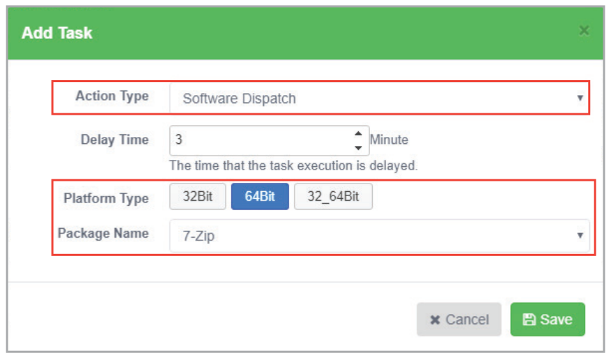

    | Action Type | Options | Description |
    | --- | --- | --- |
    | **Software Dispatch** | Platform Type | Select from **32Bit**, **64Bit**, or **32_64Bit** to filter the software options. |
    | **Software Dispatch** | Package Name | Select an item from the **Software Pool** to be installed. The options will vary according to the Bit type selected in **Platform Type**. |

    Security Control:

    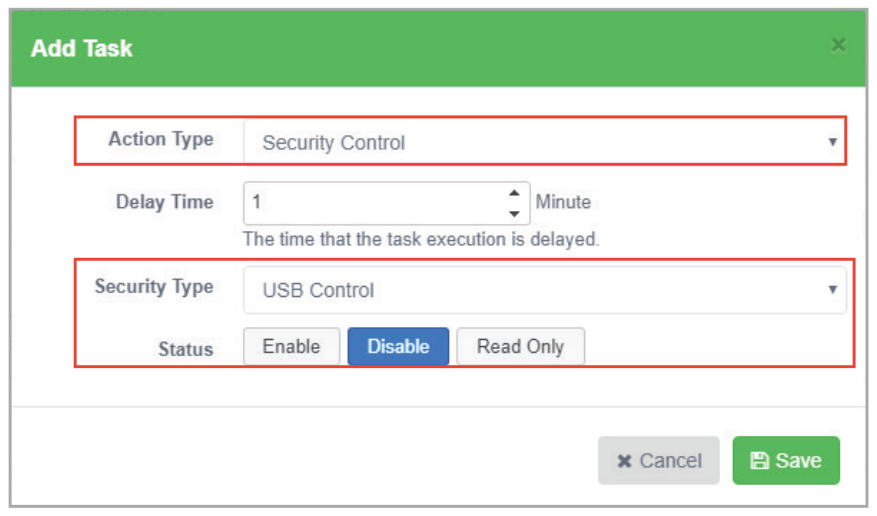

    | Action Type | Security Type | Options | Description |
    | --- | --- | --- | --- |
    | **Security Control** | USB Control | Enable Access | Allows USB ports to be accessed. |
    | **Security Control** | USB Control | Disable Access | Do not allow USB ports to be accessed. |
    | **Security Control** | USB Control | Read Only | Files on the USB storage device can only be read. |
    | **Security Control** | WatchDog Function | Enable | Enables Watchdog timer. |
    | **Security Control** | WatchDog Function | Disable | Disables Watchdog timer. |
    | **Security Control** | Registry Tool | Enable | Enable access to Regedit Tool. |
    | **Security Control** | Registry Tool | Disable | Disable access to Regedit Tool. |

10. Set the **Delay Time** (in minutes). This function is used to set a delay time before the task is executed.

    > **CAUTION:** When adding multiple tasks, ensure to set a Delay Time for each task to ensure the tasks are executed properly.

    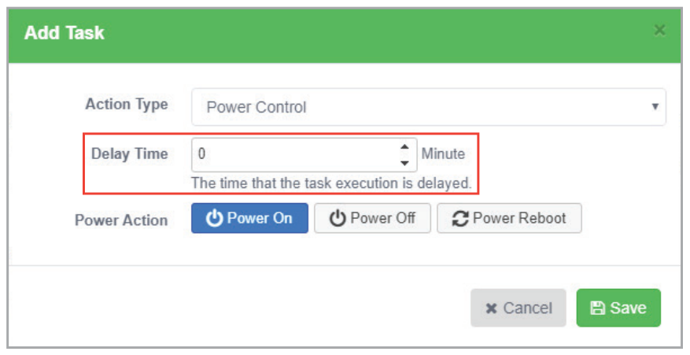

11. Once you have finished with setting the task, click on **Save**. The newly added task will be displayed in a timeline, you may click and drag the items in the timeline to rearrange the scheduled tasks. Clicking on  will delete the task.
12. When you are finished, click on the **Save** at the bottom of the screen.

    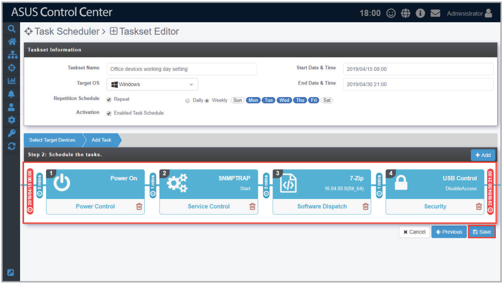

## Editing a scheduled task

1. Click on the task you wish to edit on the calendar in Calendar view.

    OR

    Click on the task you wish to edit from the list in History view.

2. Edit the details then click **Update** at the bottom of the screen when you have finished editing.

    > **NOTE:** You can refer to step 2 to 12 of the **Add Scheduled task** under the **Task Scheduler** section for the steps on editing a task; the steps are the same.

3. Click **Update** on the pop-up window to confirm the changes made.

    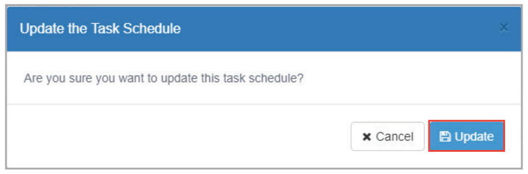

## Deleting a scheduled task

1. Click on the task you wish to edit on the calendar in Calendar view.

    OR

    Click on the task you wish to edit from the list in History view.

2. Click **Delete** at the bottom of the screen, then click **Delete** on the pop-up window to delete the scheduled task.

    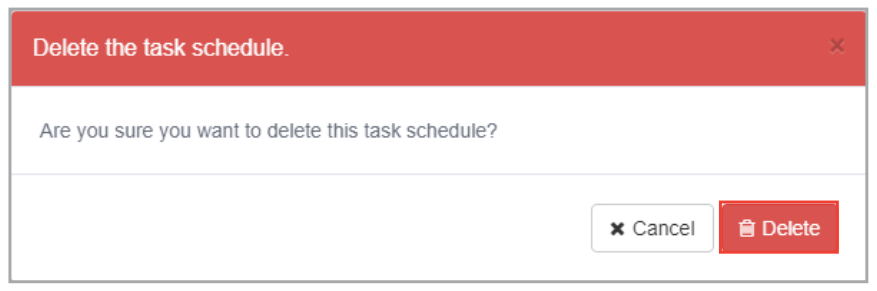
