# Deploy Agents

The **Deploy Agents** function allows you to add devices you wish to deploy agents to. You can enter a single device, or multiple devices to be scanned, and then deploy agents to the scanned devices.

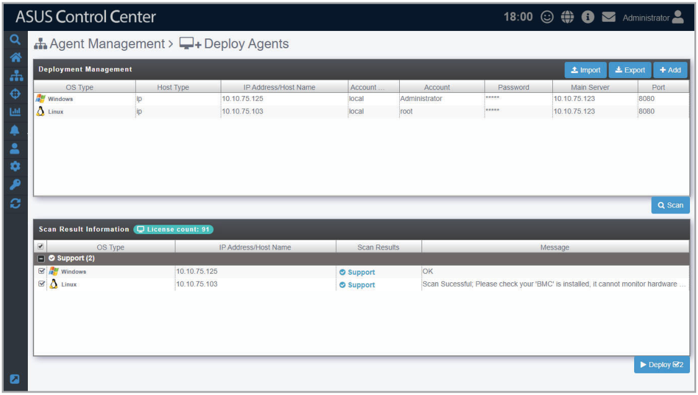

## Agent deployment conditions and settings

You may encounter problems when deploying agents to managed devices, if you do, you can first do a check and see if any of the following settings will resolve the problem.

> **NOTE:** The examples used in this section are all based on Windows® 10.

- Ensure the device has sufficient power and a steady connection to prevent packet loss when deploying the agent.
- For Windows clients

    - Windows® Home or lower versions of Windows® are not supported by ASUS Control Center.
    - The Administrator account of the client is enabled and has a password set. (Windows disables the Administrator account by default, to enable the account search for **Computer Management** in the Windows Search Box, then navigating to **System Tools** > **Local Users and Groups** > **Users** > **Administrator**, right click and select **Properties**, then uncheck the **Account is disabled** field, and click **OK**)

        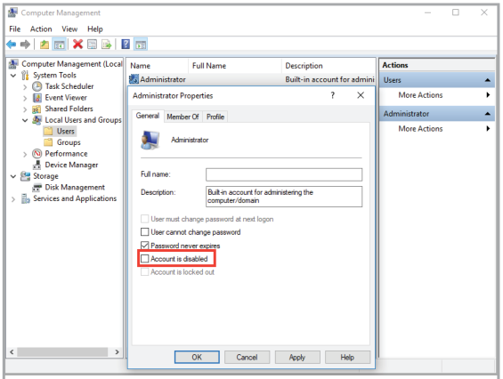

    - **Private** and **Public** should be checked in the **File and Printer Sharing** option by searching for **Control Panel** in the Windows Search Box, then navigating to **System and Security** > **Windows Firewall** > **Allow an app or feature through Windows Firewall**, then checking both **Private** and **Public** checkboxes in the **File and Printer Sharing** field.

        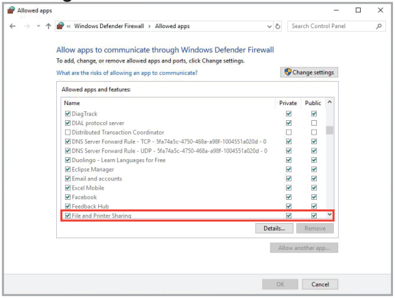

    - **User Account Control: Admin Approval Mode for the Built-in Administrator account** should be disabled. To disable this option, search for **Local Security Policy** in the Windows Search Box, then navigate to **Local Policies** > **Security Options**, then double click on **User Account Control: Admin Approval Mode for the Built-in Administrator account** and set it to **Disabled**, then click **OK**.

        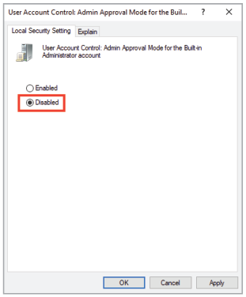

- For Debian and Ubuntu clients

    - Enable **SSH**:

        - **a.** Ensure the root account can be logged in through SSH.
        - **b.** Install SSH by executing the following:

            ```
            sudo apt-get install ssh
            ```

        - **c.** Confirm SSH server by executing the following:

            ```
            systemctl start sshd
            systemctl status sshd
            ```

- For RHEL, CentOS, and Scientific Linux clients

    - Enable **SSH** (enabled by default for RHEL and CentOS):

        - **a.** Ensure the root account can be logged in through SSH.
        - **b.** Install SSH by executing the following:

            ```
            sudo apt-get install ssh
            ```

        - **c.** Confirm SSH server by executing the following:

            ```
            systemctl start sshd
            systemctl status sshd
            ```

    - Disable **SELinux**:

        - **a.** Open `/etc/sysconfig/selinux`.
        - **b.** Set **SELINUX=enforcing** to **SELINUX=disabled**.
        - **c.** Reboot the system.

## Adding managed devices

1. Click on **Add**.

    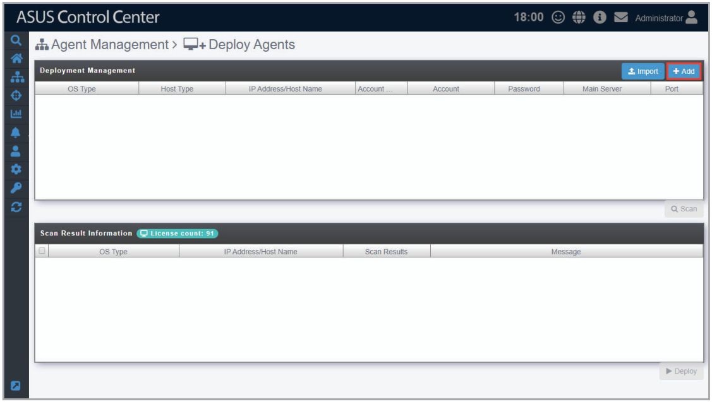

2. The IP and port of the main server should already be filled in, if not please enter the IP address and Port of the main ACC server.

    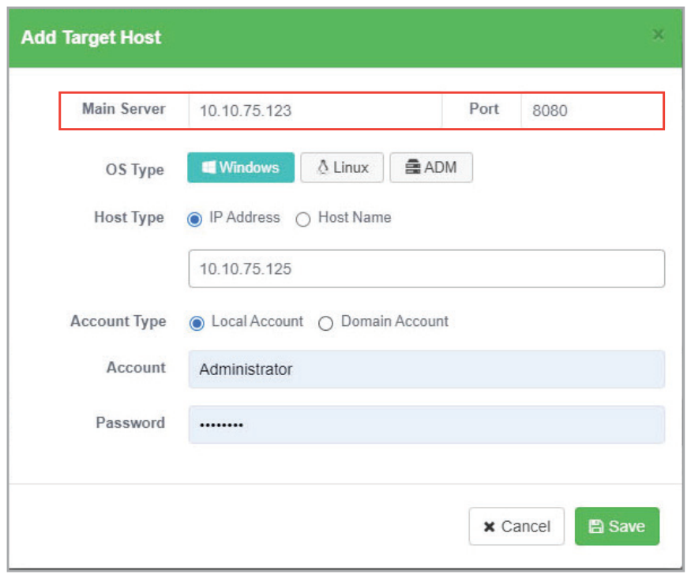

3. Select the **OS Type** of the device you wish to add from the **OS Type** options, then select the **Host Type**.

    > **NOTE:**
    >
    > - **IP Address:** Enter the IP address of the device.
    > - **Host Name:** Enter the name of the device.

    **Selecting Windows® system:**

    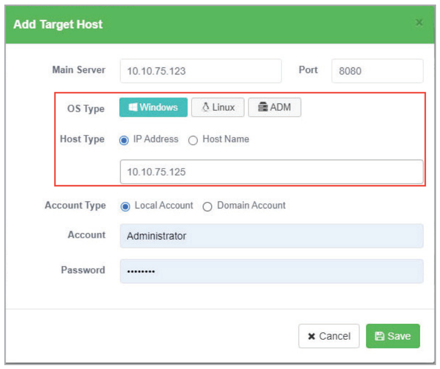

    **Selecting Linux system:**

    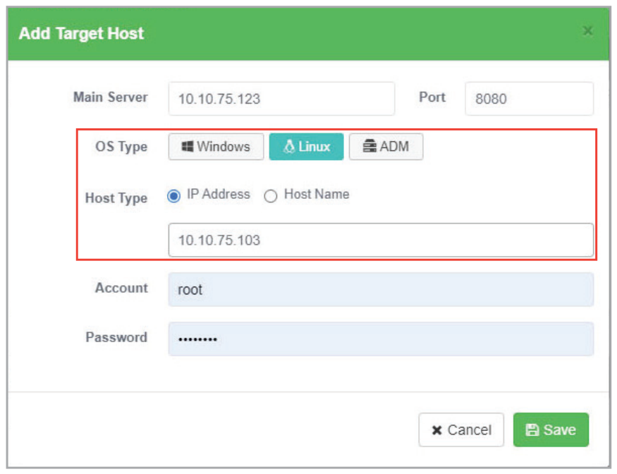

4. Select the **Account Type**.

    > **NOTE:**
    >
    > - **Local Account:** The agent's administrator (Windows) / root (Linux) privileges only allow you to manage the device the agent is installed on.
    > - **Domain Account (Windows only):** The agent's administrator privileges allows you to manage all devices in the domain.

    > **IMPORTANT:** When selecting **Local Account** as the **Account type**, and **Windows** as the **OS Type** for a device, ensure to configure your managed device settings as shown in **Agent deployment conditions and settings**.

    **Selecting Local Account:**

    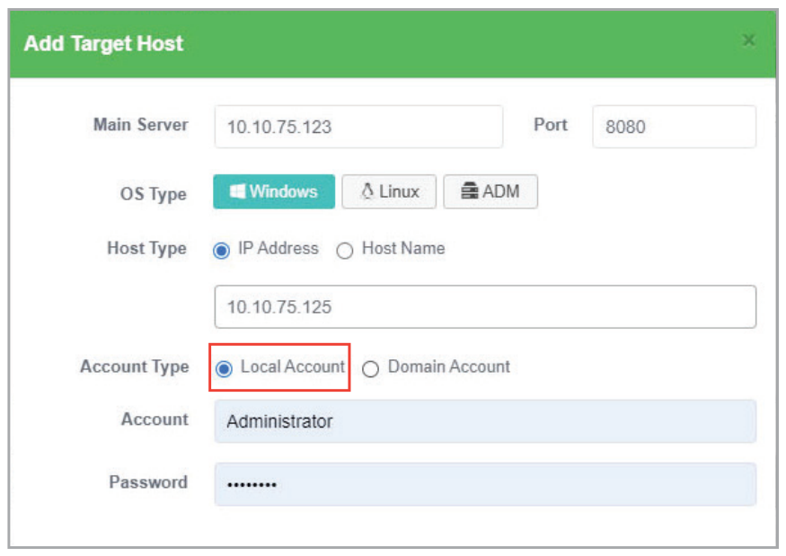

    **Selecting Domain Account:**

    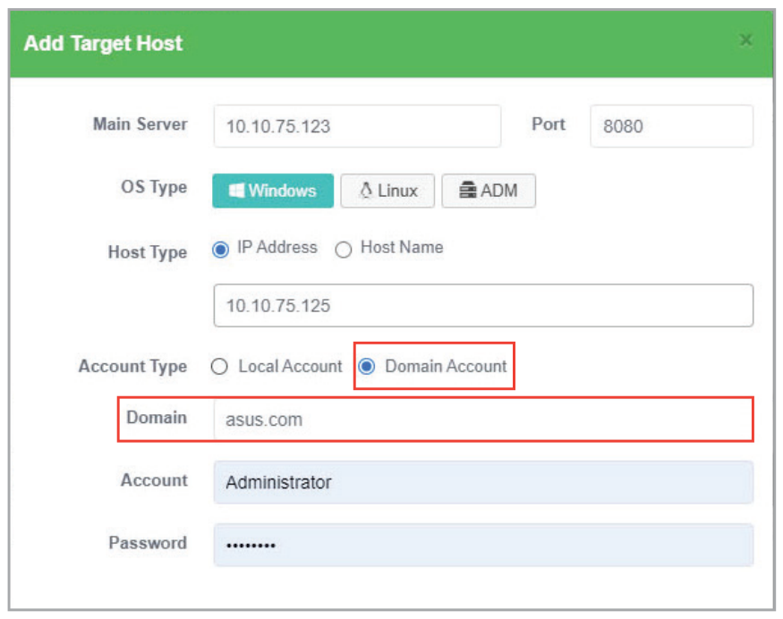

5. Enter the **Account** and **Password** for the administrator account or root account of the device, then click on **Save**.

    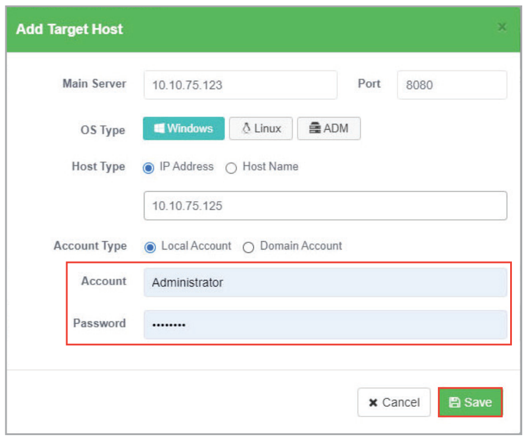

6. Repeat steps 1 to 5 to add additional devices to be scanned, or refer to the **To add multiple devices** section to import a list of devices.
7. Once you have added all the devices to scan for, click on **Scan**.

    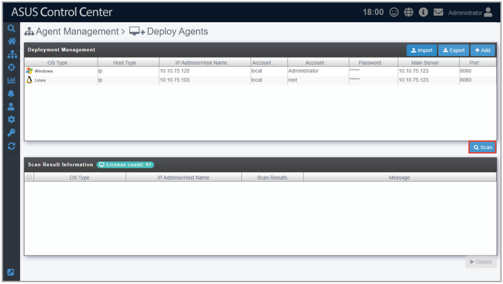

8. The scanned results will be displayed in the **Scan Result Information** block. Select the devices you wish to deploy agent then click **Deploy**.

    > **NOTE:** Unavailable devices will be listed as **Not Support**. You may click on the device to view details on why it is unavailable.

    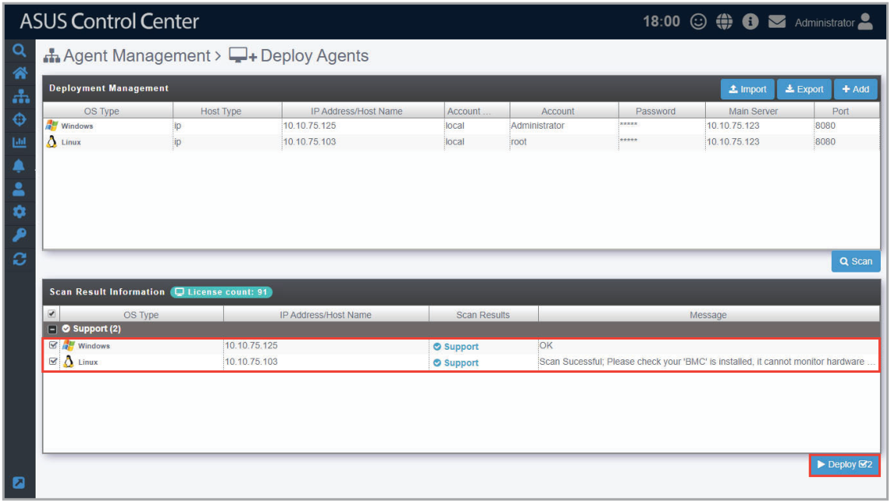

## Adding devices from CSV file

1. Click on **Import**.

    

2. Select the CSV file to import and click **Open**.

    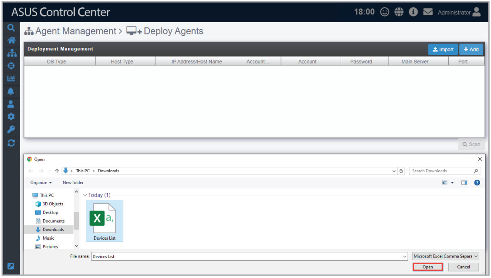

3. Once the CSV file is successfully imported, click on **Scan**.

    > **NOTE:** You may edit items added by clicking on it before scanning.

    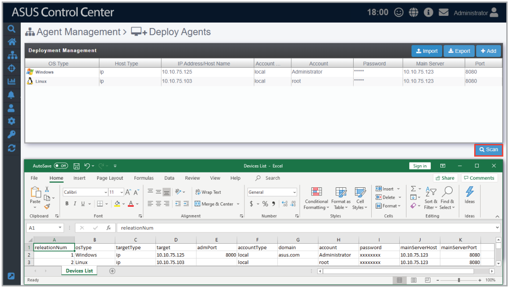

4. The scanned results will be displayed in the **Scan Result Information** block. Select the devices you wish to deploy agent then click **Deploy**.

    > **NOTE:** Unavailable devices will be listed as **Not Support**. You may click on the device to view details on why it is unavailable.

    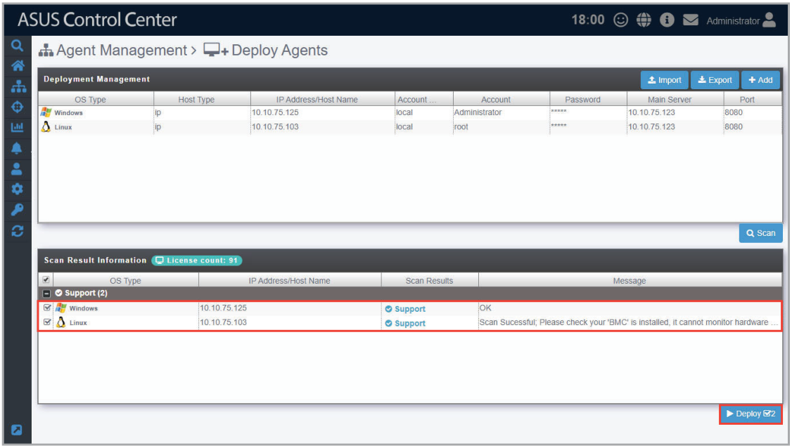

## Exporting Deployment Management list

You can export the list of devices added to the **Deployment Management** list to a CSV file by clicking on **Export**. You can edit the exported CSV file using a text editor.

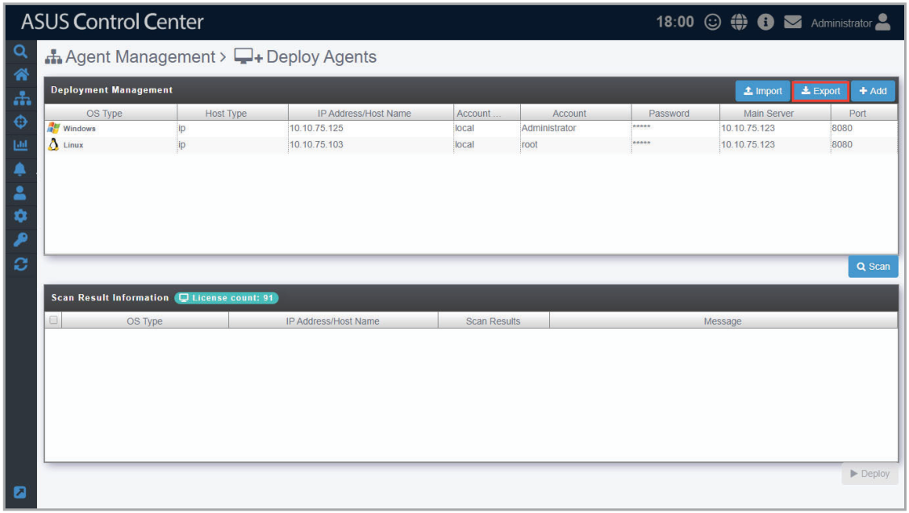
