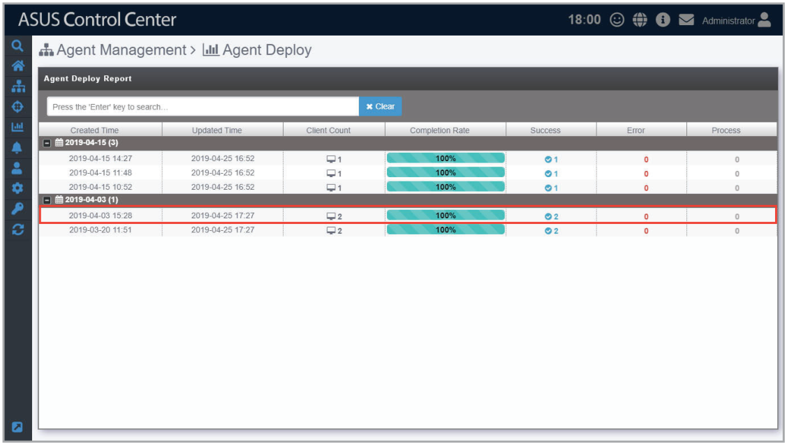
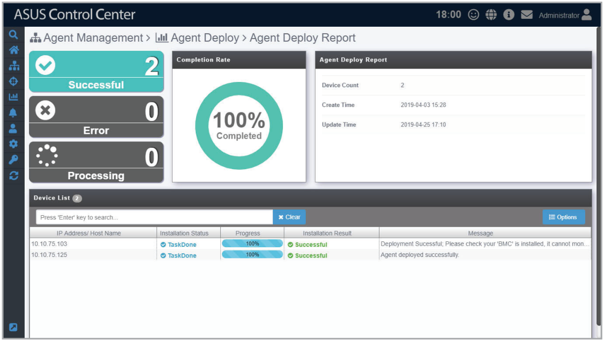

# Agent Deploy Report

The Agent Deploy Report will display information of each time you deploy agent(s) onto managed devices. Each item showed on the **Agent Deploy Report** represents a single batch of deployment; clicking on each item will allow you to view information on the devices you deployed agents to in that batch.

