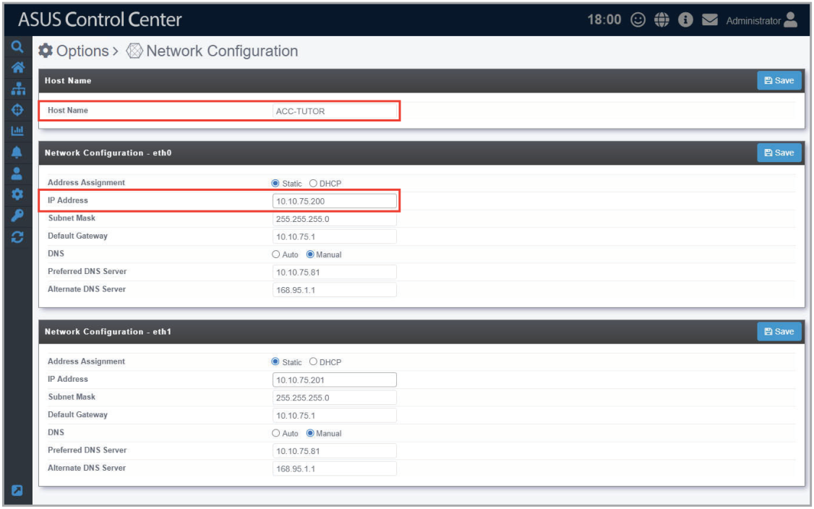

# Linux Agent

You may install agents manually on the device by downloading the Linux Agent installation files from the ASUS Control Center web console. The following 64-bits Linux distributions are supported: RHEL, CentOS, Scientific Linux, SLES, Ubuntu, Debian, and Pardus.

## Install Linux agents manually

1. Before installing the Linux agents manually, ensure that ssh is enabled, and the following software requirements are met:

    ```
    sysstat smartmontools ethtool curl
    ipmitool OpenIPMI-libs OpenIPMI-tools pciutils
    net-tools ssh
    for RHEL 8~, CentOS 8~ : libnsl package installation required
    for SLES 15~ : insserv-compat installation required
    ```

2. Click on **Linux Agent** to download Linux Agent installation files.
3. On ASUS Control Center, click  in the left menu, then click on **Network Configuration** to view the **Host Name** and **IP Address**.

    

4. On your client device, create the folder `/tmp/ASWMAgentInstallFile`.
5. Decompress the LinuxAgent.zip file, you should see a .tar file named **ASWMLinuxAgent-64bits.tar.gz**. Move the .tar file to `/tmp/ASWMAgentInstallFile` then decompress it.
6. Depending on your Linux distribution, execute the following to start the installation process:

    - For RHEL, CentOS, Scientific Linux

        Execute `/tmp/ASWMAgentInstallFile/Silentinstall_RHEL.sh XXXX.XXX.XXX.XXX`

    - For SLES

        Execute `/tmp/ASWMAgentInstallFile/Silentinstall_SLES.sh XXXX.XXX.XXX.XXX`

    - For Ubuntu, Debian, Pardus

        Execute `/tmp/ASWMAgentInstallFile/SilentInstall_Ubuntu.sh XXX.XXX.XXX.XXX`

    > **NOTE:** Please replace XXX.XXX.XXX.XXX with the actual IP of the ACC main server, for this example, it would be 10.10.75.200.
