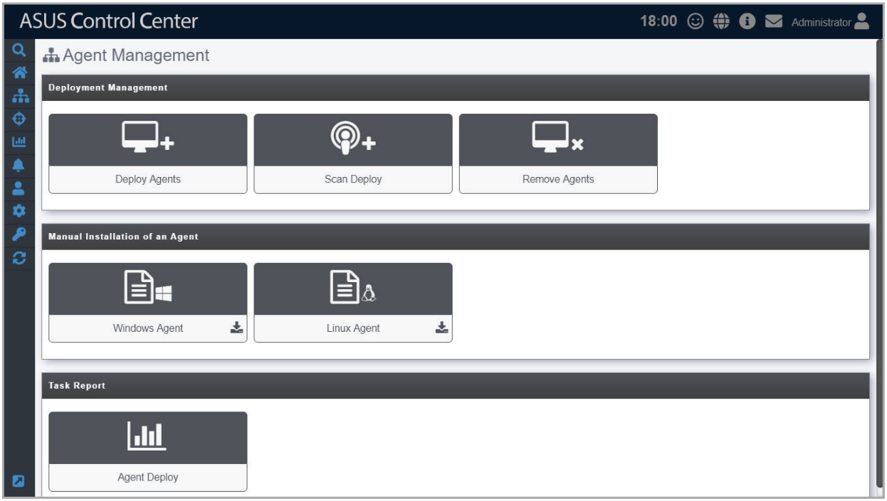

# Agent Management

The **Agent Management** screen allows you to manage agent deployment, removal or view the Agent Deploy Report. You can automatically or manually deploy and install new ASUS Control Center agents on devices and add them to the ASUS Control Center server for convenient management, monitor and control.

Refer to the **Appendix** for more details on the ASUS Control Center agent system requirements.

To access **Agent Management**, click  > **Agent Management** in the left menu.

**Using the search bar and search options**

Refer to the **Search Options** and **Search and Filter Devices** sections of the **Monitor** chapter for more information.
