# Remove Agents

The **Remove Agents** function will allow you to remove agents installed on managed devices using ASUS Control Center, or allow you to remove the managed devices from ASUS Control Center after you remove the clients manually from the managed devices.

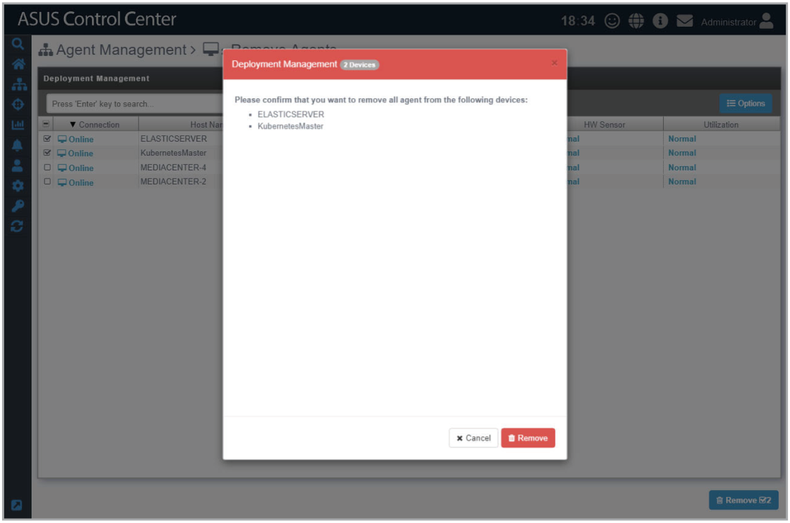

## Remove agents using ASUS Control Center

1. Check the devices you wish to remove agents from on the list.

    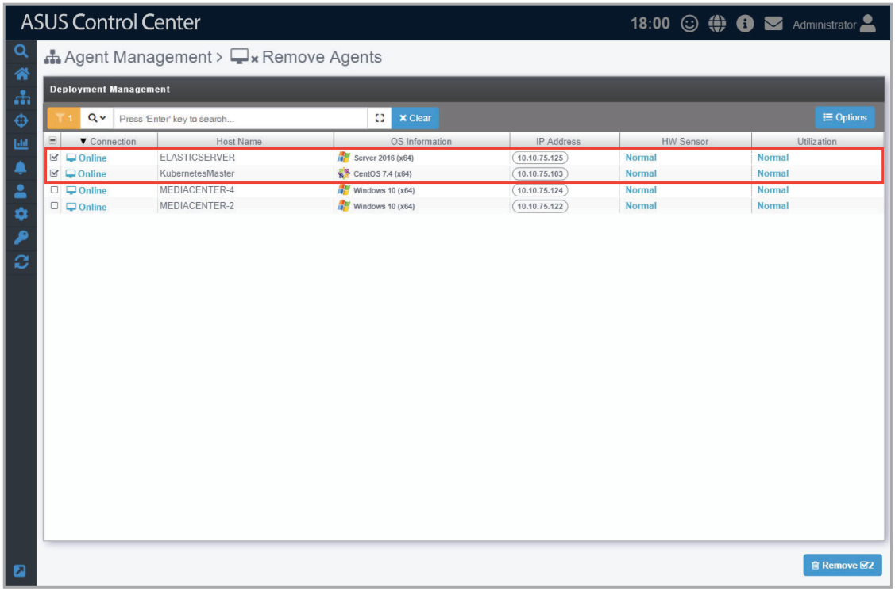

2. A pop-up window should appear, displaying the devices you wish to remove agents from. After confirming the correct managed devices are selected, click on **Remove**, then click on **OK**.

    > **NOTE:** If the target host(s) are offline, the agents on these host(s) will be removed once the host(s) are online.

    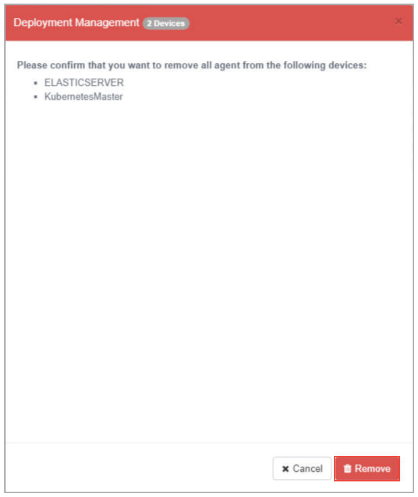

    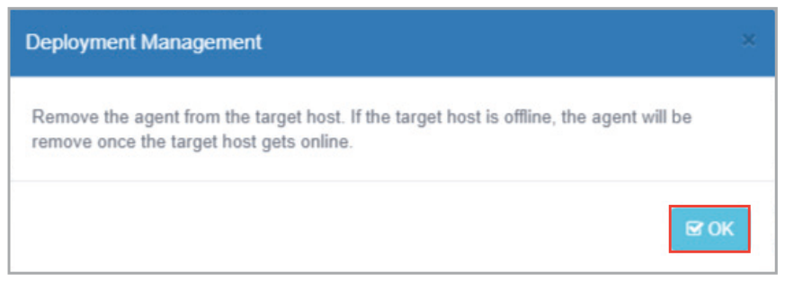

## Remove Windows Agent from local device

You may choose to remove Agents from Windows systems manually.

1. To remove the Windows Agent manually on a managed device, click on **Control Panel > Programs and Features**.

    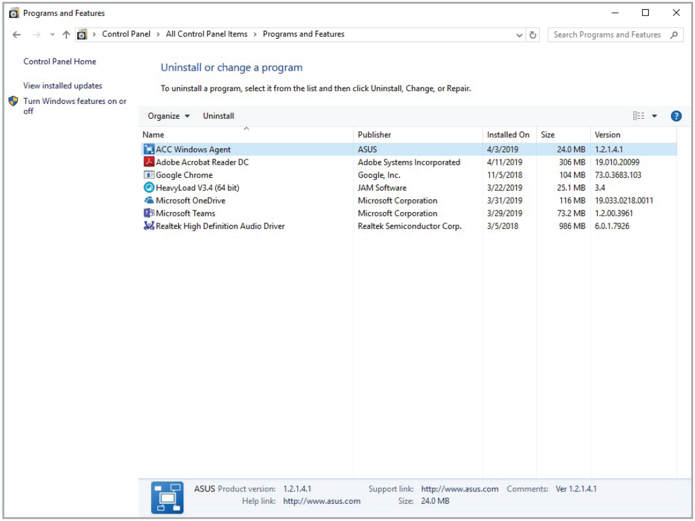

2. Select and uninstall **ACC Windows Agent** from the list of programs.

    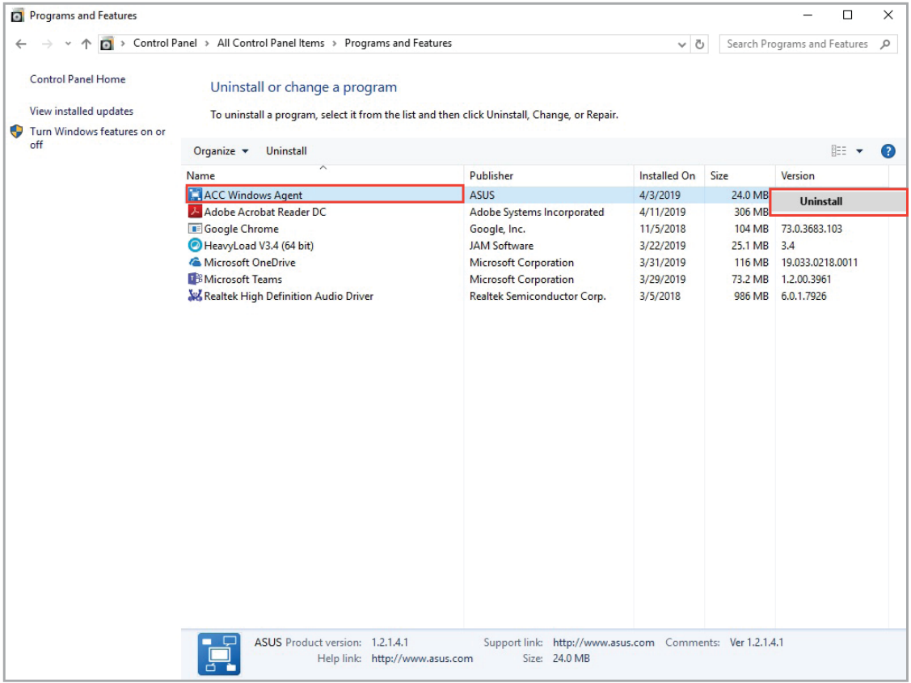

3. Ensure the applications shown in the pop-up window are closed, or you can check the **Automatically close applications and attempt to restart them after setup is complete** checkbox, then click **OK** to continue with the uninstallation process.

    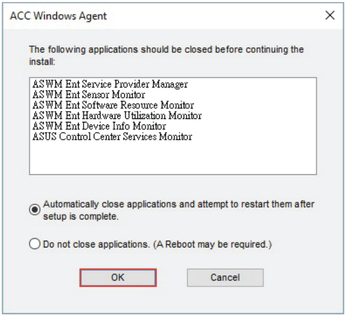

4. Once **ACC Windows Agent** is uninstalled on the managed device, please navigate to the **Remove Agents** menu of your ASUS Control Center (**Deployment** > **Agent Management** > **Remove Agents**).
5. Select the managed device which you manually removed the agent from, the connection status for that managed device should be **Offline**, then click on **Remove** to remove the managed device from ASUS Control Center.

    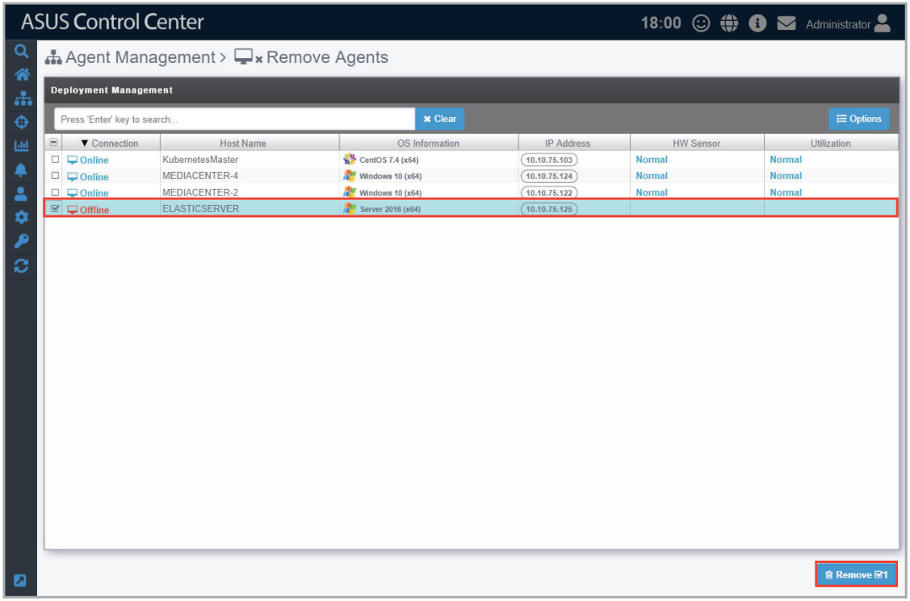

6. A pop-up window should appear, displaying the managed devices you wish to remove agents from. After confirming the correct devices are selected, click on **Remove**, then click on **OK**.

    

    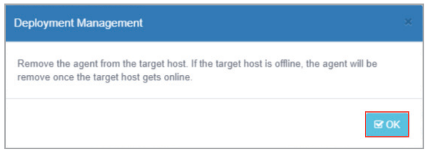

## Remove Linux Agent from local device

You may choose to remove Linux Agents from Linux systems manually.

1. (optional) If you are using a Windows OS, you may use a third-party SSH or telnet client such as PuTTY to connect to the managed Linux device.

    For this example we will be using PuTTY to log on to the managed Linux device and remove the Linux Agent.

    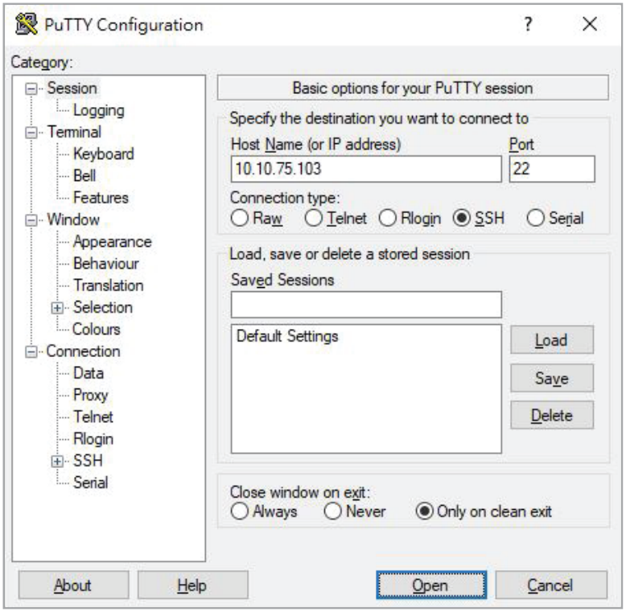

2. Enter the root account and password of the client Linux device.
3. Once you've logged in, execute `bash /root/uninstall.sh` to remove the Linux Agent from the managed device.
4. Once the Linux Agent is removed on the managed device, please navigate to the **Remove Agents** menu of your ASUS Control Center (**Deployment** > **Agent Management** > **Remove Agents**).
5. Select the managed device which you manually removed the agent from, the connection status for that managed device should be **Offline**, then click on **Remove** to remove the managed device from ASUS Control Center.

    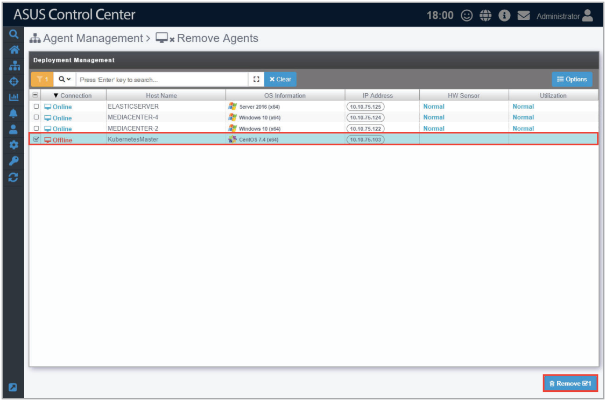

6. A pop-up window should appear, displaying the devices you wish to remove agents from. After confirming the correct devices are selected, click on **Remove**, then click on **OK**.

    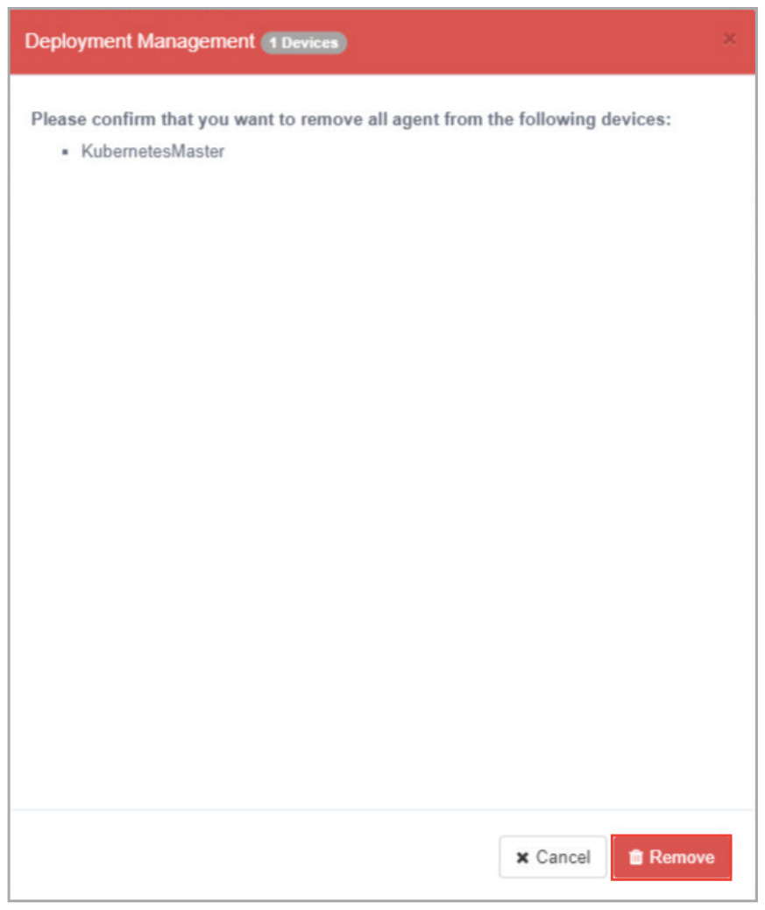

    
