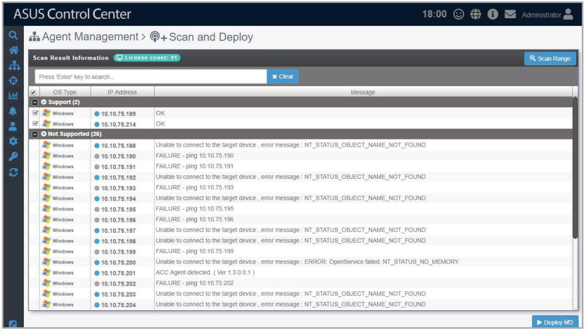
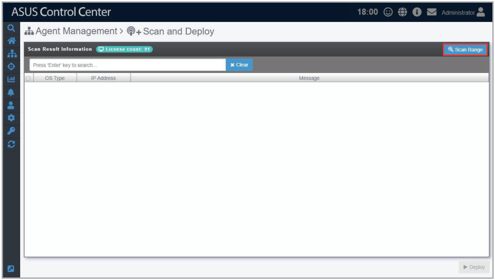
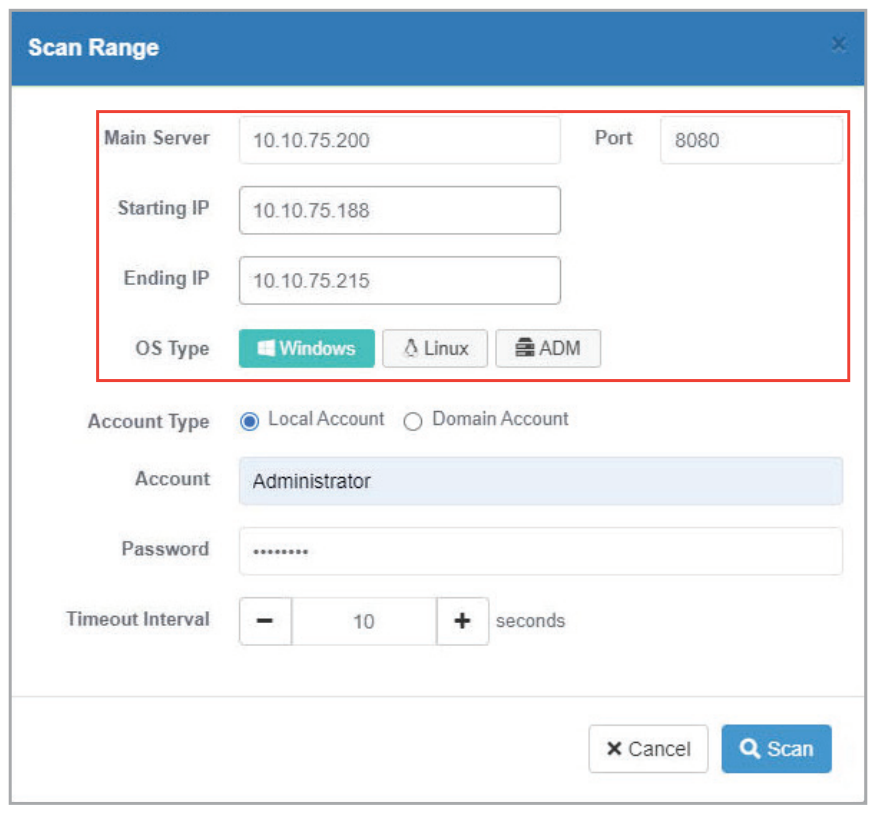
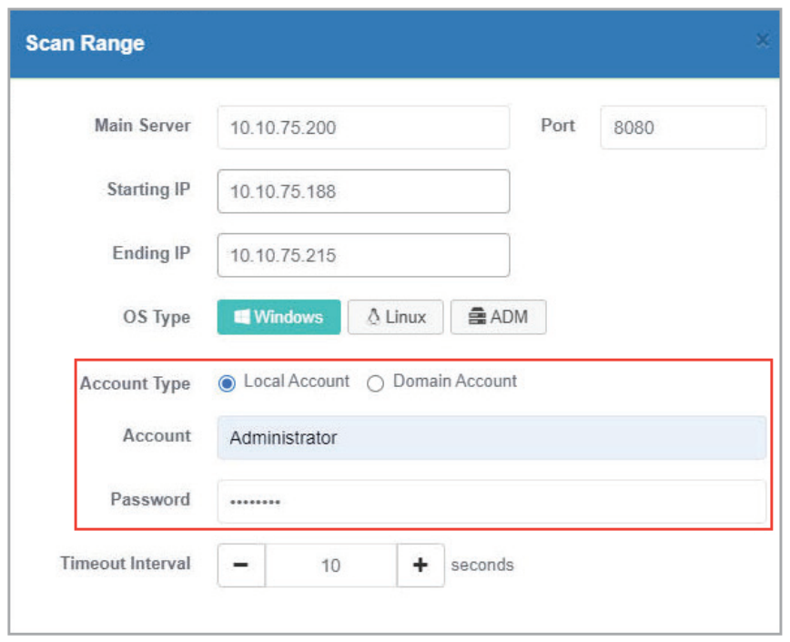
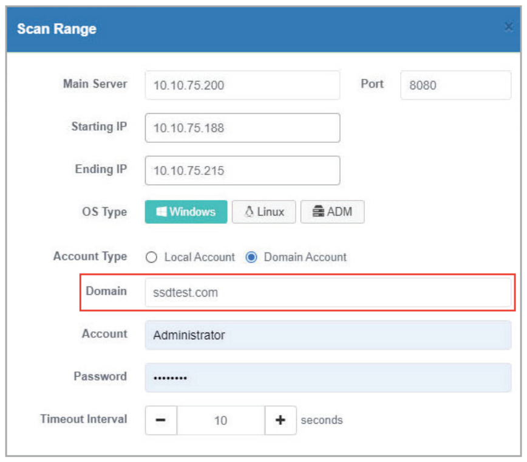
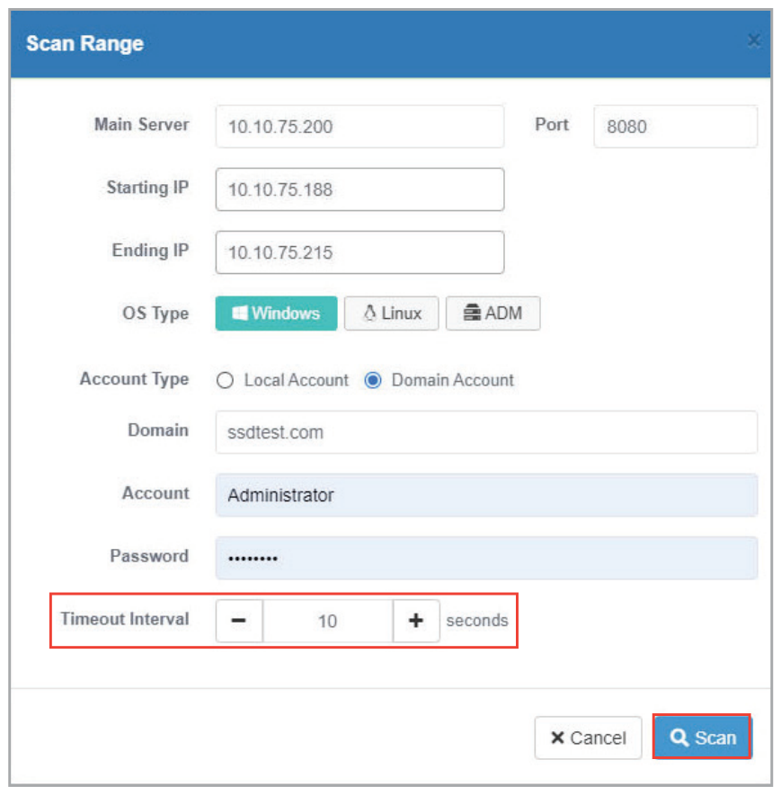
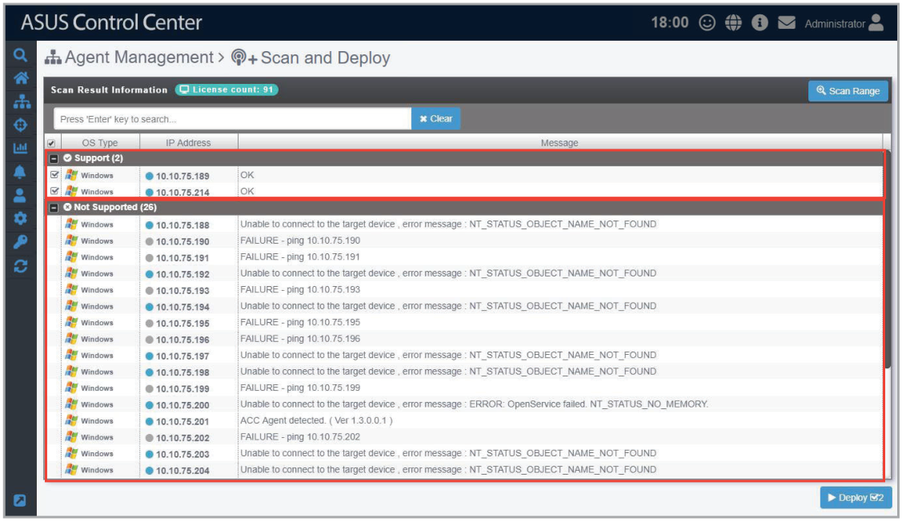
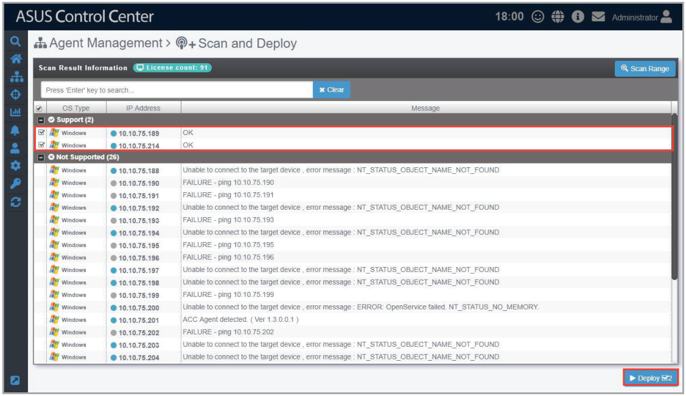
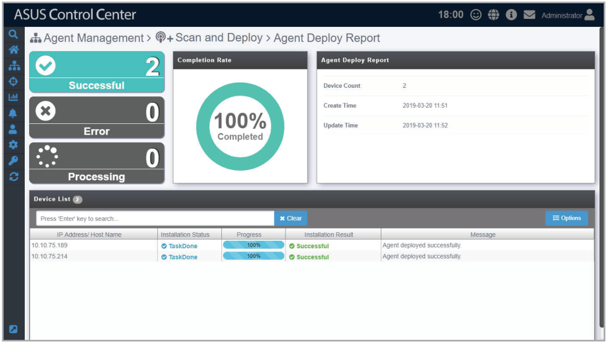

# Scan and Deploy

The **Scan and Deploy** function allows you to scan an IP range and display the managed devices which meet your set requirements for agent deployment, these requirements may vary from operating system to and connection status.

The scanned results also show which devices you can deploy new agents to and the devices you cannot deploy too as well as the reason these devices cannot be deployed to.

This makes it easy for you to quickly filter out all managed devices you wish to deploy agents to and then deploy agents to selected devices, saving you the time taken to manually deploy agents to each managed device individually.

> **IMPORTANT:** Before using the **Scan and Deploy** function, ensure that the agent deployment conditions and settings are met, for more information please refer to **Agent deployment conditions and settings** in the **Deploy Agents** section.

## Scanning for managed devices and deploying agents

1. Click on **Scan Range** to bring up the scan range pop-up window.

    

2. Enter the Main Server address, port number, the IP range you wish to scan, and the managed device OS type you would like to scan.

    

3. Select the **Local Account** or **Domain Account** in the **Account Type** field, and enter an account and password that the ASUS Control Center will use to log onto the devices scanned.

    > **IMPORTANT:** The account and password entered should be for an account that has administrator or root privileges on managed devices. For more information on activating the administrator account on managed devices, please refer to **Agent deployment conditions and settings** under the **Deploy Agents** section.

    

    Selecting **Domain Account** will also allow you to enter the domain name and import the domain information when agents are deployed to the selected scanned devices. This provides you with more control over your managed devices.

    

4. Set the **Timeout Interval**, this will determine the duration of time the scanned devices should be scanned before returning the scan results. Then click on **Scan**.

    

5. The scan results will display which devices you can deploy agents to and also the devices which cannot be deployed as well as the reasons they cannot be deployed to, for more information on agent deployment conditions, please refer to the **Deploy Agents** section.

    

6. Check the scanned devices in the **Support** window you wish to deploy agents to and click on **Deploy**.

    

7. Once the agents deployment has finished, a **Agent Deploy Report** will appear, detailing the deploy status of each selected device. This will help you check if all agents have been successfully deployed.

    
