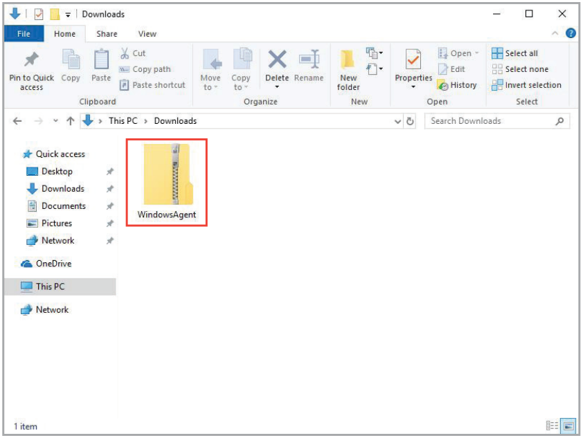
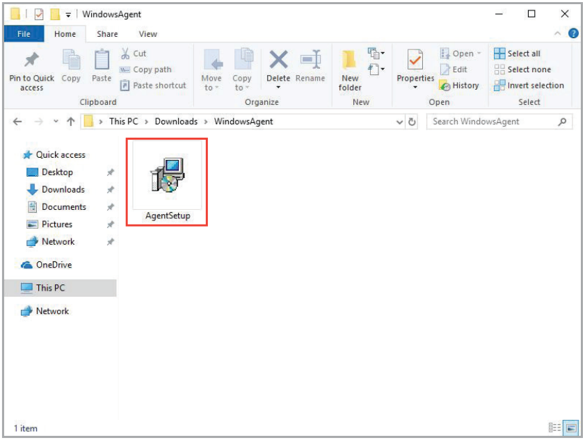
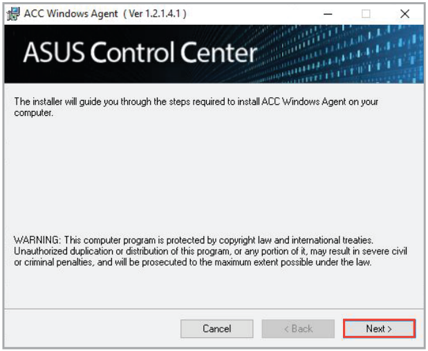
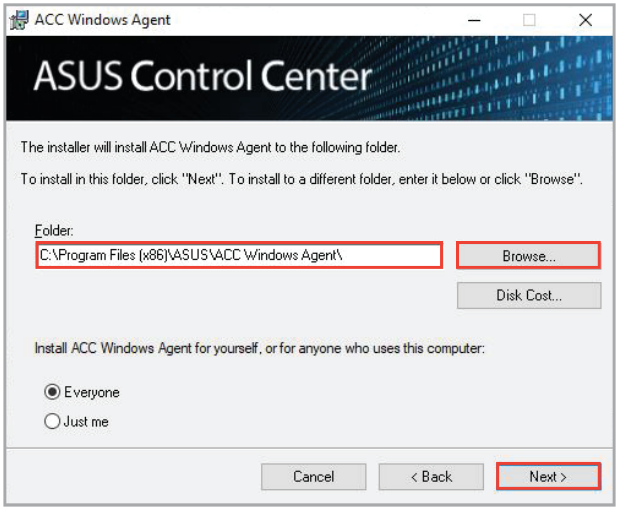
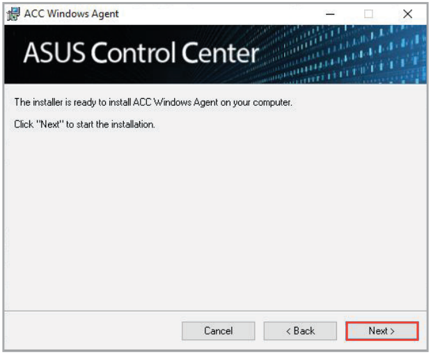
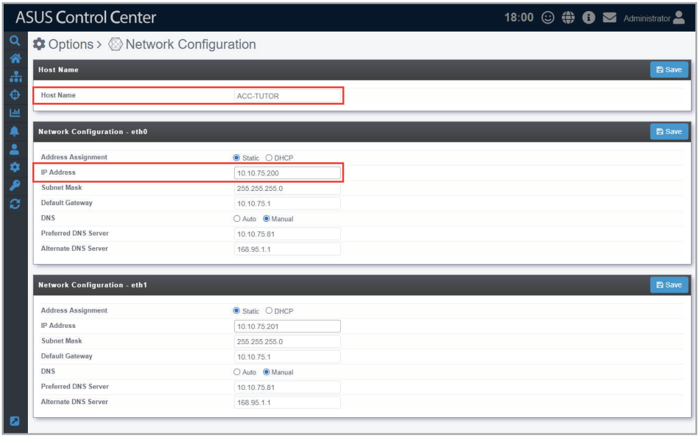
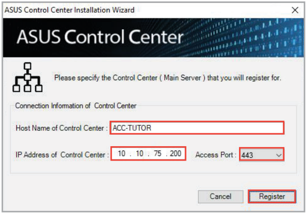
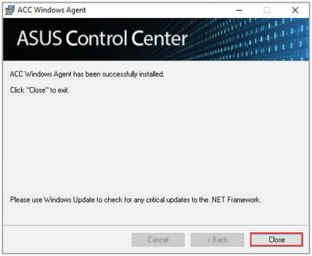

# Windows Agent

You may install agents manually on the device by downloading the Windows Agent installation files from the ASUS Control Center web console.

> **IMPORTANT:** CSM products only supports Windows Agents.

> **NOTE:** The information entered in this section is for reference only.

## Install Windows agents manually

> **IMPORTANT:**
>
> - When installing the Windows agent manually on devices with Windows 11 or Server 2022, two of the drivers - AsUpIO.sys (BIOS readings and flashing), and ASUS Management Bus Driver (Hardware Sensor reading) may be isolated by the Windows Core Isolation feature.
> - To successfully install a Windows Agent if you run into this situation you will need to set the **Memory integrity** option under **Core Isolation** to **Off**, to do so please navigate to **Start** > **Settings** > **Update & Security** > **Windows Security** > **Device Security** and then under **Core isolation**, select **Core isolation details** and set **Memory integrity** to **Off**.

1. Log in remotely to the device you wish to install the Windows Agent on.
2. Download the Windows Agent installation files using the following methods.

    - Download installation files on ASUS Control Center

        - **a.** Click on **Windows Agent** to start downloading the installation files.
        - **b.** Copy the downloaded ZIP file to the remote desktop of the device.

    - Download installation files on managed device

        - **a.** Use the browser on the managed device to log into ASUS Control Center.
        - **b.** Click on **Windows Agent** to start downloading the installation files.

3. Unzip the ZIP file containing the installation files.

    

4. Click on the **AgentSetup.msi** file to launch the installation.

    

5. Click on **Next** to begin the installation.

    

6. Browse and select a folder to install the agent, then click **Next**.

    

7. Click on **Next** again to continue the installation.

    

8. On ASUS Control Center, click  in the left menu, then click on **Network Configuration** to view the **Host Name** and **IP Address**.

    

9. Enter the **Host Name** and **IP Address** from the previous step into the Windows® Agent Installer, select **443** as the **Access Port**, then click **Register**.

    > **NOTE:** The host name field supports Fully Qualified Domain Names (FQDN). The ASUS Control Center IP can be pinged via the host name during deployment.

    

10. Wait for the installation to finish, then click **Close** to complete the installation. The device(s) should appear in the **Devices List** on the **System Overview** screen.

    > **NOTE:** The device's hardware performance and network speed will affect the time taken to deploy the agent.

    
