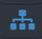
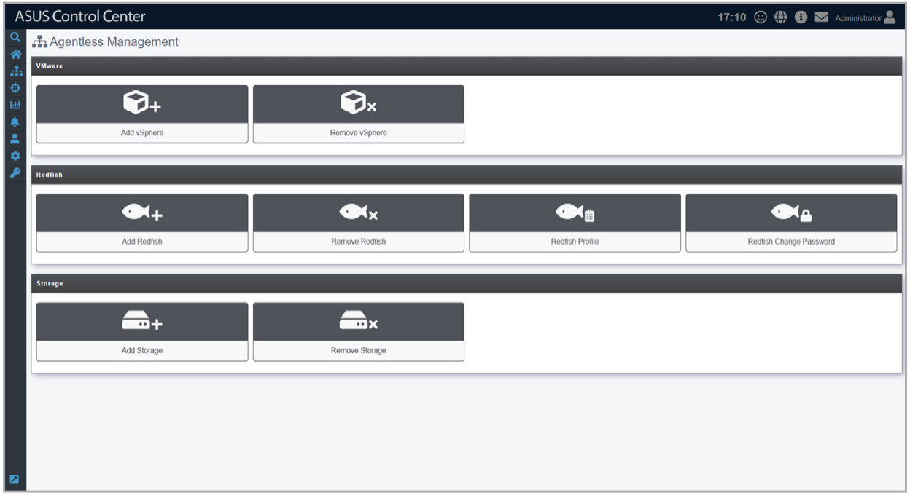

# Agentless Management

The **Agentless Management** screen allows you to add vSphere or Redfish for monitoring and other management options. When adding the vSphere, the device added is the hypervisor. All VM on the hypervisor will be displayed once the vSphere has been added.

To access **Agentless Management**, click  > **Agentless Management** in the left menu.

**Using the search bar and search options**

Refer to the **Search Options** and **Search and Filter Devices** sections of the **Monitor** chapter for more information.
