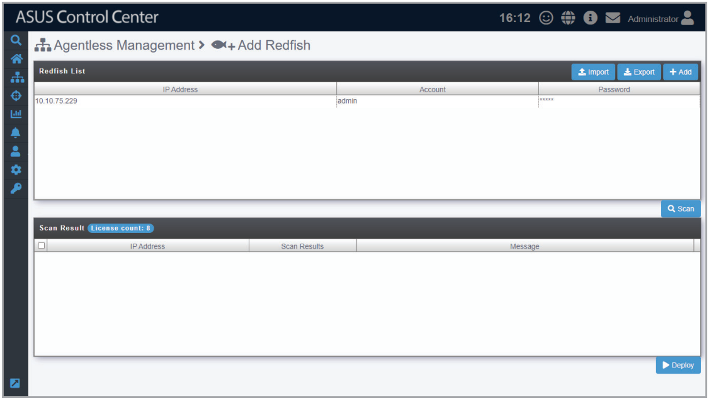
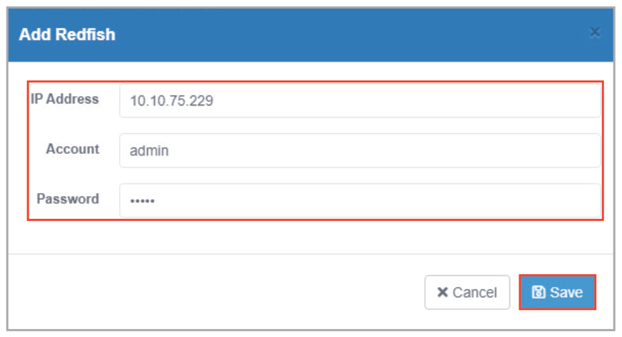
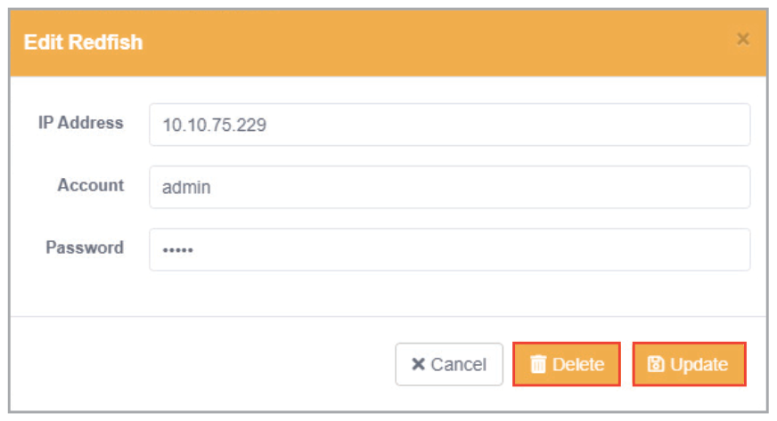
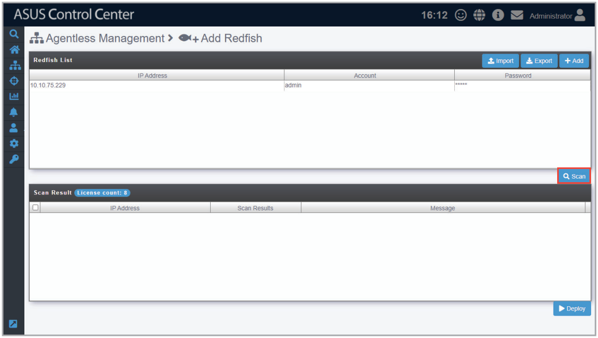
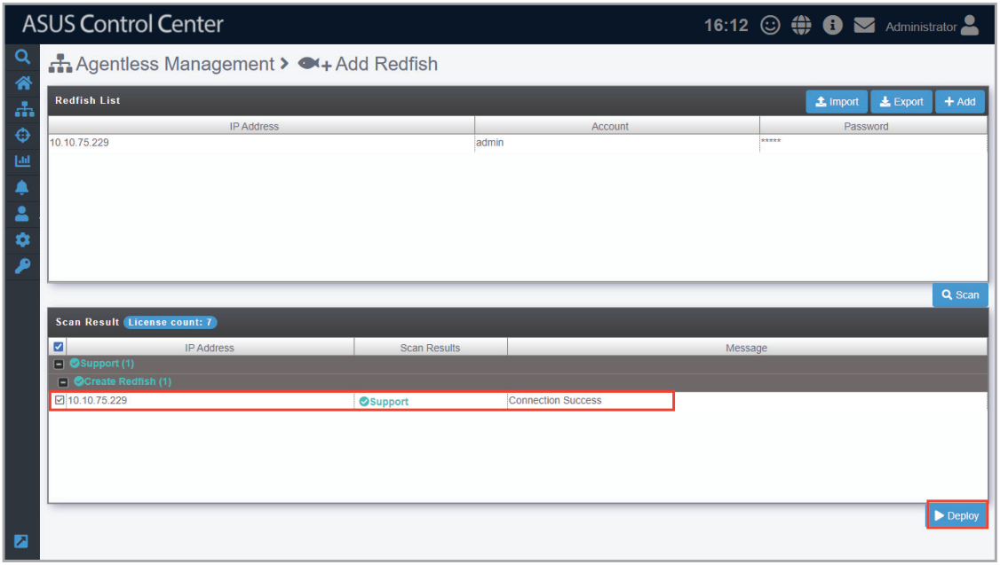
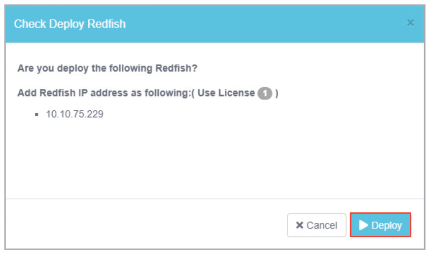
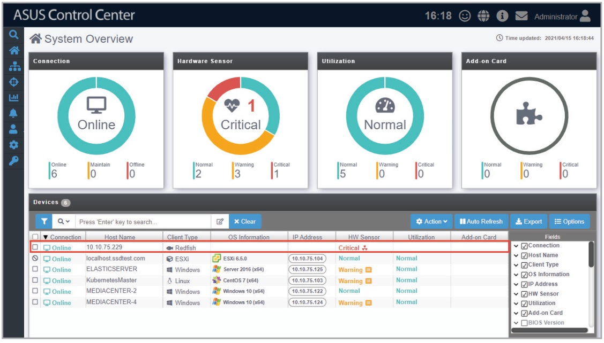
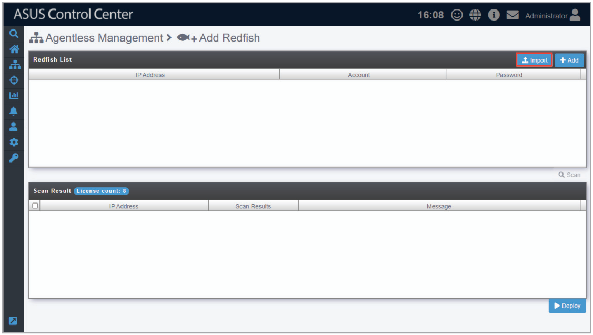

# Add Redfish

The **Add Redfish** function allows you to add Redfish devices you wish to manage. You can enter a single Redfish device, or multiple Redfish devices to be scanned, and then add the scanned Redfish devices you wish to manage to ASUS Control Center.

> **NOTE:** Ensure to register the License keys before adding the Redfish device you wish to manage to ASUS Control Center. For more information on registering license keys, please refer to the **License** chapter.

## Adding managed Redfish device

1. Click on **Add**.

    

2. Enter the **IP Address**, **Account**, and **Password** of the Redfish device, then click **Save**.

    

3. Repeat steps 1 and 2 to add additional Redfish devicees to be scanned, or refer to the **Add Redfish devices from CSV file** section to import a list of Redfish devices.
4. (optional) You may edit or delete Redfish devices added before scanning by clicking on the Redfish device in the **Redfish List**.

    

5. Once you have added all the Redfish devices you wish to scan, click on **Scan**.

    

6. The scanned results will be displayed in the **Scan Result** block. Select the Redfish devices you wish to manage then click **Deploy**.

    > **NOTE:** Unavailable Redfish devices will be listed as **Not Support**. You may click on the Redfish device to view details on why it is unavailable.

    

7. A pop-up window should appear, displaying the devices you wish to deploy agents to. After confirming the correct devices are selected, click on **Deploy**, then click **OK**.

    

8. The Redfish devices added should appear in the **Devices List** on the **System Overview** screen.

    > **NOTE:** Redfish devices added may take a few minutes before they are displayed in the overview.

    

## Adding Redfish devices from a CSV file

1. Click on **Import**.

    

2. Select the CSV file to import and click **Open**.
3. Once the CSV file is successfully imported, click on **Scan**.

    > **NOTE:** You may edit items added by clicking on it before scanning.

4. The scanned results will be displayed in the **Scan Result** block. Select the Redfish devices you wish to manage then click **Deploy**.
5. A pop-up window should appear, displaying the devices you wish to deploy agents to. After confirming the correct devices are selected, click on **Deploy**, then click **OK**.
6. The Redfish devices added should appear in the **Devices List** on the **System Overview** screen.

    > **NOTE:** Redfish devices added may take a few minutes before they are displayed in the overview.
