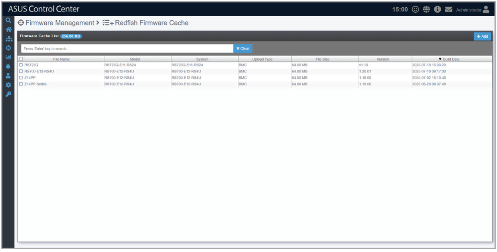
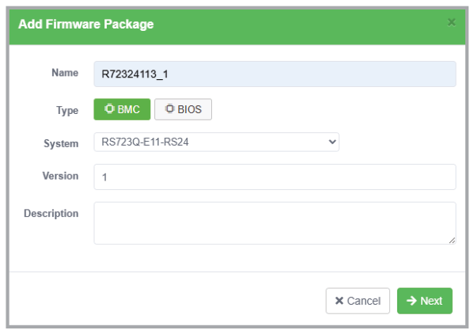
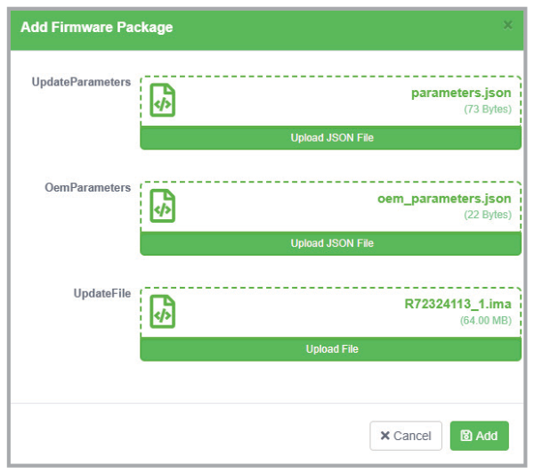

# Redfish Firmware Cache

This page allows you to upload BIOS and BMC firmware packages for use with the **Redfish Firmware Update** function.

## Uploading a firmware package

1. Click **Add** and fill in the Name, Type, System, Version, and Description fields, then click **Next**.
2. Upload the Update/OEM parameters (as JSON files) and firmware package files, then click **Add**.

    

    

## Removing a firmware package

1. Select one or more firmware packages and click **Remove**, then confirm the removal when prompted.
