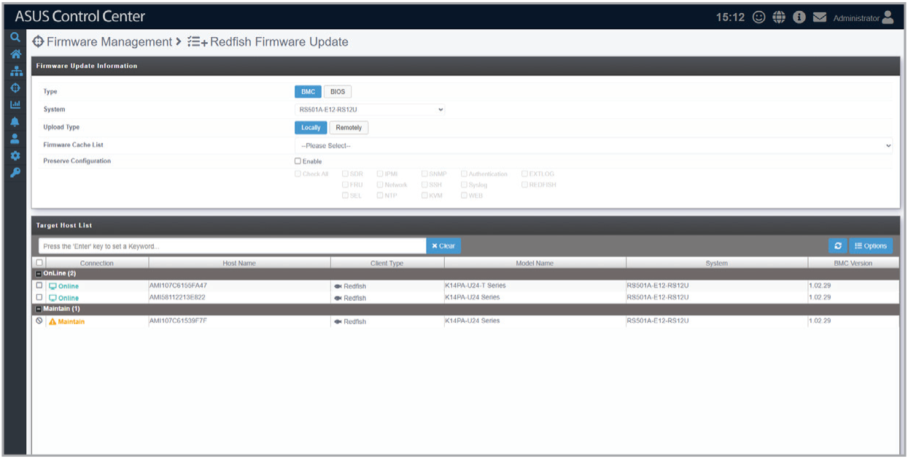

# Redfish Firmware Update

This page allows you to initiate an out-of-band firmware update using Redfish.

## Updating BMC firmware

1. Select **BMC** in the **Firmware Update Information** block, then select a system and upload type.
2. If the **Upload Type** is set to **Remotely**, select a protocol and enter the address of the image in the **Protocol** and **Image URI** fields.
3. Select an update package from the **Firmware Cache List** dropdown menu.
4. To preserve existing configuration settings, tick the **Preserve Configuration** checkbox and the individual checkboxes for each type of configuration setting.
5. Select one or more devices in the **Target Host List** block and click **Update**.
6. Check the **Redfish Firmware Update Report** page to see if the scan was successful.

## Updating BIOS firmware

1. Select **BIOS** in the **Firmware Update Information** block, then select a system and upload type.
2. Select an update package from the **Firmware Cache List** dropdown menu.
3. Select one or more devices in the **Target Host List** block and click **Update**.
4. Check the **Redfish Firmware Update Report** page to see if the scan was successful.
