# Redfish Profile

The **Redfish Profile** function allows you to add, edit, or delete Redfish profiles.

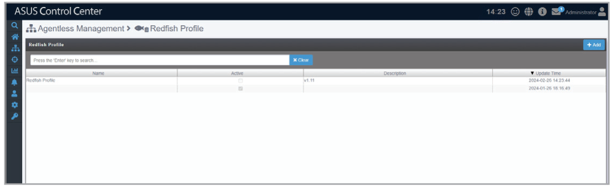

## Adding a Redfish profile by importing a profile file

1. Click **Add**.

    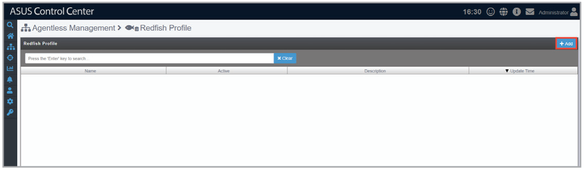

2. Click **Import**.

    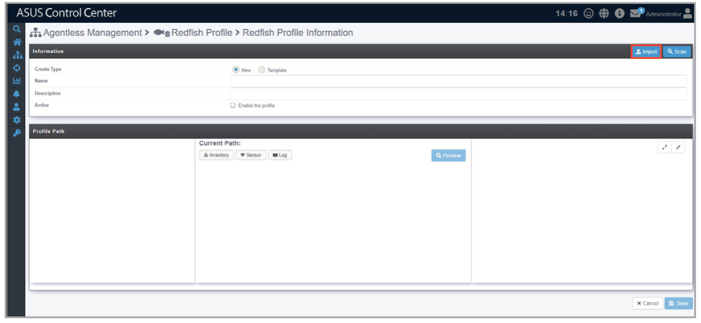

3. Select a Redfish profile JSON file, then click **Open**.

    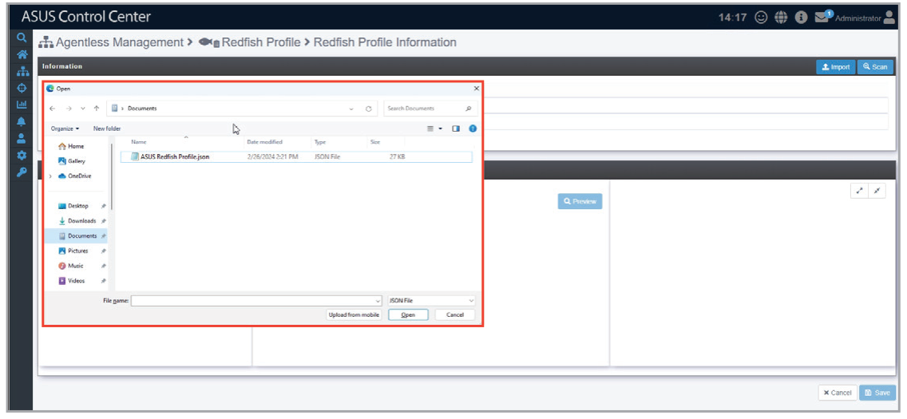

4. Fill in the **Name** and **Description** fields (optional) and tick **Enable this profile**, then click **Scan**.

    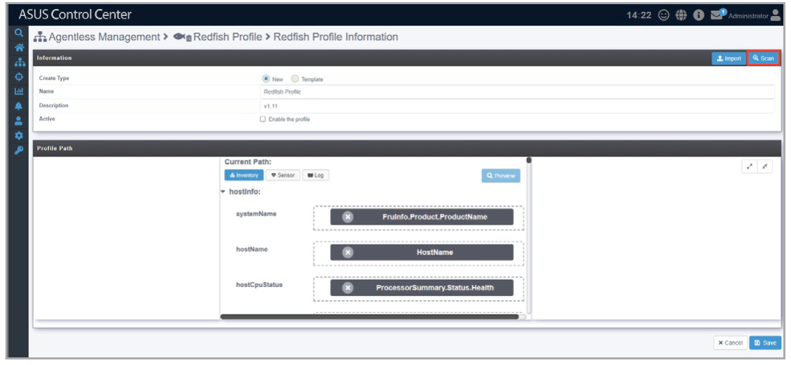

5. Fill in the **IP Address**, **Apply Path**, **Account**, and **Password** fields, then click **Scan**.

    > **NOTE:** If the **Apply Path** field is set to Default, the root directory will be scanned. If set to URI, the specified relative path will be scanned.

    

6. To make changes to the Redfish profile, follow the below instructions:

    - **A.** Drag and drop a property from the left pane to the value field in the middle pane.

        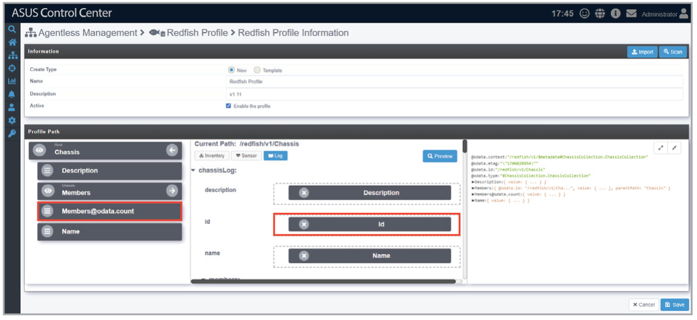

    - **B.** Click **Preview** to show the updated JSON output in the right pane.

        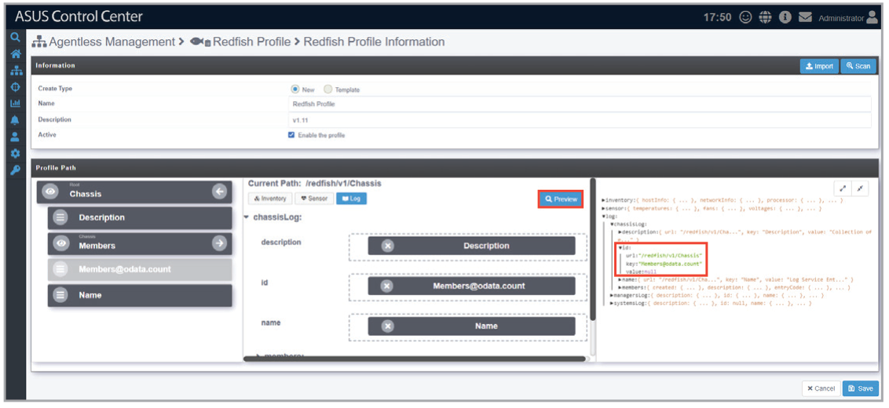

7. Click **Save**.

    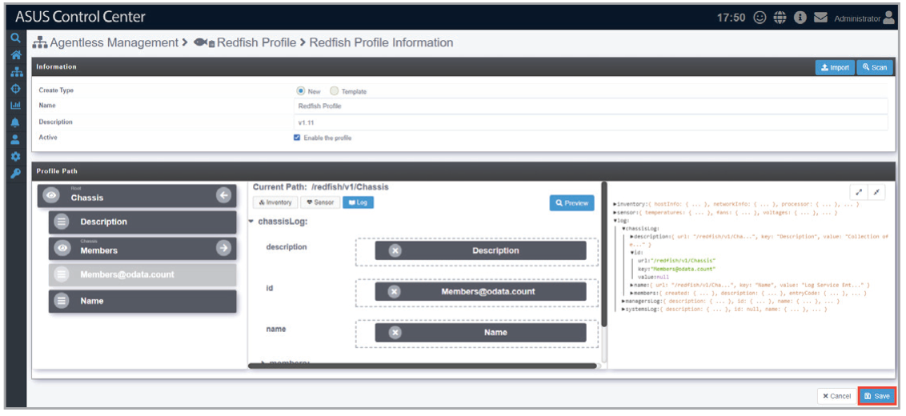

## Adding a Redfish profile from a template

1. Click **Add**.

    

2. Select **Template** in the **Create Type** field, then select a template from the drop down menu.

    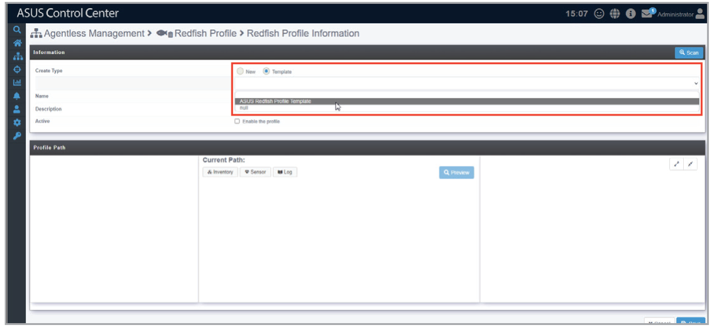

3. Fill in the **Name** and **Description** fields (optional) and tick **Enable this profile**, then click **Scan**.

    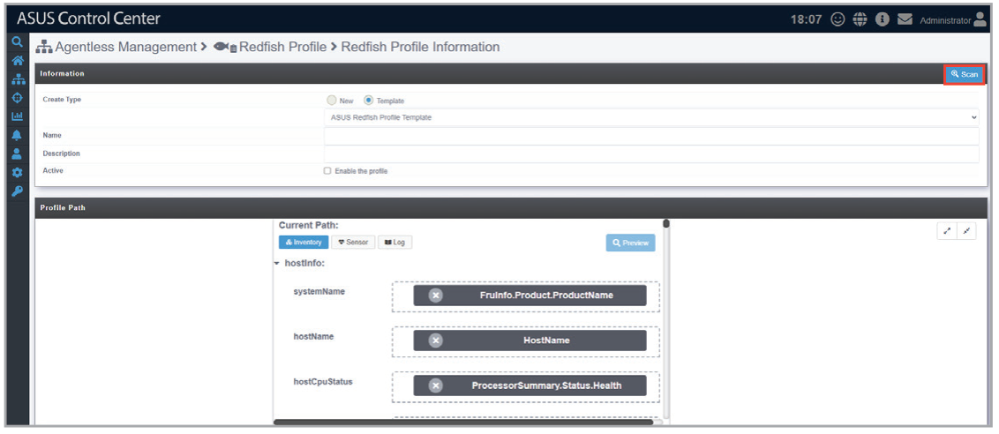

4. Fill in the **IP Address**, **Apply Path**, **Account**, and **Password** fields, then click **Scan**.

    > **NOTE:** If the **Apply Path** field is set to Default, the root directory will be scanned. If set to URI, the specified relative path will be scanned.

    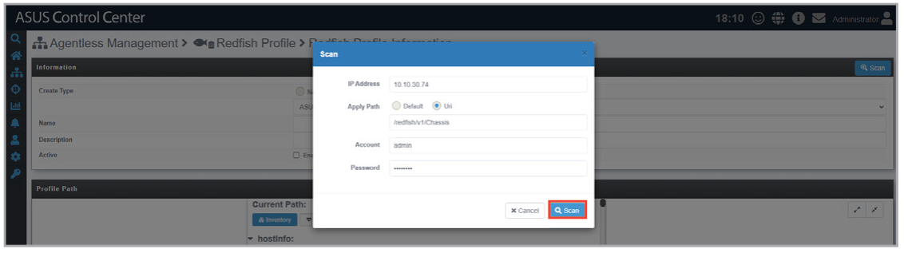

5. To make changes to the Redfish profile, follow the below instructions:

    - **A.** Drag and drop a property from the left pane to the value field in the middle pane.

        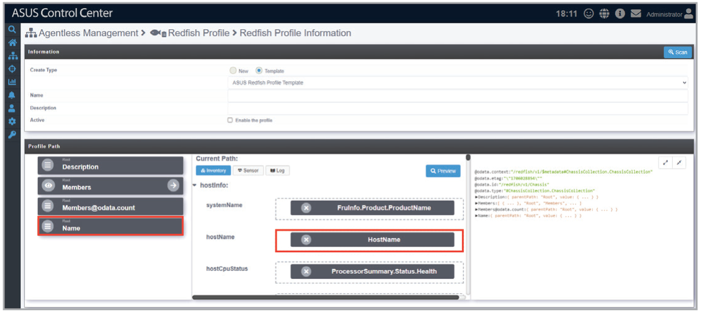

    - **B.** Click **Preview** to show the updated JSON output in the right pane.

        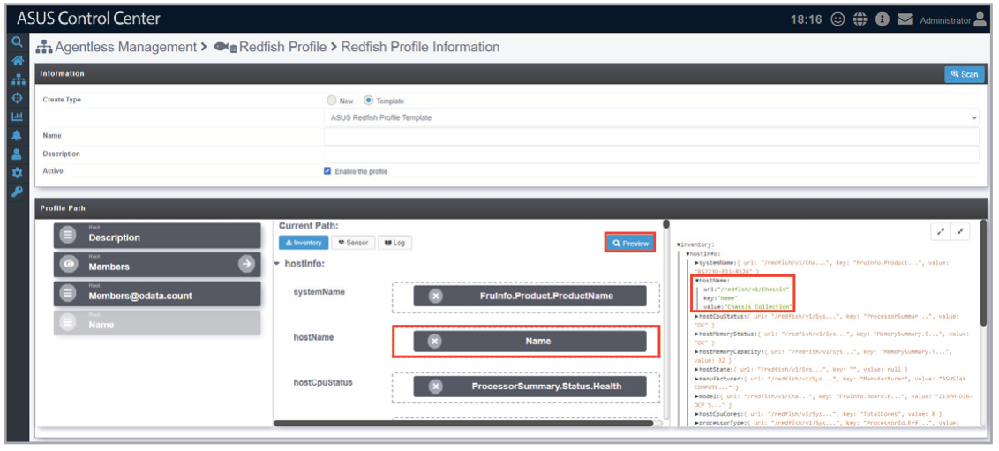

6. Click **Save**.

    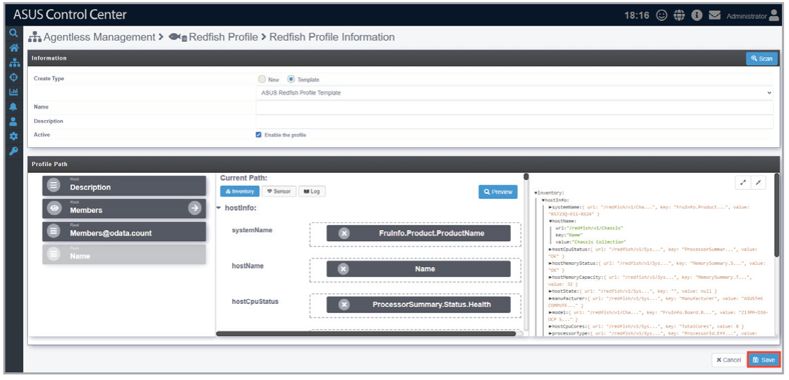

## Editing an existing Redfish profile

1. Select an existing Redfish profile.

    

2. Make the desired changes to the Redfish profile, then click **Save**.

    

## Exporting an existing Redfish profile

1. Select an existing Redfish profile.

    

2. Click **Export**.

    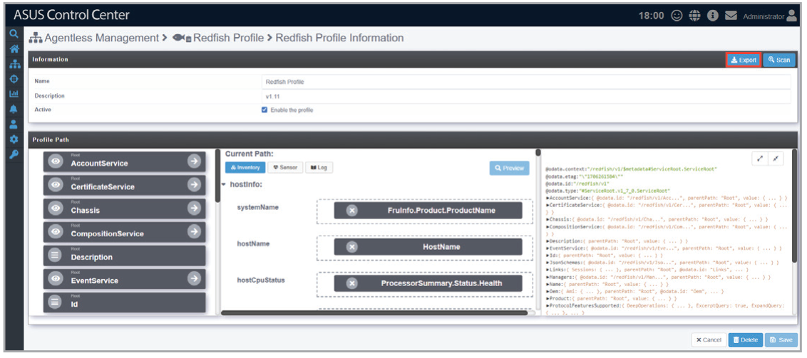

3. Enter a file name for the exported Redfish profile JSON file, then click **OK**.

    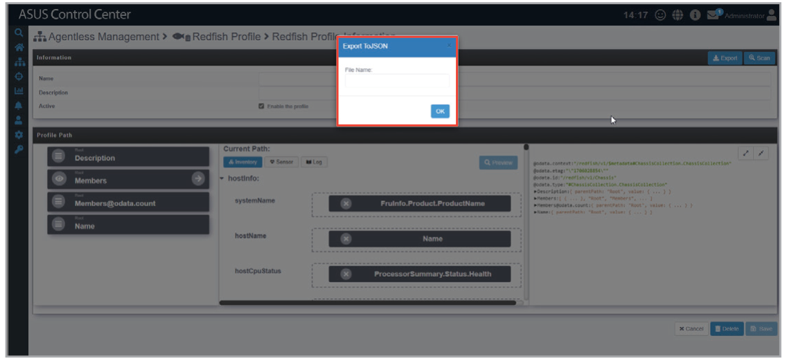

## Deleting an existing Redfish profile

1. Select an existing Redfish profile.

    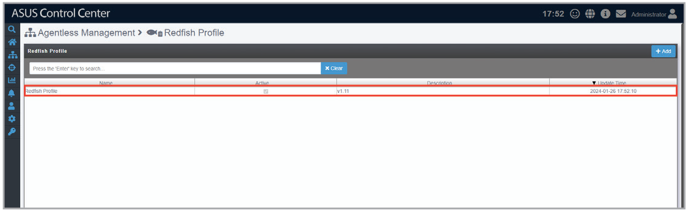

2. Click **Delete**.

    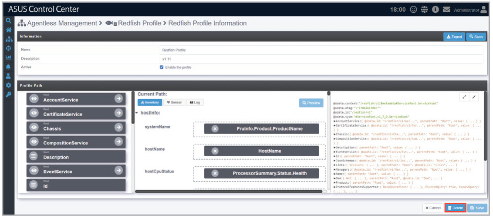
