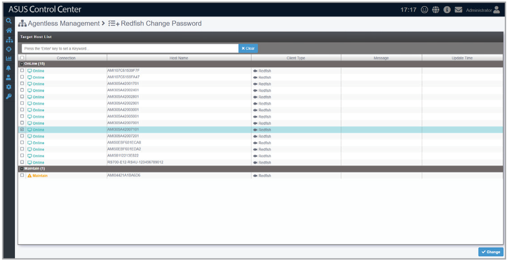
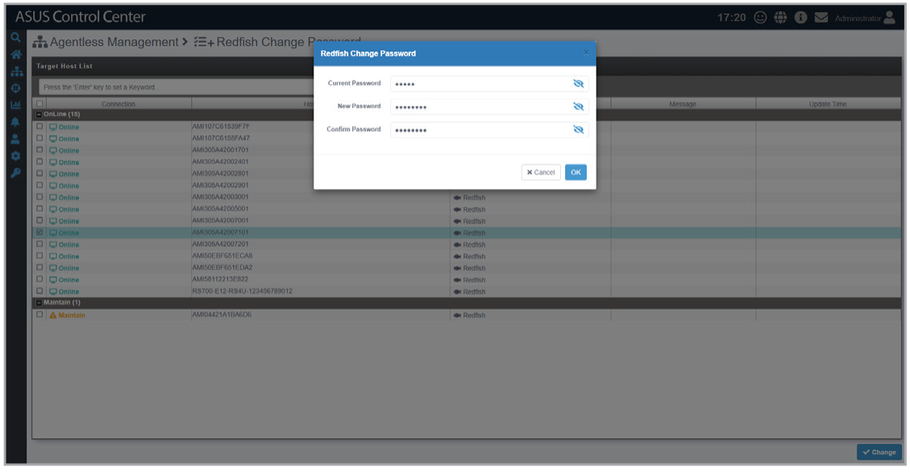

# Redfish Change Password

The **Redfish Change Password** function allows you to modify the Redfish password for devices.

> **NOTE:** If Preserve Configuration was not enabled during a Redfish firmware update, the Redfish password will be reset to the default password.

## Changing a Redfish password

1. Select a Redfish device, then click **Change**.

    

2. Enter the current password and new password, then click **OK**.

    
