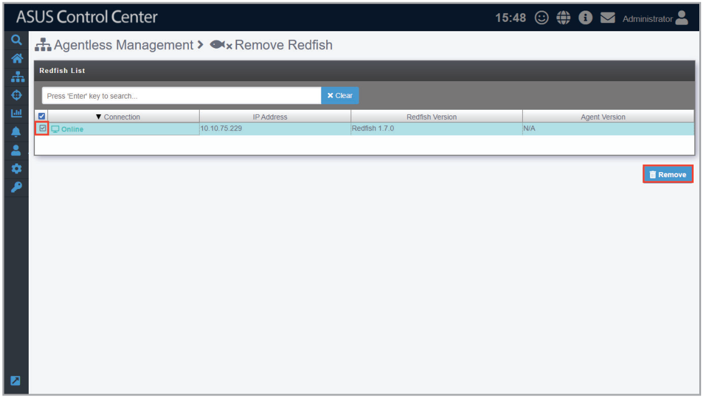
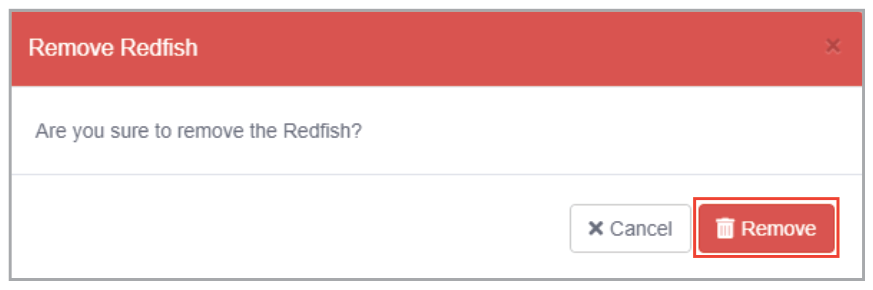

# Remove Redfish

1. Check the Redfish device(s) you wish to remove, then click **Remove**.

    

2. A confirmation window should pop-up, click **Remove** to remove the agents from the selected Redfish devices.

    > **NOTE:** If the target host(s) are offline, the agents on these host(s) will be removed once the host(s) are online.

    
