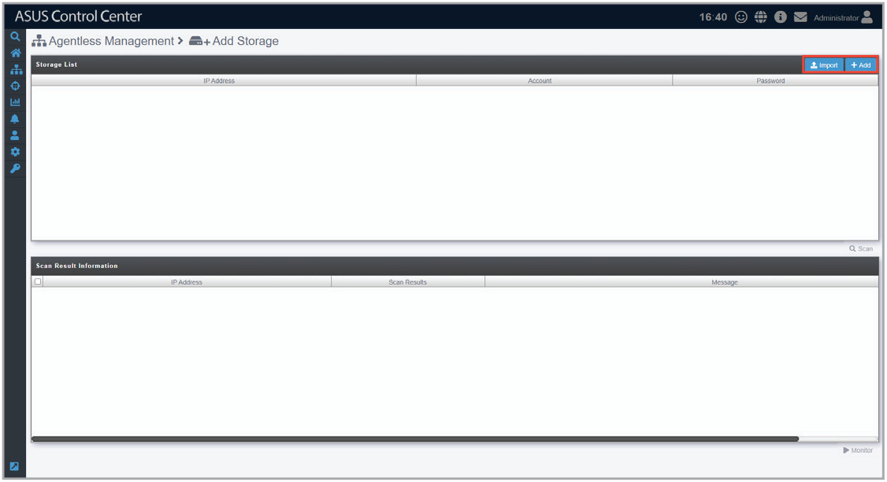

# Add Storage

The **Add Storage** function allows you to add a managed storage device.

## Adding managed storage devices

1. Click **Import** to add a device using a CSV file, or click **Add** to manually enter the device details.

    

2. Click **Scan** and wait for the scan results to be displayed in the **Scan Result** block.
3. Select one or more managed storage devices in the **Scan Result Information** block, then click **Monitor**.
4. The selected managed storage devices added should appear in the **Devices List** on the **System Overview** screen.

    > **NOTE:** Newly added devices may take a few minutes to appear in the overview.
