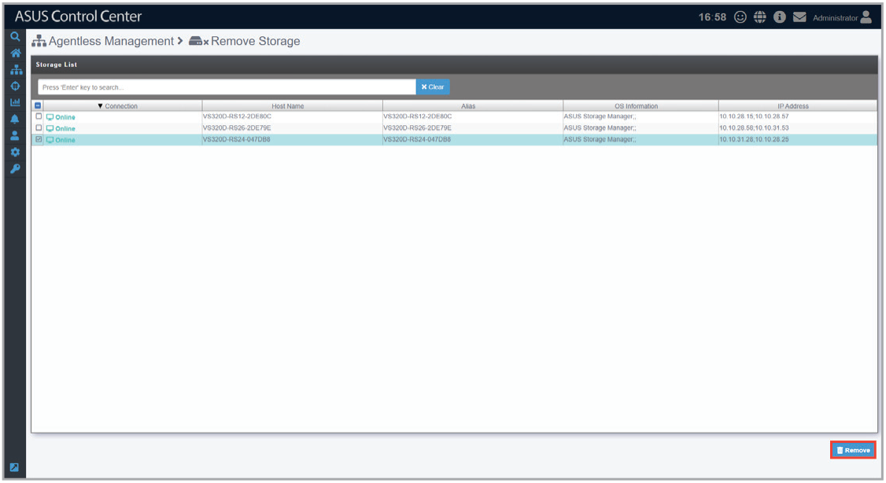

# Remove Storage

The **Remove Storage** function allows you to remove a managed storage device.

## Removing managed storage devices

Select one or more managed storage devices, then click **Remove**.

