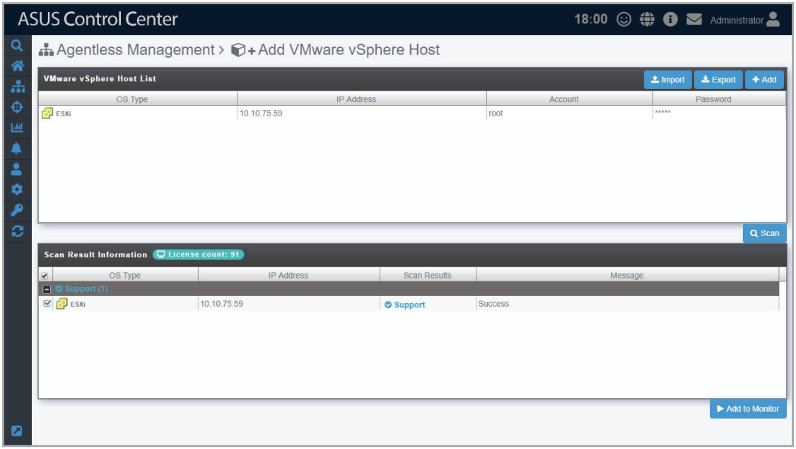
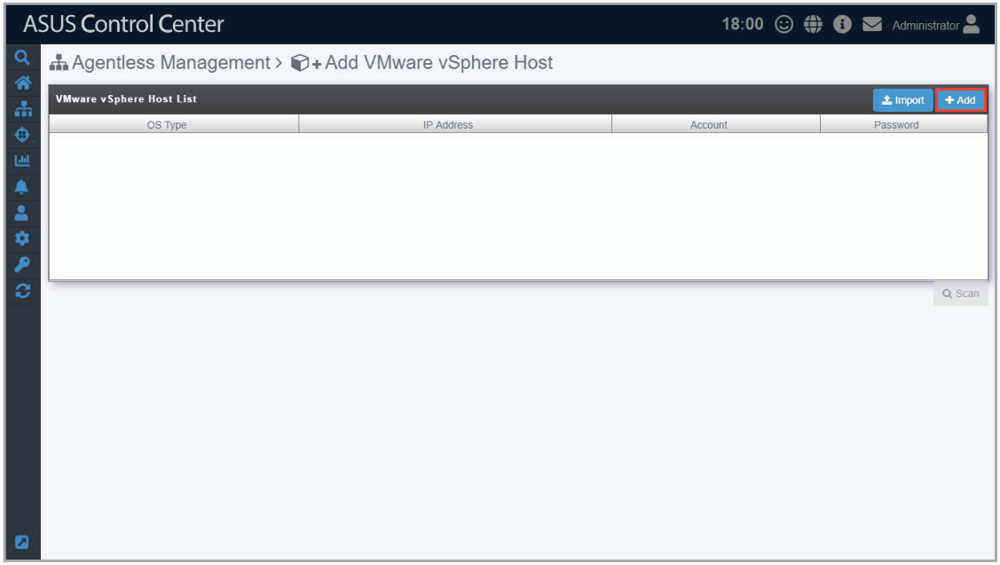
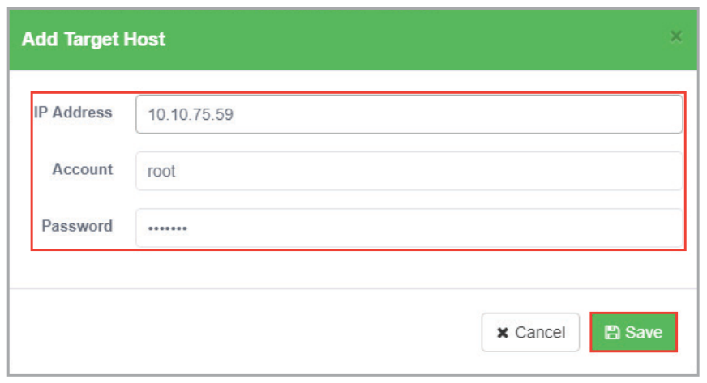
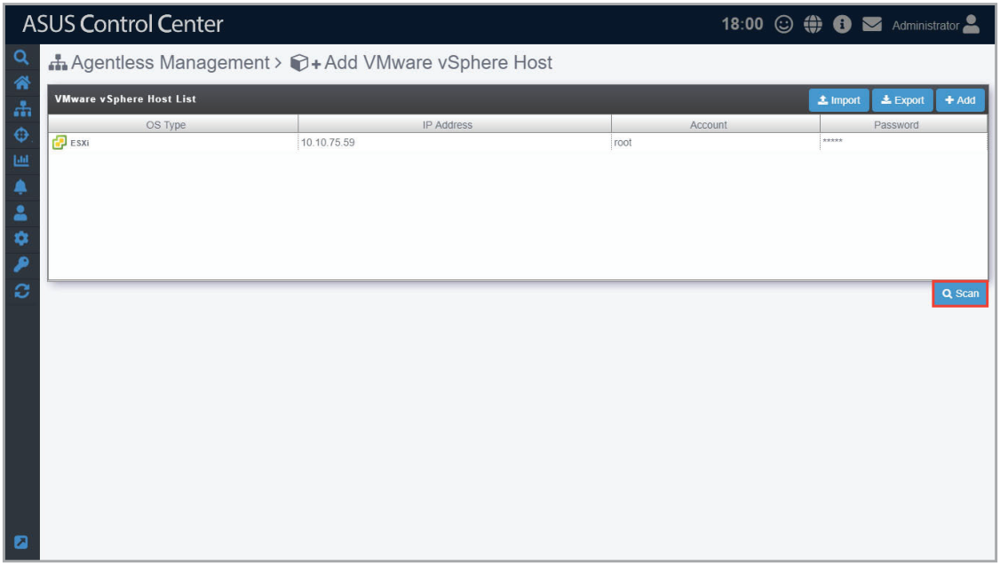
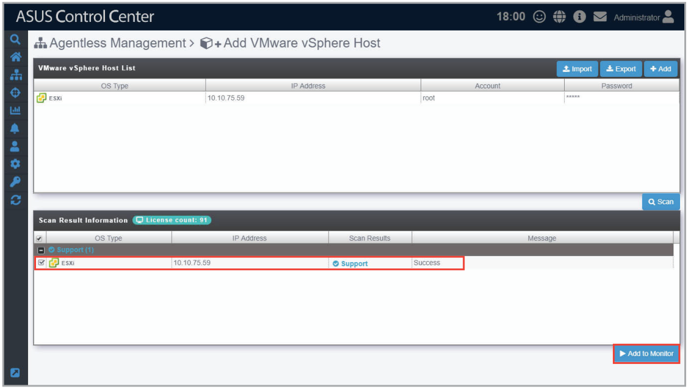
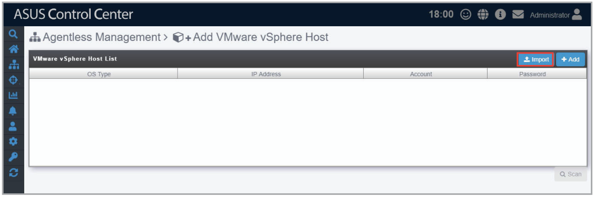
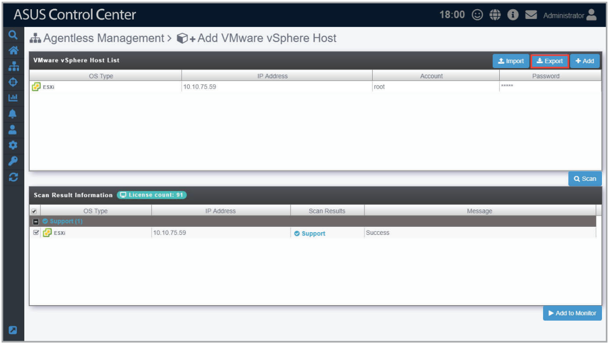

# Add vSphere

The **Add vSphere** function allows you to add vSphere you wish to manage. You can enter a single vSphere, or multiple vSpheres to be scanned, and then add the scanned vSpheres you wish to manage to ASUS Control Center.

> **NOTE:** Ensure to register the License keys before adding the vSphere you wish to manage to ASUS Control Center. For more information on registering license keys, please refer to the **License** chapter.

## Adding managed vSphere

1. Click on **Add**.

    

2. Enter the **IP Address**, **Account**, and **Password** of the vSphere, then click **Save**.

    

3. Repeat steps 1 and 2 to add additional vSpheres to be scanned, or refer to the **Add vSphere from CSV file** section to import a list of vSpheres.
4. Once you have added all the vSpheres you wish to scan, click on **Scan**.

    

5. The scanned results will be displayed in the **Scan Result Information** block. Select the vSpheres you wish to manage then click **Add to Monitor**. The vSpheres added should appear in the **Devices List** on the **System Overview** screen.

    > **NOTE:**
    >
    > - Unavailable vSpheres will be listed as **Not Support**. You may click on the vSpheres to view details on why it is unavailable.
    > - vSpheres added may take a few minutes before they are displayed in the overview.

    

## Add vSphere from CSV file

1. Click on **Import**.

    

2. Select the CSV file to import and click **Open**.
3. Once the CSV file is successfully imported, click on **Scan**.

    > **NOTE:** You may edit items added by clicking on it before scanning.

4. The scanned results will be displayed in the **Scan Result Information** block. Select the vSpheres you wish to manage then click **Add to Monitor**. The vSpheres added should appear in the **Devices List** on the **System Overview** screen.

    > **NOTE:**
    >
    > - Unavailable vSpheres will be listed as **Not Support**. You may click on the vSpheres to view details on why it is unavailable.
    > - vSpheres added may take a few minutes before they are displayed in the overview.

    

## Exporting VMware vSphere Host List

You can export the list of vSpheres added to the **VMware vSphere Host List** to a CSV file by clicking on **Export**. You can edit the exported CSV file using a text editor.

