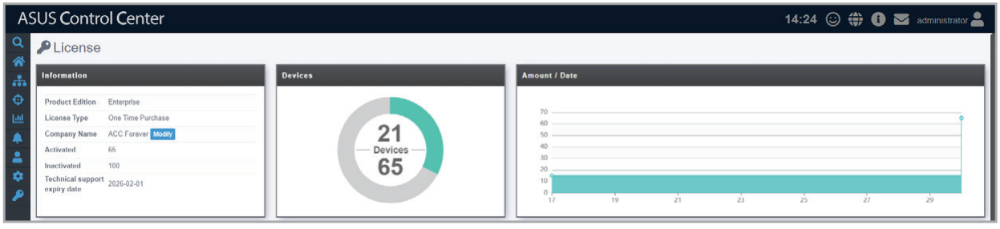
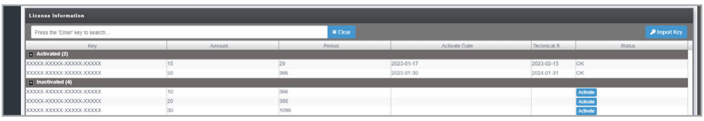
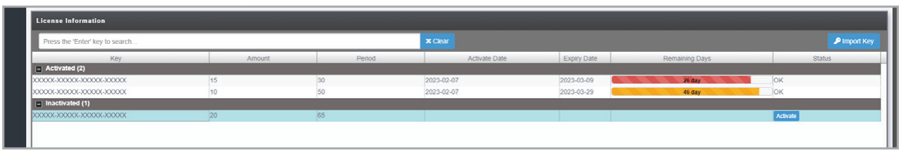
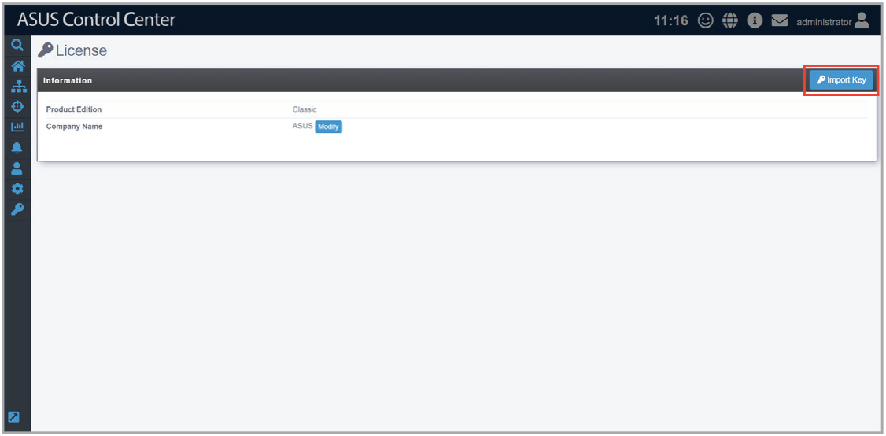
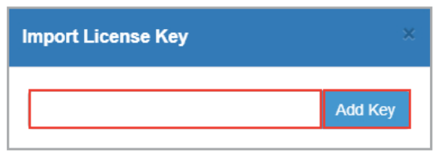

# License

This chapter describes the license settings.

## License Information

The **License** page displays license information, the number of licensed devices, the total number of licenses, and a time distribution graph of licensed devices. You can also upgrade from ASUS Control Center Classic or CSM edition to Enterprise edition. For more information on license keys, refer to [https://asuscontrolcenter.asus.com](https://asuscontrolcenter.asus.com).

To access **License**, click  in the left menu.

> **NOTE:** The upper number in the **Devices** block displays the number of activated devices and the bottom number displays the number of activated licenses.

### One Time Purchase licenses

For One Time Purchase licenses, the License Information list shows active and inactive licenses, and the activation date and technical support period for each license.

### Subscription licenses

For Subscription licenses, the License Information list shows active and inactive licenses, and the activation date and expiry date for each license.

### Activating a License key

Click  next to an unused license key to activate a license.

### Importing a License key

If you are using ASUS Control Center (Classic) or the CSM edition, and have a license key to upgrade to Enterprise edition, you can follow the steps below to import your Enterprise edition license key.

> **NOTE:** A working Internet connection is required when verifying the upgrade License key.

1. Click on **Import Key**.

   

2. Enter your license key and click **Add Key**.

   

3. After entering the license key, you should be prompted with a message, then automatically logged out of ASUS Control Center. Please log into ASUS Control Center again.
4. Navigate to the License screen to see the details of your license displayed.
