# BIOS

This item allows you to update the BIOS of a managed device by uploading a BIOS cap file or selecting a BIOS cap file from the BIOS Cache, view and adjust BIOS settings, and view the Desktop Management Interface Information.

> **NOTE:** The functions available in this item may vary according to managed device.

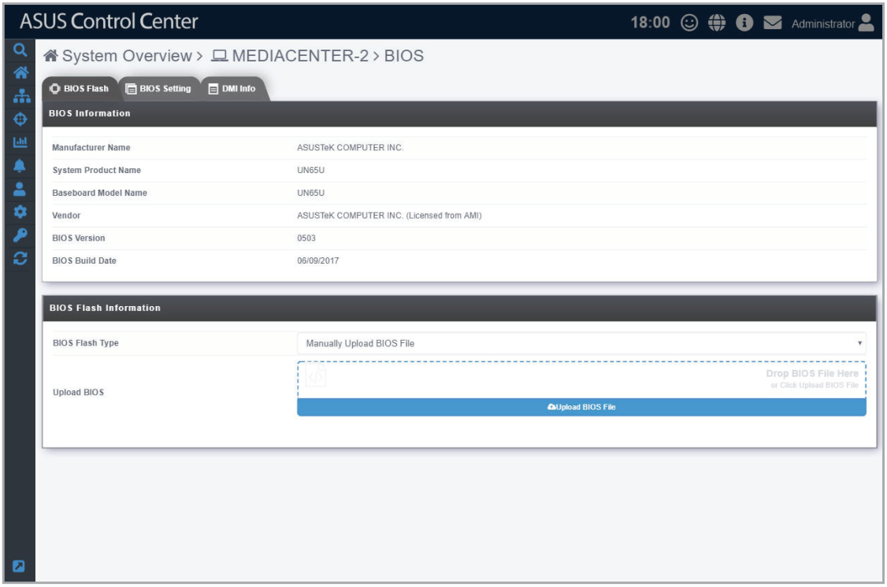

## BIOS Flash

The **BIOS Flash** tab allows you to flash the BIOS of the device by manually uploading a BIOS cap file or selecting a BIOS cap file from the BIOS Cache.

> **IMPORTANT:** Flashing the BIOS using ASUS Control Center is only supported on managed devices that are ASUS products.

1. You can upload or select your BIOS cap file using the following methods:
    - **Manually uploading BIOS cap file**
        - **a.** Select **Manually Upload BIOS File** in the **BIOS Flash Type** field.

            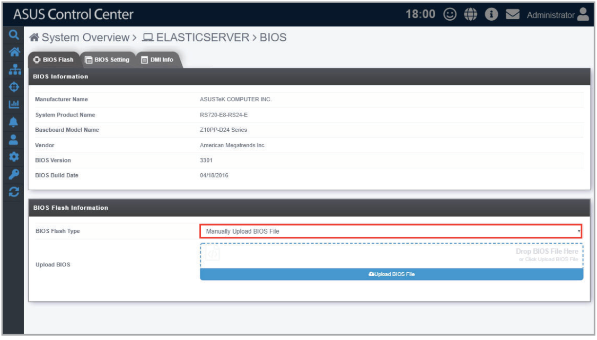

        - **b.** Click on **Upload BIOS File** to select a BIOS cap file, or drag the BIOS cap file into the dotted square.

            > **NOTE:** The uploaded BIOS cap file will automatically be added to the **BIOS Cache**.

            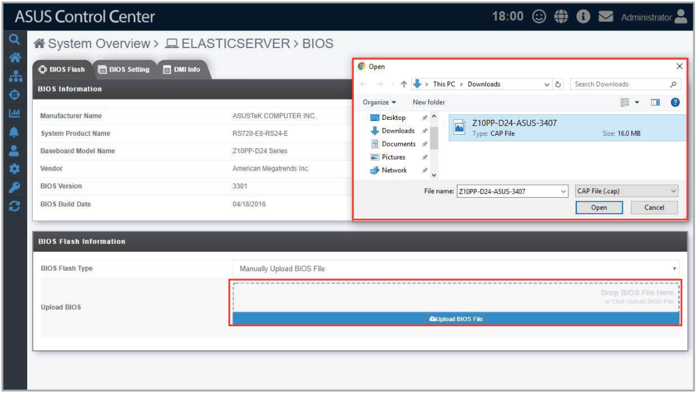

    - **Selecting BIOS cap file from the BIOS Cache**
        - **a.** Select **Flash From BIOS Cache** in the **BIOS Flash Type** field.

            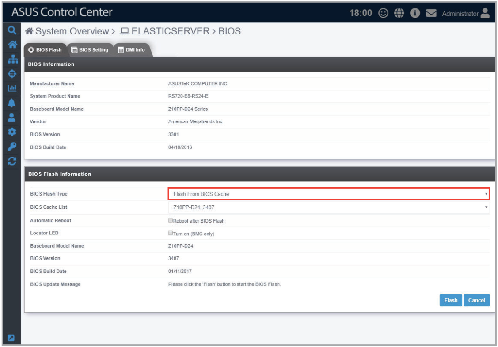

        - **b.** Select a BIOS cap file to use from the **BIOS Cache List** drop down menu.

            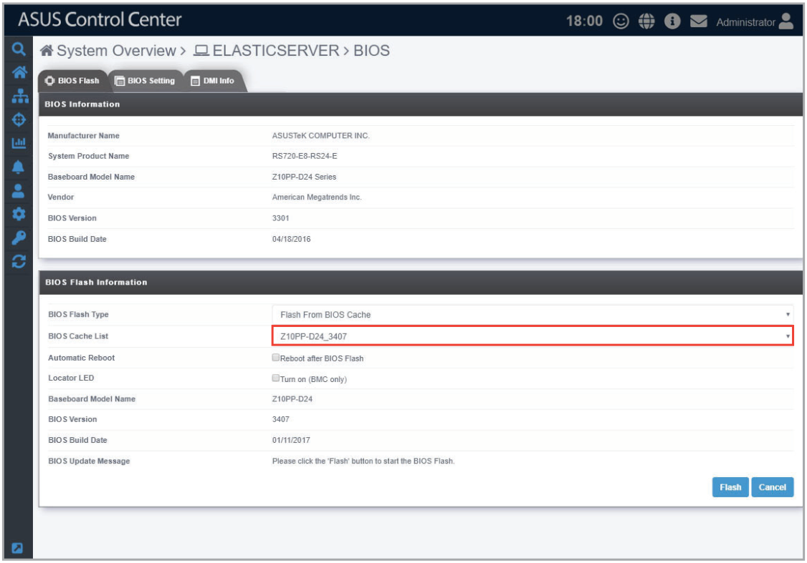

2. (optional) You may check the **Reboot after BIOS Flash** checkbox in the **Automatic Reboot** field to automatically reboot the device after BIOS has been flashed.

    

3. (optional) You may check the **Turn On (BMC only)** checkbox in the Locator LED field to turn on the Locator LED once BIOS Flash is completed.

    > **NOTE:** BMC is required for this option to work properly.

    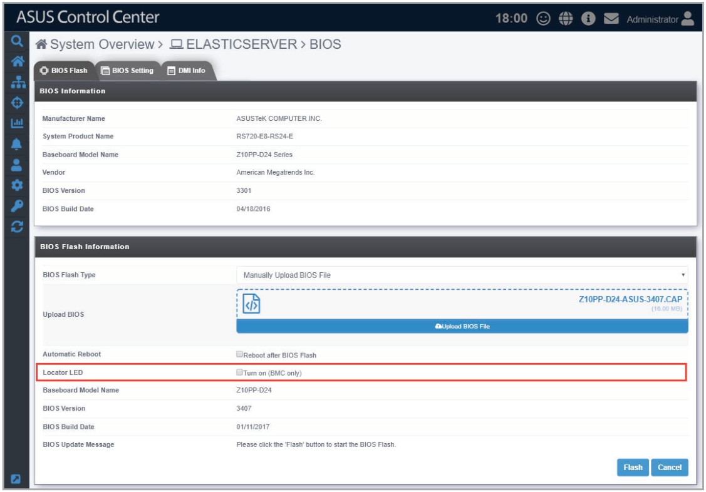

4. Click **Flash** to begin the BIOS flash, then wait for the BIOS flash to be completed.

    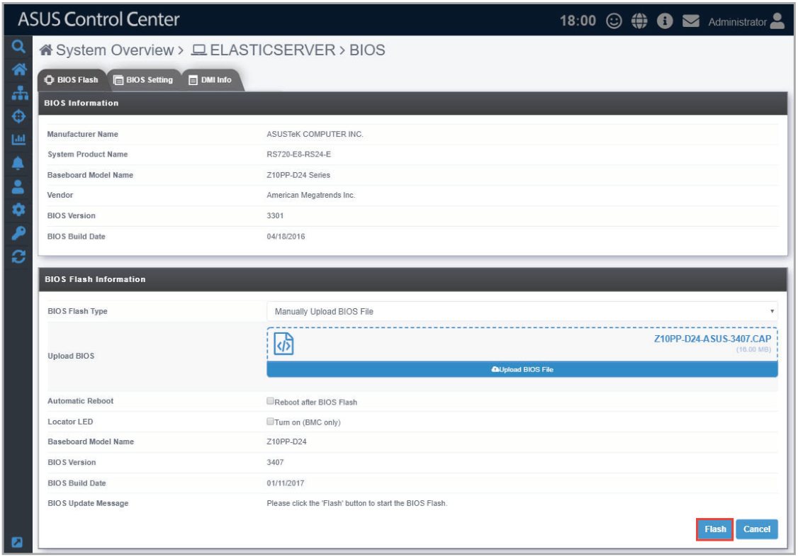

    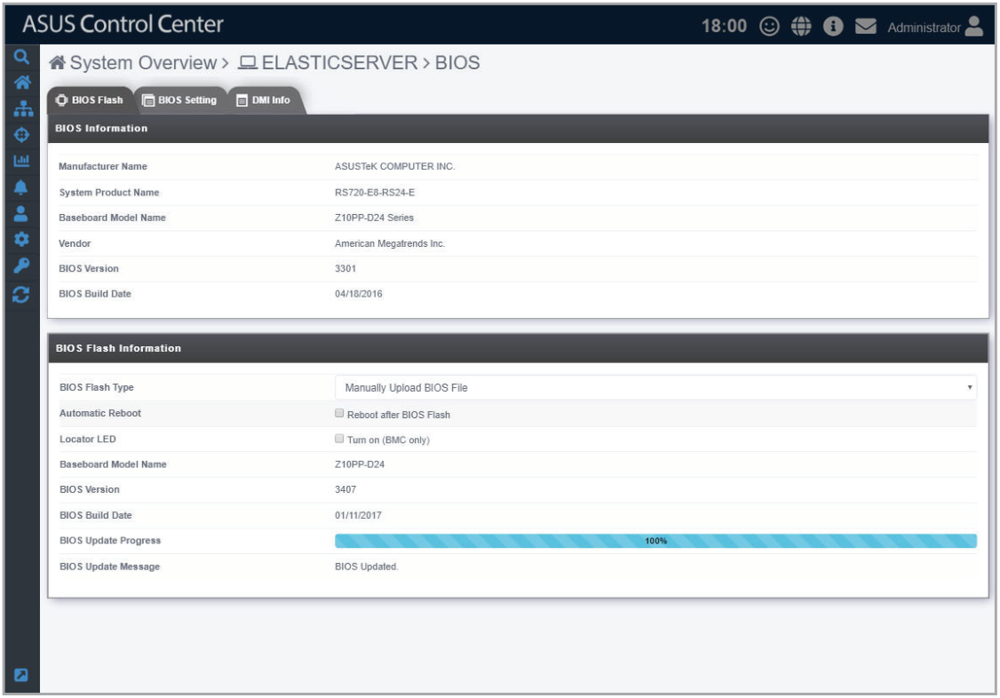

5. Once the BIOS flash has been completed, a pop-up window will appear, prompting you to reboot the system, click **OK**. You can also view this message in the **Device Information** screen and **Mission Center**.

    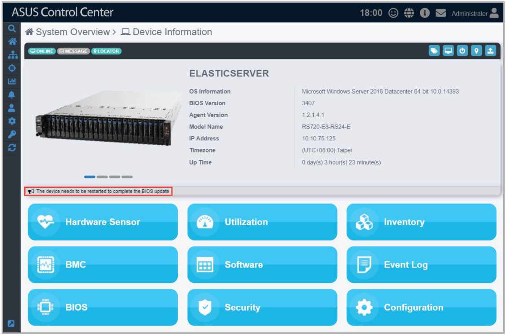

    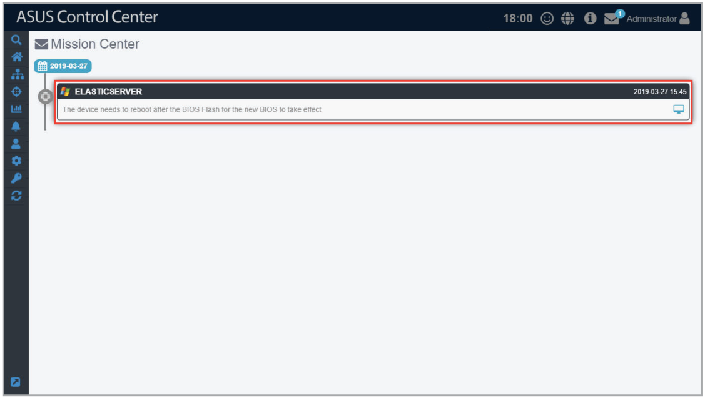

6. Reboot the device to complete the BIOS flash.

## BIOS Setting

> **IMPORTANT:** The **BIOS Setting** tab is only available on specific ASUS products such as an ASUS commercial notebook PC. For more information on ASUS products that support ASUS Control Center, please refer to https://asuscontrolcenter.asus.com.

The **BIOS Setting** tab allows you to view and adjust the BIOS **Advanced**, **Monitor**, **Boot**, and **Security** settings of the device, providing you with a quick way of adjusting BIOS settings without having to enter the BIOS menu of the device.

> **NOTE:** The BIOS settings may differ between devices. Please refer to the device’s motherboard user manual for more information about the BIOS settings.

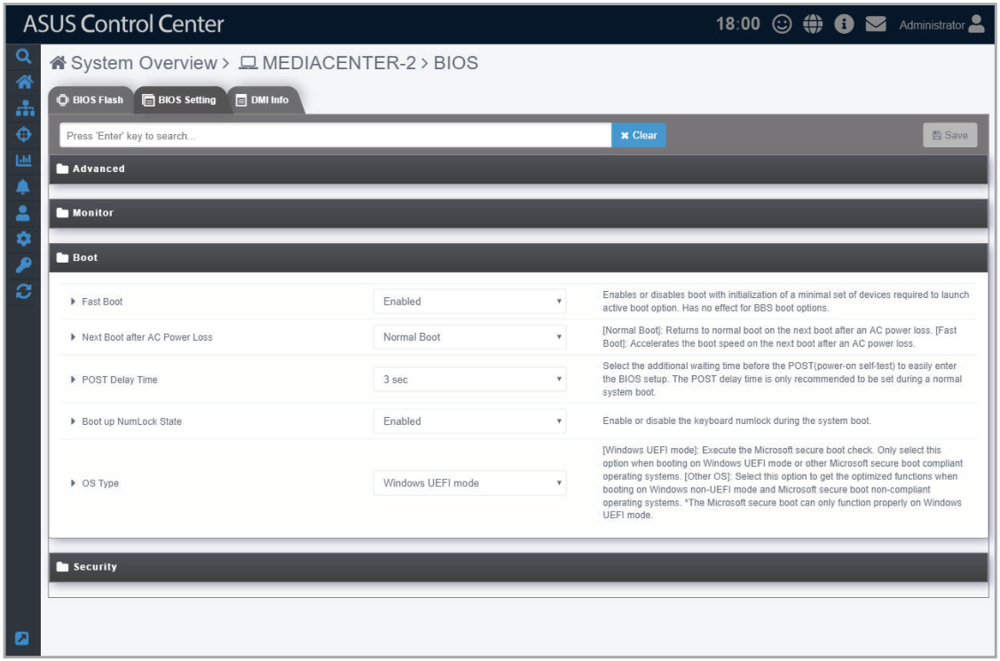

## DMI Info

Under the SMBIOS standard, the **DMI Info** tab allows you to view details on certain items such as manufacturer name and hardware component information of the device without a hardware controller.

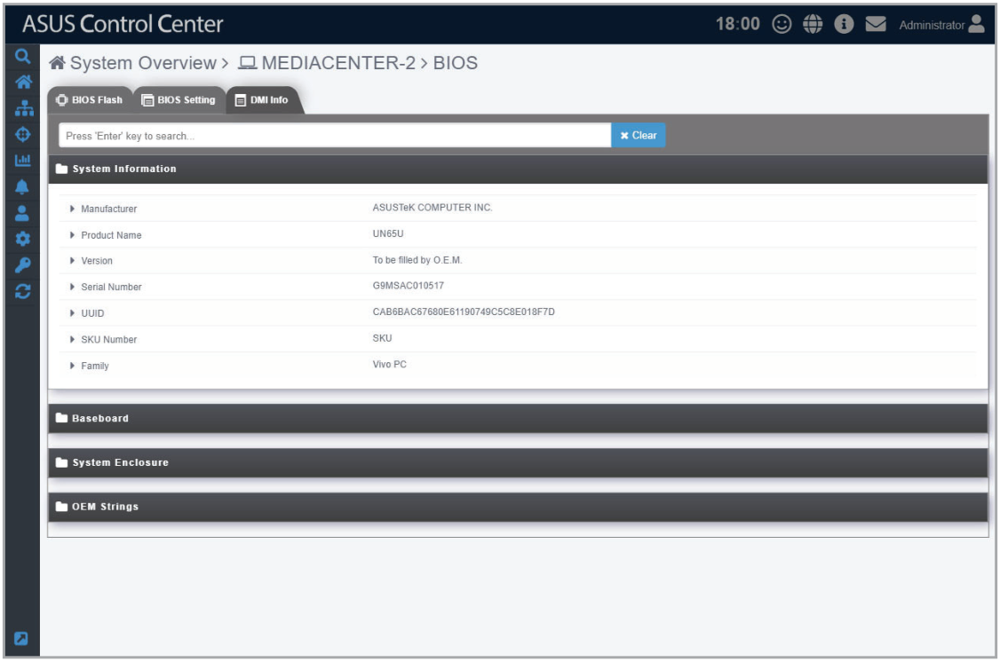
