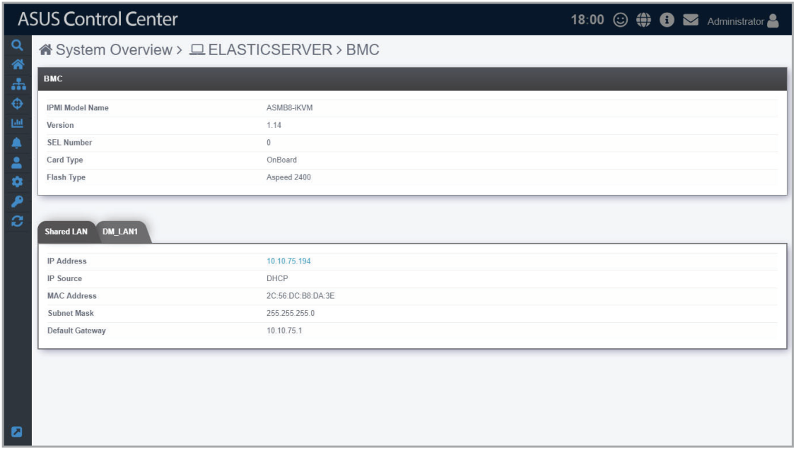
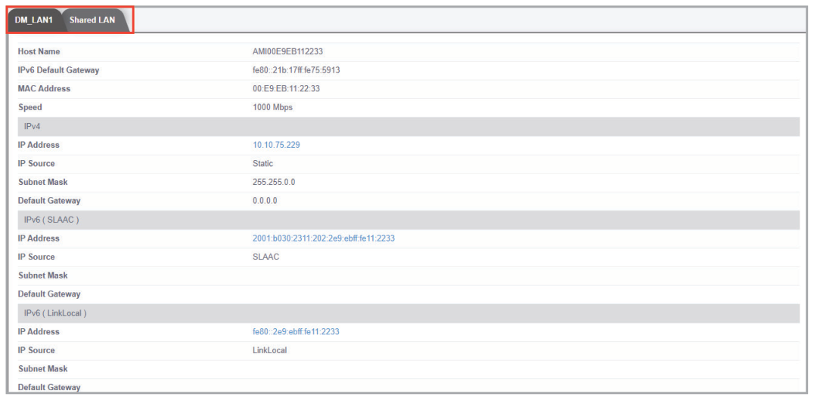
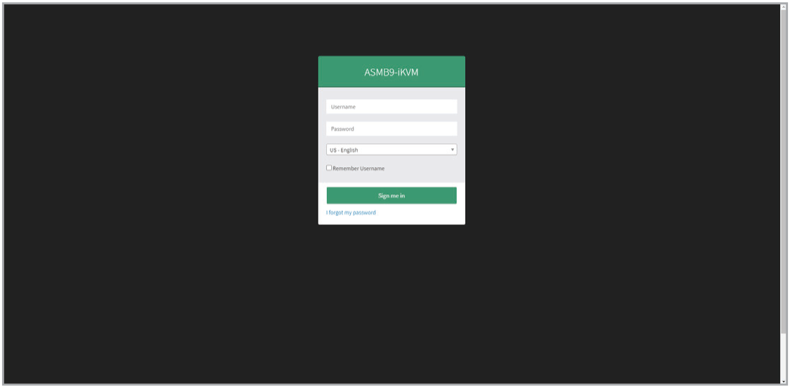

# BMC

This item displays the information on the BMC of the managed device, you may also set the BMC using ASMB through the **Shared LAN** and **DM_LAN** tabs.

> **NOTE:**
>
> - The managed device has to support BMC to use the functions described in this section. The BMC option will be grayed out if BMC is unavailable on the managed device.
> - The information entered in this section is for reference only.

## Shared LAN

> **NOTE:** BMC is required to use this item.

This item is the communication port for BMC and OS, clicking on the BMC IP in the **IP Address** field will redirect you to the ASMB page, allowing you to view the hardware sensor values of the device.

## DM_LAN

> **NOTE:** BMC is required to use this item.

This item is the communication port specifically for BMC, clicking on the BMC IP in the **IP Address** field will redirect you to the ASMB page, allowing you to view the hardware sensor values of the device.

## Edit BMC using ASMB

To edit BMC settings using ASMB on the device:

1. Select **DM_LAN1** or **Shared LAN**, then click on any of the IP Addresses.

    

2. Log into ASMB.

    
