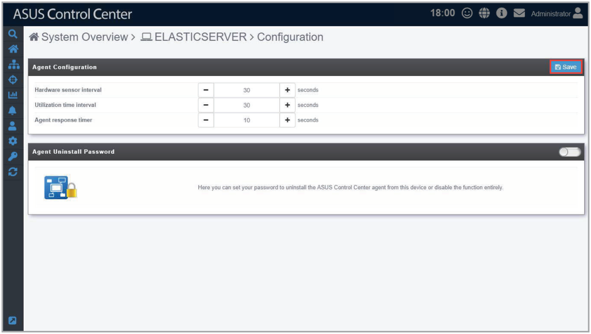
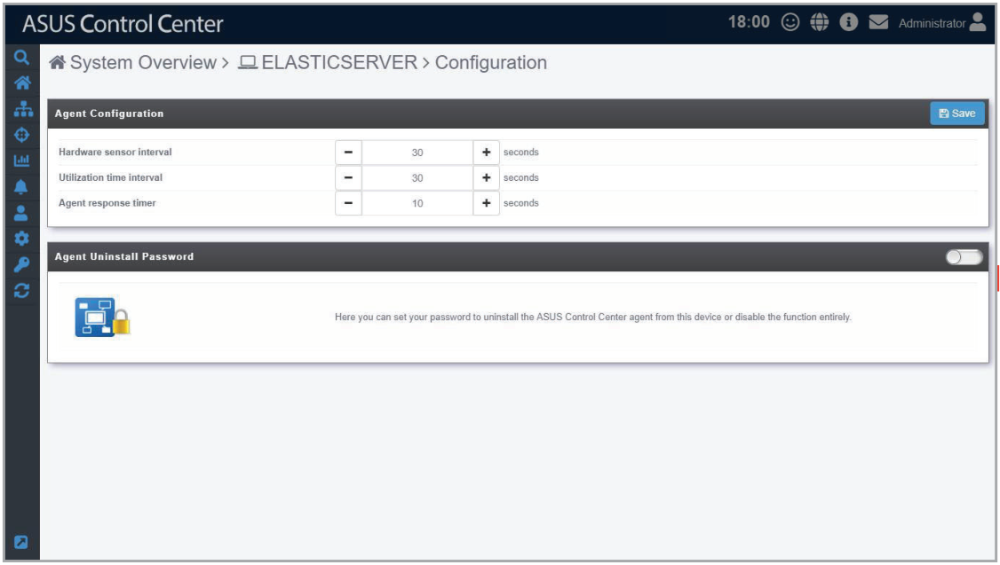
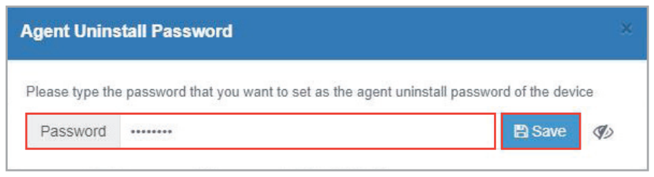
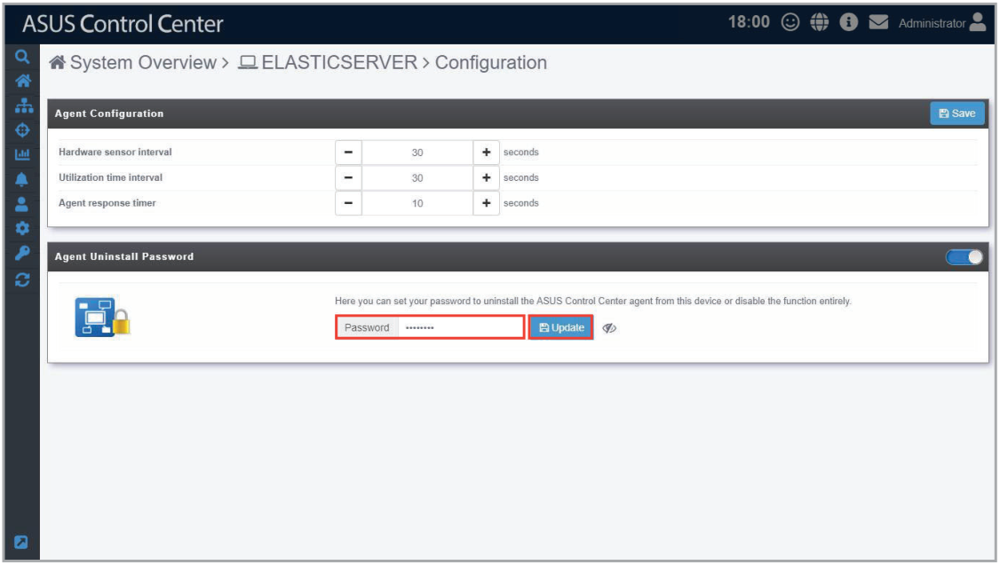

# Configuration

This item allows you to configure the interval at which hardware and utilization sensors are checked, and set the interval which the agent will respond to the server’s requests. You can also set a password which has to be entered when removing the agent from the managed device.

## Agent Configuration

Configure the interval at which hardware and utilization sensors are checked, and the interval at which the agent will request updates on tasks from the ASUS Control Center server. You can configure these options by clicking on  /  to increase or decrease the time, then click **Save** to save the changes made.

| Item | Description |
| --- | --- |
| **Hardware sensor interval** | Interval in seconds at which the hardware sensor information is sent to the ASUS Control Center server. \* **The default is set to 30 seconds, which means that every 30 seconds the agent will report items such as fan disconnected back to the ACC server, and the ACC server will update this fan status within 30 seconds of receiving this report from the agent.** |
| **Utilization time interval** | Interval in seconds at which the utilization information is sent to the ASUS Control Center server. \* **The default is set to 30 seconds, which means that every 30 seconds the agent will report items such as CPU stress test back to the ACC server, and the ACC server will update this CPU status within 30 seconds of receiving this report from the agent.** |
| **Agent response timer** | Interval in seconds at which the agent will query the ASUS Control Center server for task updates. \* **The default is set to 10 seconds, which means that every 10 seconds the agent will query the ACC server for new tasks. For example, when you set the Registry to disabled on the ACC server, the device will query the ACC server and receive this task, then perform this task within 10 seconds of receiving the task.** |

## Agent Uninstall Password

Set a password for agent uninstallation. The user will be prompted to enter the password when they want to uninstall the agent.

1. If **Agent Uninstall Password** is not enabled, click on the slider to enable it.

    

2. A pop-up window should appear, enter the password you wish to use, then click **Save**.

    

3. (optional) You can edit the password by entering a new password into the **Password** field, then clicking on **Update**.

    
