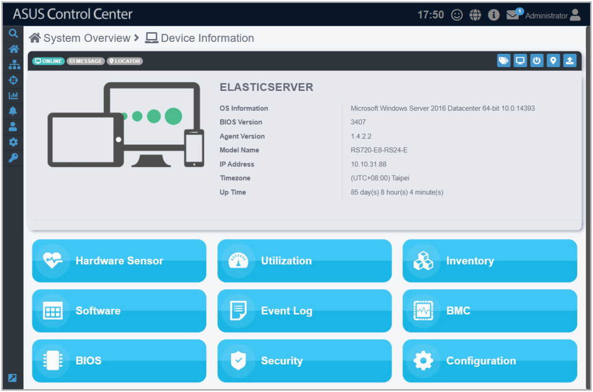

# Device Information

> **NOTE:** The screenshot may vary between agent and agentless devices, for more details on viewing agentless device details, refer to the **Host Information** section.

The **Device Information** screen gives you various functions to view the status and manage the selected device.

To access the **Device Information** of a managed device, click on the  icon located next to the managed device you wish to view in the **Devices list**.

The **Device Information** screen will display the **OS Information**, **BIOS Version**, **Agent Version**, **Model Name**, **IP Address**, **Timezone**, and **Up Time** of the device.

**Using the search bar and search options**

Refer to the **Search Options** and **Search and Filter Devices** sections of the **Monitor** chapter for more information.

## Device Statuses and Quick Buttons

| Icon | Item | Description |
| --- | --- | --- |
|  | **Connection status** | This item displays the connection status of the selected managed device. |
|  | **Message status**\* | This item will turn red if the selected device's BMC returns a hardware sensor warning/critical event. |
|  | **Locator status**\* | This item will turn green if the locator LED is enabled through the ACC Web UI. The locator LED allows you quickly locate the physical location of the device in a server rack. |
|  | **Metadata Editor** | This item allows you to edit the metadata of the managed device by double clicking in the **Value** field. |
|  | **Remote Desktop** | This item allows you to remotely control a managed device. Refer to **Accessing remote desktop** under the **Devices list** section for more details. |
|  | **Power Control** | This item allows you to power off or restart a managed device. |
|  | **Locator LED** | This item allows you to turn on/off the Locator LED. |
|  | **Refetch** | This item will refetch the device data. |

\* Only available on BMC enabled devices
