# GPU

This item allows you to view the GPU Load, Fan, Temperature, Power, and Memory details on GPU cards installed on the device, and also view the timeline chart of these items. For more details on a GPU device click on 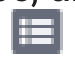 next to the GPU device.

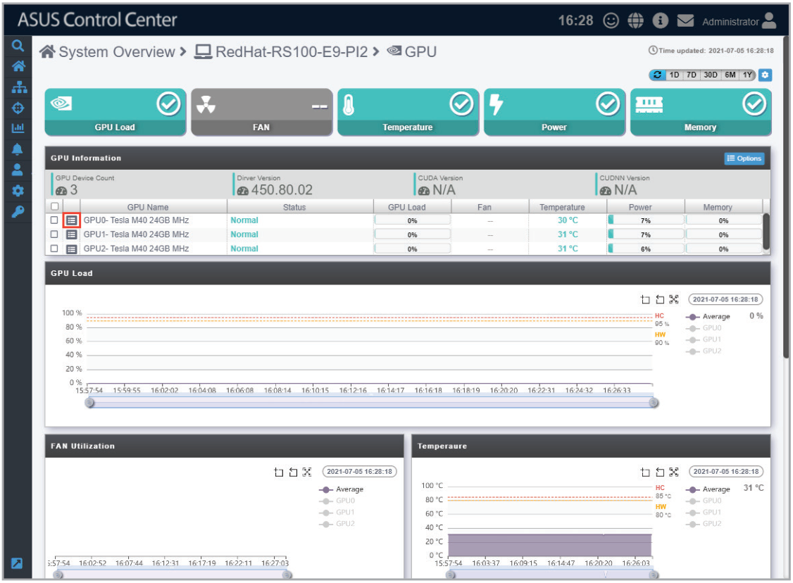

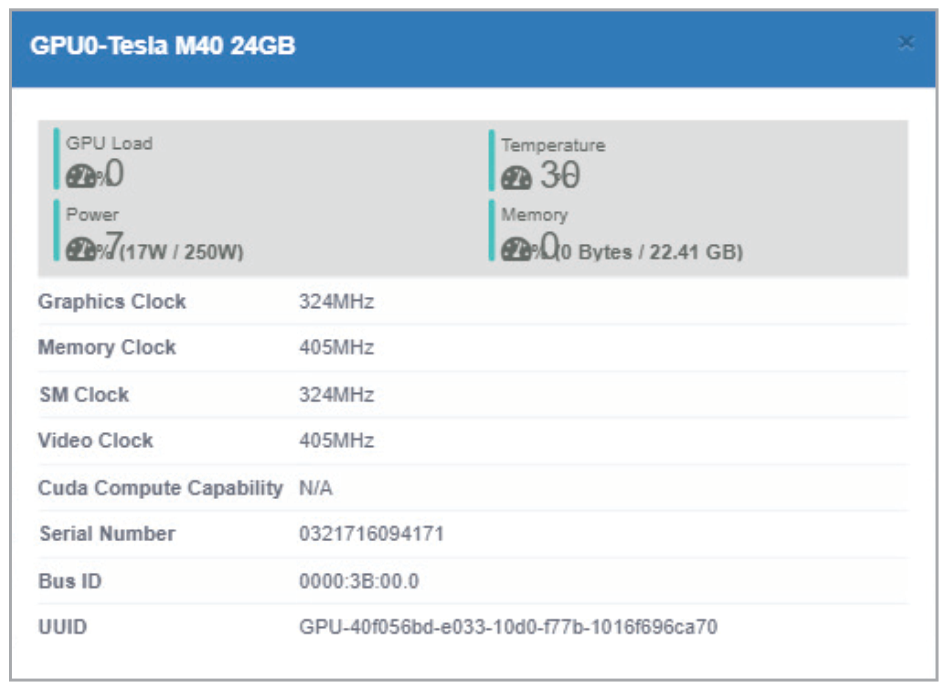

## Filtering the GPU devices

By clicking on a status block you can filter the GPU devices shown in the GPU information block according to the status selected

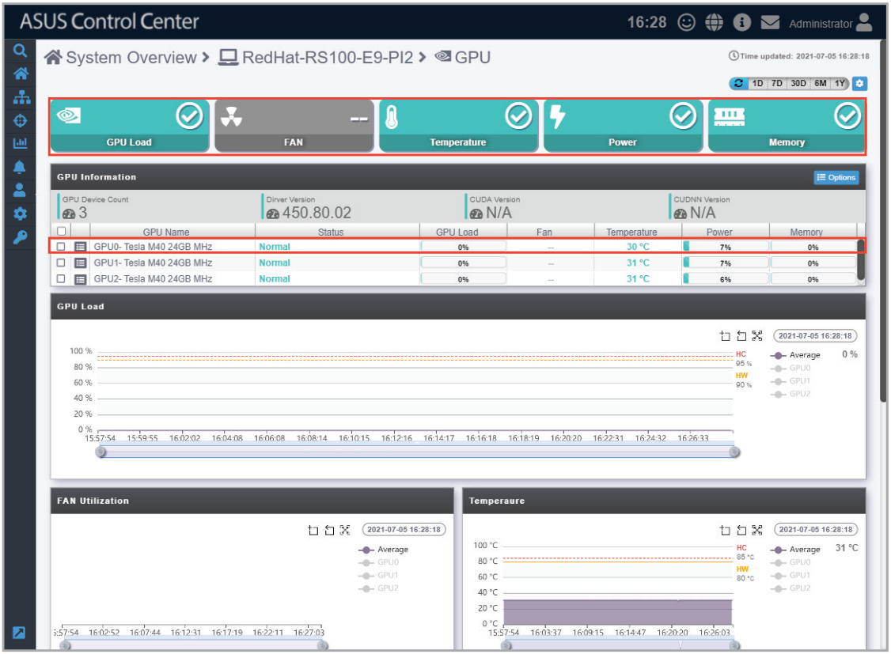

## Toggling the Chart View for GPU devices

You can view the timeline charts for GPU Load, Fan Utilization, Temperature, Power Utilization, Power Usage, Memory Utilization, and Memory Usage by scrolling down on the GPU page.

By default the timeline charts display the Average values, but you may select to view only selected GPU devices by checking the device in the GPU Information block, or by clicking on the GPU device(s) in the timeline chart legend.

> **NOTE:** Any changes made, such as selecting a device to view on a timeline chart will be applied to all other timeline charts, for example selecting GPU0 in the timeline chart legend of GPU Load timeline chart will cause all other timeline charts on this page to display information on GPU0 only.

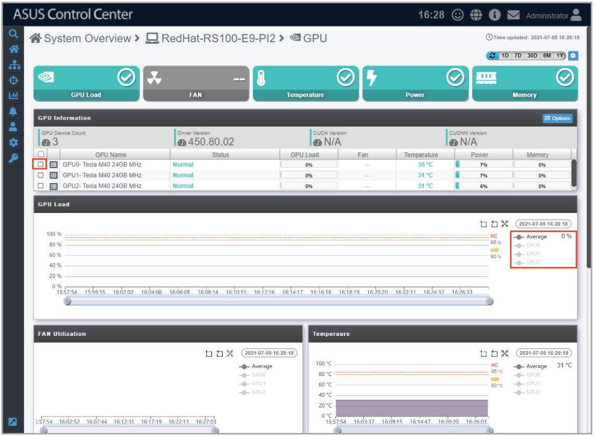

### Chart Quick Buttons

| Icon | Description |
| --- | --- |
|  | Click to zoom in on the timeline of the chart. |
|  | Click to zoom out on the timeline of the chart. |
|  | Click to restore the chart to its default view. |

You can customize the timeline chart by selecting the period of time you wish to view for the timeline charts, then selecting the frequency for which the sensor should return data. This will be applied to the timeline charts for all the sensors shown on this page.

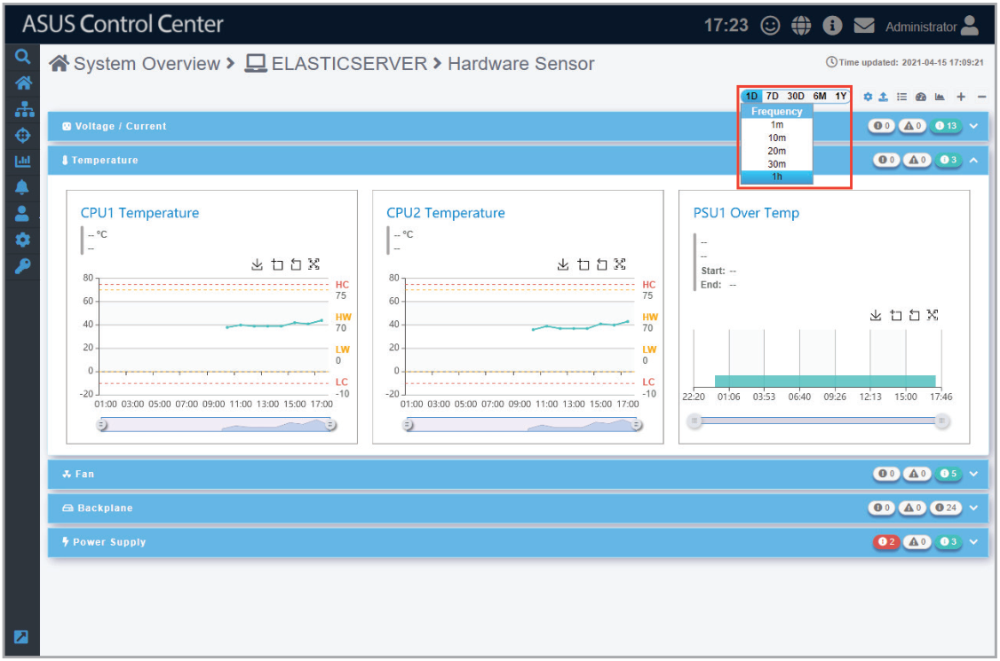

| Period of time | Frequency |
| --- | --- |
| **1D** | 1m, 10m, 20m, 30m, 1h |
| **7D** | 10m, 20m, 30m, 1h, 3h, 6h, 12h |
| **30D** | 30m, 1h, 3h, 6h, 12h, 1d |
| **6M** | 3h, 6h, 12h, 1d, 7d, 14d |
| **1Y** | 6h, 12h, 1d, 7d, 14d, 30d |

Additionally, by clicking on the  icon, you can customize the data you wish to view on the timeline.

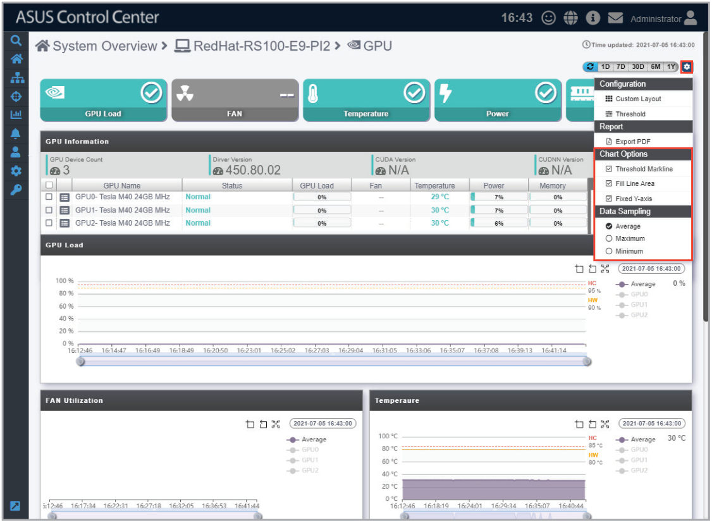

| Item | Description |
| --- | --- |
| **Chart Options** | Allows you to check the items you wish to display on the timeline charts such as **Threshold Markline** and **Fill Line Area**, or set a **Fixed Y-axis** for the timeline chart. |
| **Data Sampling** | Allows you to select whether the **Maximum** values, **Minimum** values, or **Average** values should be displayed on the timeline chart. |

## Configuring the GPU layout

You can freely rearrange and resize the different blocks on the GPU page to change  the layout of this page to your preference.

1. Click on the  icon, then select **Custom Layout**.

    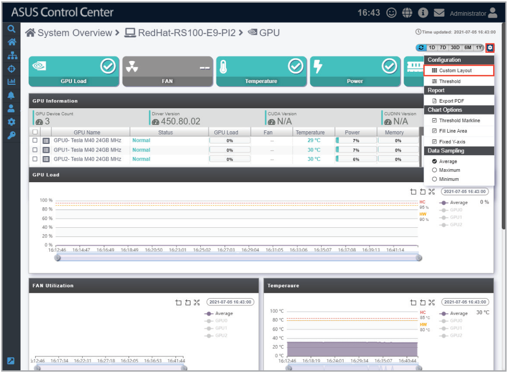

2. You can now rearrange or resize each of the blocks on this page. Please refer to the following for instructions on resizing or rearranging the blocks.

    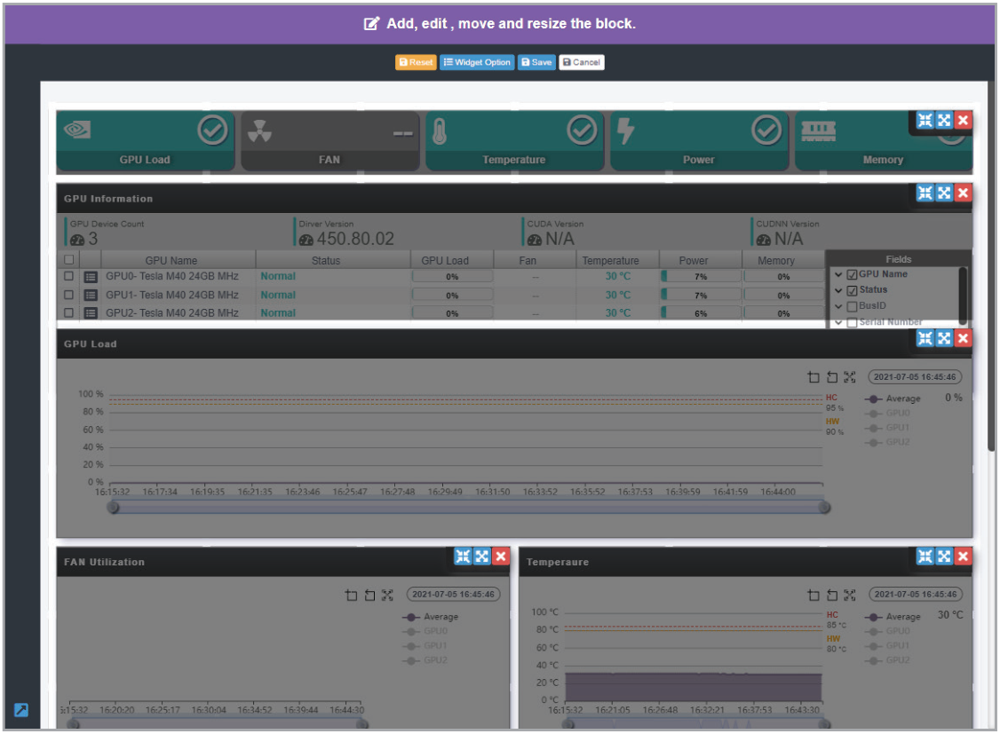

    - **To resize the block:**

        Hover the mouse over the edges of the block you wish to resize until the resize arrows appear, then click and drag to resize the block.

    - **To expand the block to its maximum size:**

        Click on  to expand the block to its maximum size.

    - **To minimize the block to its minimum size:**

        Click on  to minimize the block to its minimum size.

    - **To rearrange the blocks:**

        Click and hold inside the block you would like to rearrange, then drag the block to rearrange it.

    - **To remove a block:**

        Click on  to remove the block, or click on  and uncheck the block you wish to remove.

    - **To add a block:**

        Click on  and check the block you wish to add.

    - **To reset to default layout:**

        Click on  to reset the GPU page to its default layout.

3. Once you are finished rearranging and resizing the blocks, click on **Save** to save the changes made to this page.

## Editing the threshold valuesx

You can edit the critical and warning threshold values for **GPU** items.

1. Click on the  icon, then select **Threshold**.

    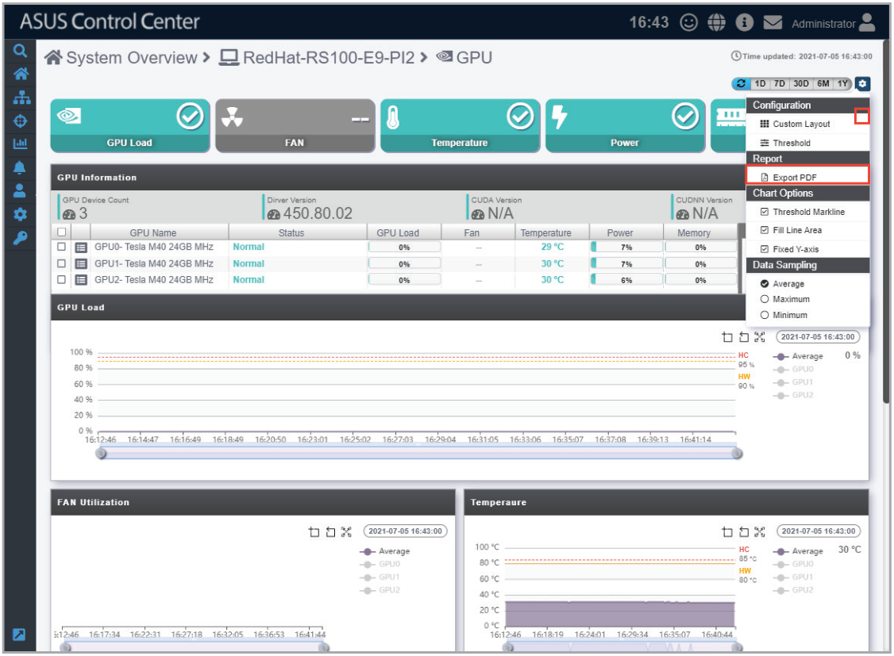

2. Adjust the thresholds for the sensors by sliding the **Normal** (green), **Warning** (yellow) and **Critical** (red) sliders for the **High Alert** and **Low Alert**. You can also disable or enable **High Alert** and/or **Low Alert** by checking/unchecking **High Alert** and/or **Low Alert**.

    > **NOTE:** Click on **Reset** to reset the threshold settings to default settings.

    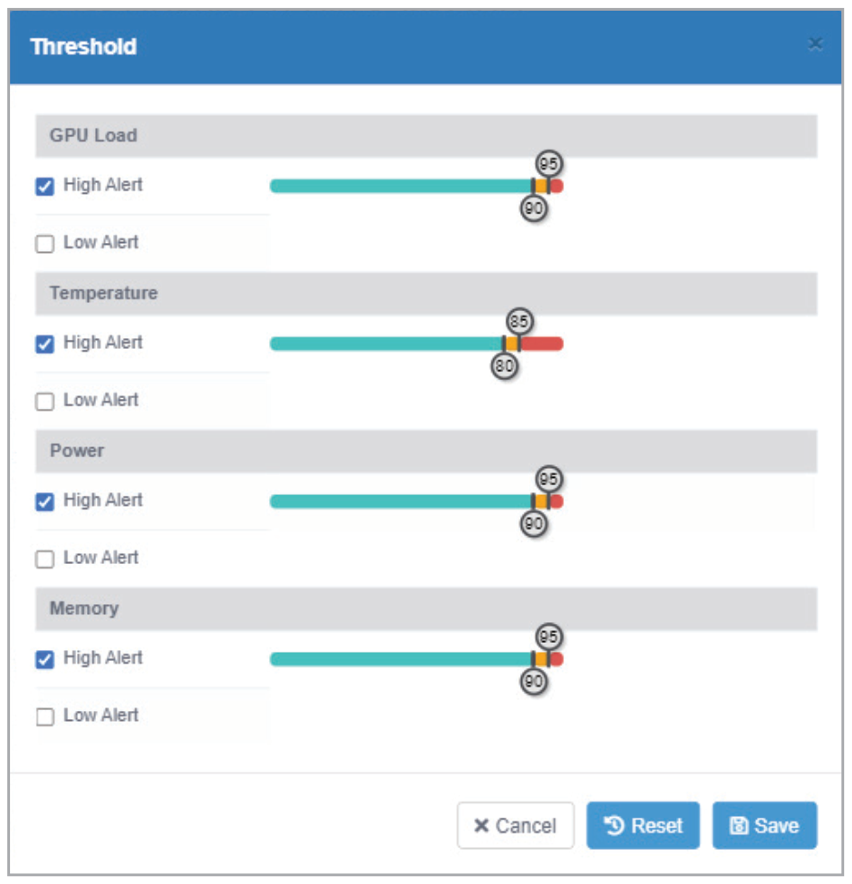

3. Once you have finished adjusting the thresholds, click on **Save** to save the changes made.
