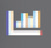
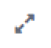
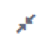
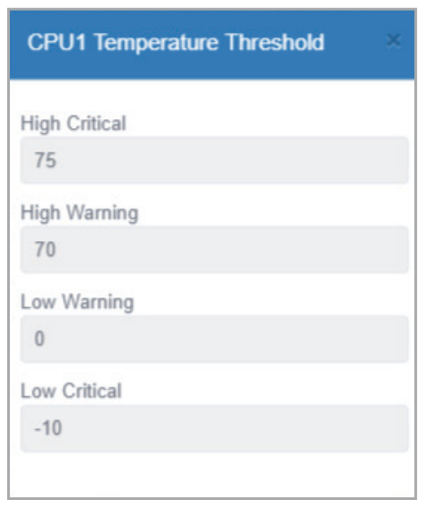
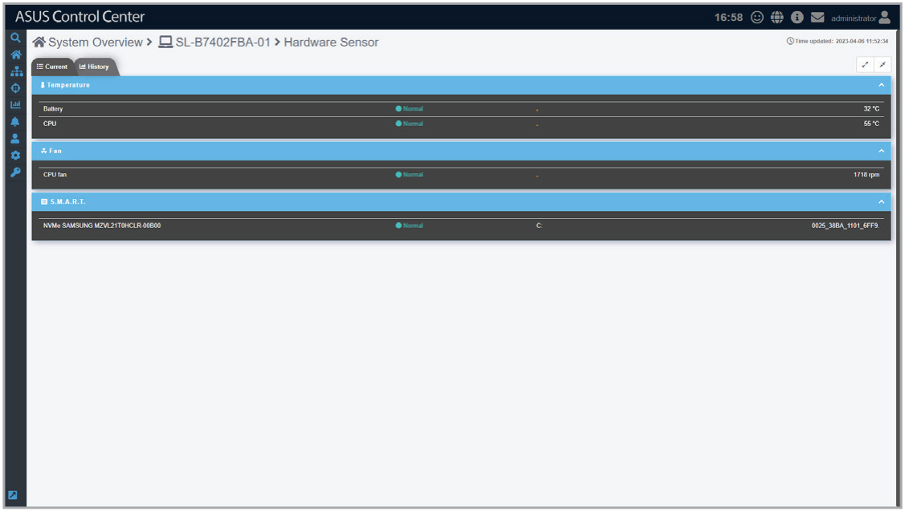
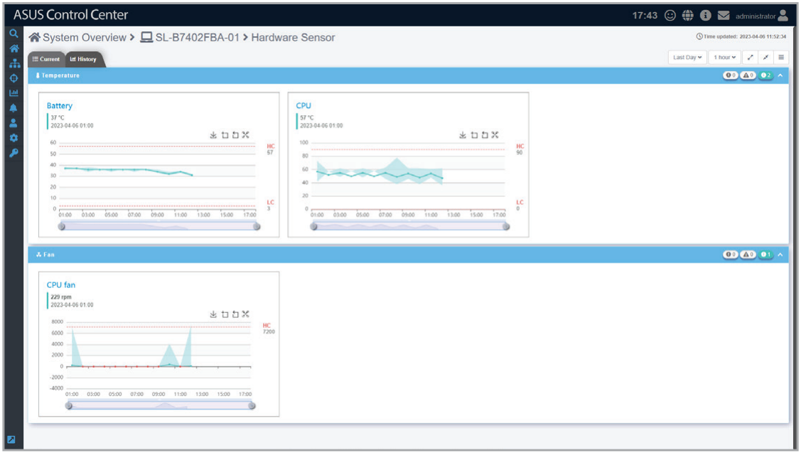
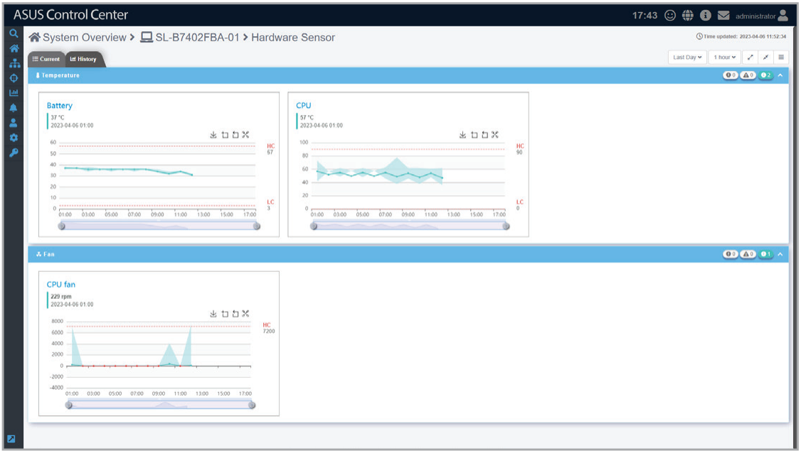
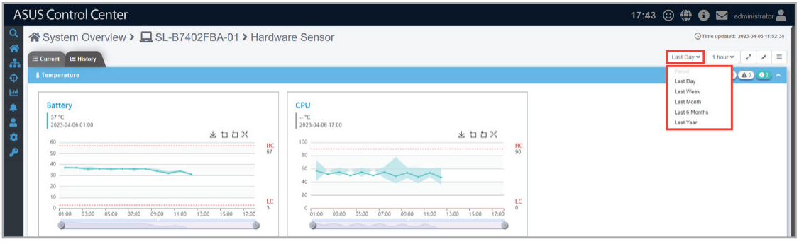
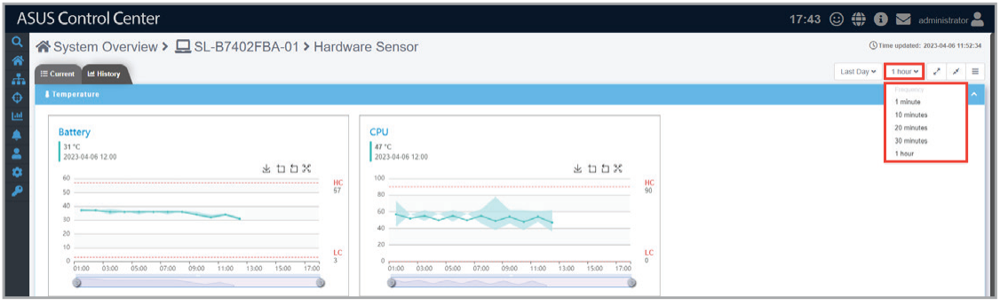
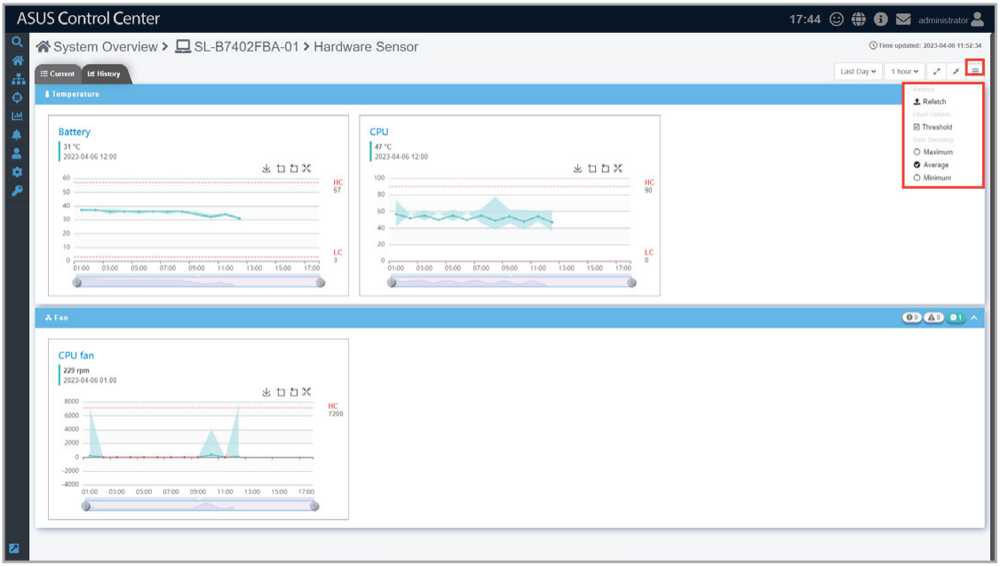

# Hardware Sensor

This item allows you to view the details and values for the Voltage, Temperature, Fan, Backplane, Power Supply, Chassis, and S.M.A.R.T items in real time.

> **NOTE:**
>
> - The Hardware Sensor values on Linux devices are returned only if the Linux device has BMC, otherwise only the S.M.A.R.T. details can be viewed.
> - If the device is using Windows 11 or Server 2022 and the sensor readings keep failing, please navigate to **Start** > **Settings** > **Update & Security** > **Windows Security** > **Device Security**, then select **Core Isolation details** and set **Memory integrity** to **Off** on the device.

## Quick Buttons

| Icon | Description |
| --- | --- |
|  | Click to switch to the Current tab. |
|  | Click to switch to the History tab. |
|  | Click to expand all blocks. |
|  | Click to minimize all blocks. |
|  | Click to expand this block. |
|  | Click to minimize this block. |

Clicking on an item in the voltage, temperature, fans, Backplane, Power Supply, Chassis, and S.M.A.R.T groups will display the High and Low critical and warning values. Please refer to the table below for more details on the items shown in the example below of CPU Temperature Threshold, and the Normal status which is not shown in the threshold pop-up window.

| Item | Description |
| --- | --- |
| **High Critical** | If the sensor value is equal to or exceeds this value the sensor status will be **Critical**. For the above example, if the sensor value is 75 or higher, the sensor status will be **Critical**. |
| **High Warning** | If the sensor value is equal to or exceeds this value, and below the **High Critical** value the sensor status will be **Warning**. For the above example, if the sensor value is between 70 ~ 74, the sensor status will be **Warning**. |
| **Normal** | The sensor will **Normal** if the sensor value is between the **Low Warning** and **High Warning** values. For this example, if the sensor value is between 1 ~ 69, the sensor status will be **Normal**. |
| **Low Warning** | If the sensor value is equal to or lower than this value, and above the **Low Critical** value the sensor status will be **Warning**. For the above example, if the sensor value is between -9 ~ 0, the sensor status will be **Warning**. |
| **Low Critical** | If the sensor value is equal to or lower than this value the sensor status will be **Critical**. For the above example, if the sensor value is -10 or lower, the sensor status will be **Critical**. |

## Toggling between tabs

You can switch between different **Hardware Sensor** tabs by clicking the tabs in the top bar.

-  **Current tab (default)**

    

-  **History tab**

    

## Customizing the Hardware Sensor history tab

You can customize the history tab which displays historical data for the Voltage / Current, Temperature, Fan, Backplane, and Power Supply sensor events according to different periods of time.

### Quick Buttons

| Icon | Description |
| --- | --- |
|  | Click to expand all blocks. |
|  | Click to minimize all blocks. |
|  | Click to expand this block. |
|  | Click to minimize this block. |

### Chart Quick Buttons

| Icon | Description |
| --- | --- |
|  | Click to download an image of the chart as a .png file. |
|  | Click to zoom in on the timeline of the chart. |
|  | Click to zoom out on the timeline of the chart. |
|  | Click to restore the chart to its default view. |

You can customize the charts by selecting the period of time you wish to view for the charts, then selecting the frequency for which the sensors should return data. This will be applied to the charts for all the sensors shown on this page.

| Period of time | Frequency |
| --- | --- |
| **Last day** | 1 minute, 10 minutes, 20 minutes, 30 minutes, 1 hour |
| **Last week** | 10 minutes, 20 minutes, 30 minutes, 1 hour, 3 hours, 6 hours, 12 hours |
| **Last month** | 30 minutes, 1 hour, 3 hours, 6 hours, 12 hours, 1 day |
| **Last 6 months** | 3 hours, 6 hours, 12 hours, 1 day, 7 days, 14 days |
| **Last year** | 6 hours, 12 hours, 1 day, 7 days, 14 days, 30 days |

Additionally, by clicking on the  icon, you can customize the data you wish to view on the chart.

| Item | Description |
| --- | --- |
| **Refetch** | Allows you to trigger a refetch of device data. |
| **Chart Options** | Allows you to select whether the **Threshold** should be displayed on the chart. |
| **Data Sampling** | Allows you to select whether the **Maximum** values, **Average** values, or **Minimum** values should be displayed on the charts. |
