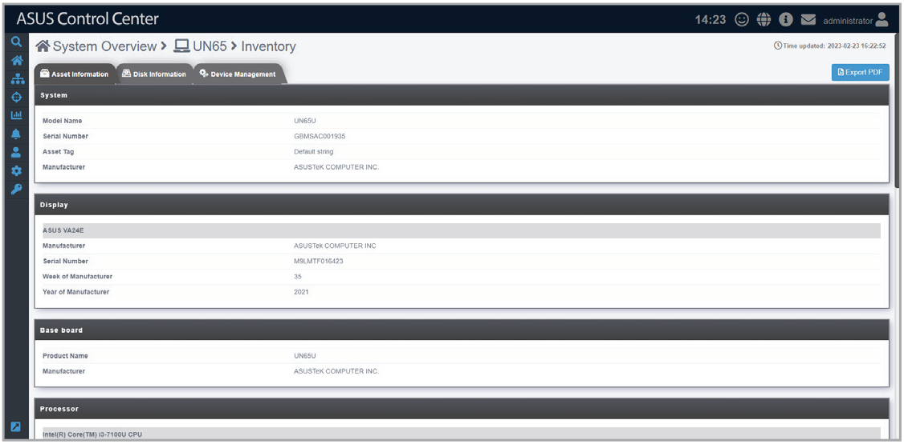
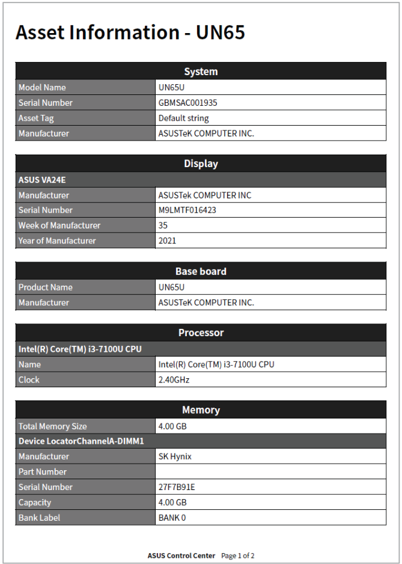
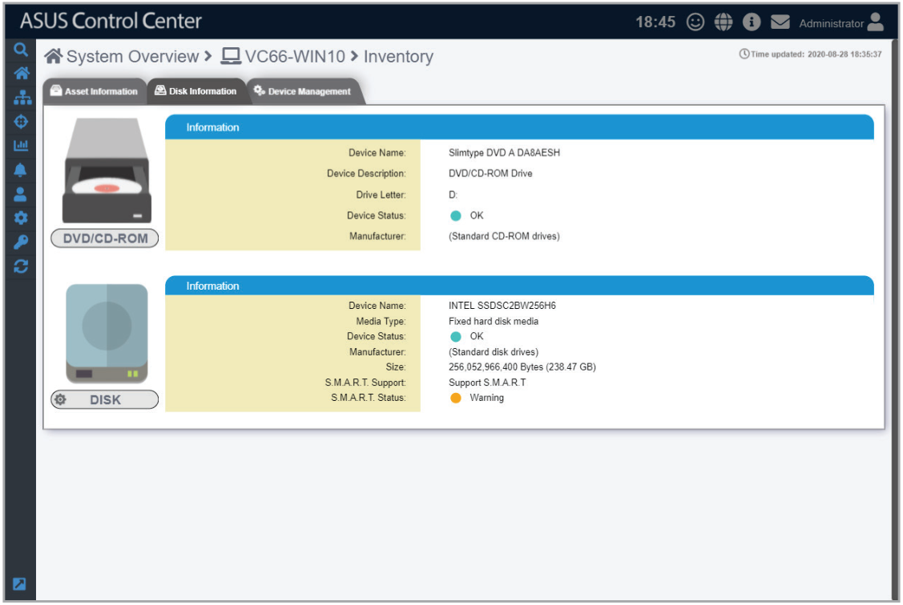
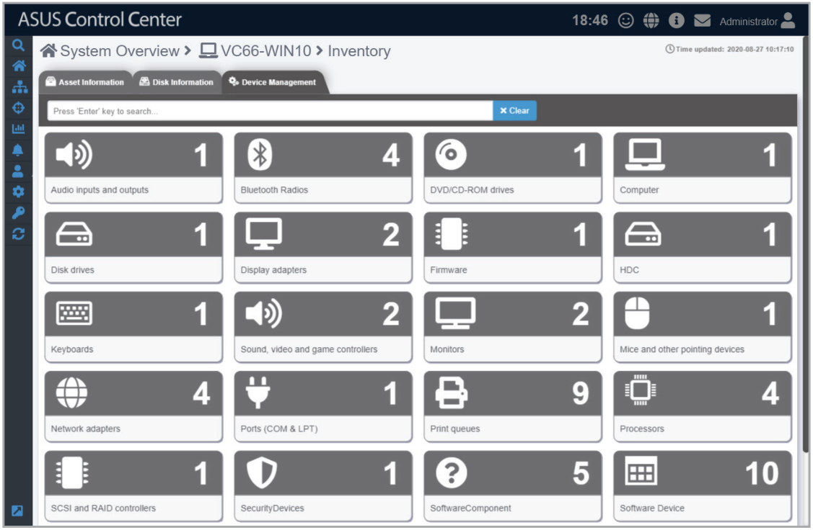

# Inventory

This item displays more details about your managed device and disk.

## Asset Information

View details for the **System**, **Display**, **Base Board**, **Memory**, **BIOS**, **Processor**, **Network Adapter**, **Storage**, and **RAID** of the managed device.

You can click on **Export PDF** to export the Asset Information to a PDF file.

## Disk Information

View details on disks installed on the managed device, such as ODD drives, hard disk drives, and USB drives.

## Device Management

View the Device Management properties of the managed device.

